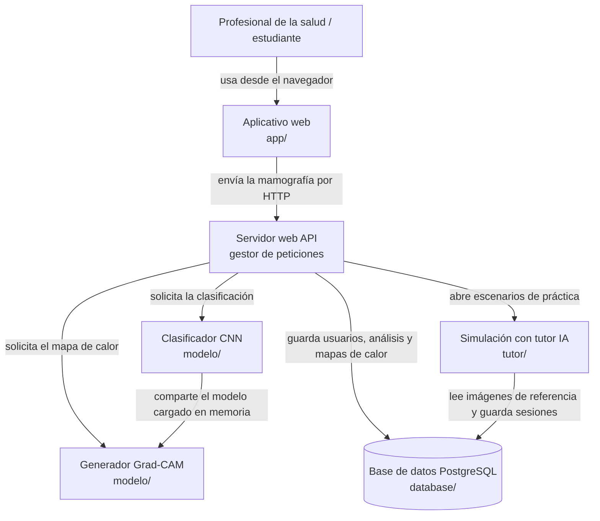

# MAMMO-AI

Aplicación web de apoyo para el análisis preliminar de mamografías. Este repositorio reúne la documentación de gestión del proyecto y el diseño de la base de datos.

> **Aviso:** MAMMO-AI es una herramienta de apoyo académica. No emite diagnósticos médicos ni reemplaza el criterio de un profesional de la salud.

## Descripción

MAMMO-AI propone tres componentes:

- **Clasificador:** una red neuronal convolucional, entrenada con aprendizaje por transferencia sobre conjuntos de datos públicos (CBIS-DDSM, INbreast, MIAS), que etiqueta cada mamografía como *normal* o *sospechosa* e indica un nivel de confianza.
- **Visualizador explicable:** un mapa de calor Grad-CAM que muestra las regiones de la imagen que más influyeron en la clasificación.
- **Simulación con tutor IA:** escenarios gamificados en los que un tutor guía al usuario, le da retroalimentación y le muestra casos en los que el modelo se equivoca, para fomentar un uso crítico de la IA.

Metodología de trabajo: **TSP (Team Software Process)**, con plantillas de gestión de proyectos.

## Arquitectura

MAMMO-AI usa una **arquitectura en capas** (presentación, lógica y datos). El detalle está en [docs/justificacion-arquitectura.md](docs/justificacion-arquitectura.md) y en [docs/arquitectura-sistema.md](docs/arquitectura-sistema.md).



Flujo de un análisis:

1. El **usuario** carga una mamografía (JPG o PNG) en el **aplicativo web** (`app/`).
2. El aplicativo la envía al **servidor web (API)**, que valida el formato.
3. El servidor pide la clasificación *normal* o *sospechosa* al **clasificador CNN** (`modelo/`) y el mapa de calor al **generador Grad-CAM**, que usa el mismo modelo.
4. El servidor registra el análisis y el mapa de calor en la **base de datos** (`database/mammo_ai_bd.sql`: tablas `mamografia`, `analisis` y `mapa_calor`) y devuelve el resultado al aplicativo, siempre con el aviso de que es preliminar.
5. En el **tutor IA** (`tutor/`), el usuario practica con escenarios que usan las imágenes de referencia de la base de datos (`imagen_referencia`, `escenario`), y sus respuestas se guardan en `sesion_simulacion` y `respuesta_escenario`.

## Información académica

| | |
|---|---|
| Universidad | Universidad Santiago de Cali |
| Asignatura | Gestión de Proyectos de TI (GPT01) |
| Periodo | 2026B |
| Docente | Jair Enrique Sanclemente Castro |

## Equipo

| Integrante | Rol TSP | Rol en el proyecto |
|---|---|---|
| Alvaro Jose Jaramillo Gonzalez | Líder del equipo | Director de proyecto / Analista |
| Daniel Esteban Olarte Vasquez | Gestor de planificación | Planeador |
| Juan Jose Herrera Rengifo | Gestor de desarrollo | Constructor |
| Juan Camilo Ospina Daza | Gestor de calidad | Tester |
| Kelvin Andres Palma Viveros | Gestor de soporte | Diseñador |

## Documentación

| Documento | Markdown | Original |
|---|---|---|
| Informe del proyecto | [docs/informe.md](docs/informe.md) | [.docx](docs/originales/Informe_MAMMO-AI.docx) |
| Acta de constitución | [docs/acta-constitucion.md](docs/acta-constitucion.md) | [.docx](docs/originales/Acta_de_Constitucion_MAMMO-AI_v1.2.docx) |
| Plan para la dirección del proyecto | [docs/plan-direccion.md](docs/plan-direccion.md) | [.docx](docs/originales/Plan_de_Direccion_MAMMO-AI.docx) |
| Plan de gestión del alcance | [docs/plan-gestion-alcance.md](docs/plan-gestion-alcance.md) | [.docx](docs/originales/Plan_Gestion_del_Alcance_MAMMO-AI.docx) |
| Estructura de desglose del trabajo (EDT) | [docs/edt.md](docs/edt.md) | [.docx](docs/originales/EDT_WBS_MAMMO-AI.docx) |
| Diccionario de la EDT | [docs/diccionario-edt.md](docs/diccionario-edt.md) | [.docx](docs/originales/Diccionario_EDT_MAMMO-AI.docx) |
| Plan de gestión de calidad | [docs/plan-gestion-calidad.md](docs/plan-gestion-calidad.md) | [.docx](docs/originales/Plan_Gestion_de_Calidad_MAMMO-AI_v1.0.docx) |
| Metodología del proyecto | [docs/metodologia.md](docs/metodologia.md) | [.html](docs/originales/Metodologia_del_proyecto_MAMMO-AI.html) |
| Cronograma | [docs/cronograma.md](docs/cronograma.md) | Lucidchart (enlace pendiente) |
| Monitoreo y control con TSP | [docs/monitoreo-control-tsp.md](docs/monitoreo-control-tsp.md) | [.docx](docs/originales/Monitoreo_Control_TSP_MAMMO-AI_v2.docx) |
| Matriz de trazabilidad de requisitos | [docs/matriz-trazabilidad.md](docs/matriz-trazabilidad.md) | [.xlsx](docs/originales/Matriz_Trazabilidad_Requisitos_MAMMO-AI.xlsx) |
| Arquitectura de datos y diseño de BD | [docs/diseno-base-datos.md](docs/diseno-base-datos.md) | [.docx](docs/originales/Diseno_Base_de_Datos_MAMMO-AI.docx) |
| Diagrama de arquitectura del sistema | [docs/arquitectura-sistema.md](docs/arquitectura-sistema.md) | [.pdf](docs/originales/Arquitectura_del_Sistema_MAMMO-AI.pdf) |
| Arquitectura de software | [docs/arquitectura-software.md](docs/arquitectura-software.md) | [.pdf](docs/originales/Arquitectura_de_Software_MAMMO-AI.pdf) |
| Justificación de la arquitectura | [docs/justificacion-arquitectura.md](docs/justificacion-arquitectura.md) | [.pdf](docs/originales/Justificacion_Arquitectura_MAMMO-AI.pdf) |
| Patrones de diseño | [docs/patrones-diseno.md](docs/patrones-diseno.md) | [.pdf](docs/originales/Informe_Patrones_de_Diseno_MAMMO-AI.pdf) |

La documentación también se publica en GitBook a partir de la carpeta `docs/`.

## Estructura del repositorio

```text
mammo-ai/
├── README.md               Este archivo
├── gitbook-docs.yaml       Configuración del sitio de GitBook (usa la carpeta docs/)
├── app/                    Aplicativo web (pendiente de construcción)
├── modelo/                 Clasificador CNN y Grad-CAM (pendiente)
├── tutor/                  Simulación con tutor IA (pendiente)
├── docs/
│   ├── .gitbook.yaml       Configuración del espacio de GitBook
│   ├── README.md           Portada de la documentación en GitBook
│   ├── SUMMARY.md          Índice de GitBook
│   ├── *.md                Documentos del proyecto en Markdown
│   ├── img/                Diagramas e imágenes
│   └── originales/         Archivos Word, Excel, PDF y HTML entregados
└── database/
    ├── mammo_ai_bd.sql     Script de creación de la base de datos (PostgreSQL 16)
    └── pruebas_mammo_ai.sql Pruebas de restricciones, vistas e índices
```

## Base de datos

El diseño físico está hecho para PostgreSQL 16. Para crear la base y ejecutar las pruebas:

```bash
createdb mammo_ai
psql -d mammo_ai -f database/mammo_ai_bd.sql
psql -d mammo_ai -f database/pruebas_mammo_ai.sql
```

## Estado

Fase de planificación y diseño. El código del prototipo (modelo, aplicación web y tutor) se agregará en carpetas propias cuando comience la fase de construcción.
