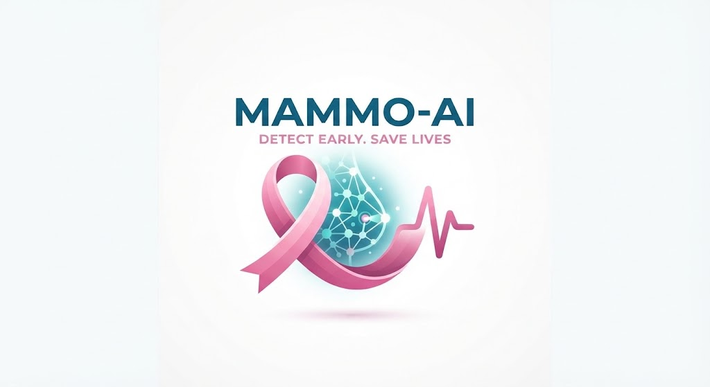

# Acta de Constitución del Proyecto

Universidad Santiago De Cali

Facultad De Ingeniería- Programa De Ingeniería de Sistemas

Acta de Constitución del Proyecto

**MAMMO-AI**

> Fecha: 04/10/2026
>
> Versión: 1.2
>
> Versión de Plantilla: 3.0.1

*Esta plantilla está basada en PM² V3.0*

*Para consultar la última versión de esta plantilla por favor visite el Wiki PM²*

**Información de Control del Documento**

<table>
<colgroup>
<col style="width: 31%" />
<col style="width: 68%" />
</colgroup>
<thead>
<tr class="header">
<th><strong>Descripción</strong></th>
<th><strong>Valor</strong></th>
</tr>
</thead>
<tbody>
<tr class="odd">
<td><strong>Título del Documento:</strong></td>
<td>Acta de Constitución del Proyecto</td>
</tr>
<tr class="even">
<td><strong>Título del Proyecto:</strong></td>
<td>MAMMO-AI</td>
</tr>
<tr class="odd">
<td><strong>Autor del Documento:</strong></td>
<td>
Alvaro Jose Jaramillo Gonzalez

Juan Jose Herrera Rengifo

Juan Camilo Ospina Daza

Kelvin Andres Palma
</td>
</tr>
<tr class="even">
<td><strong>Propietario del Proyecto:</strong></td>
<td>Project Tech TI</td>
</tr>
<tr class="odd">
<td><strong>Proveedor de Soluciones</strong></td>
<td>
Alvaro Jose Jaramillo Gonzalez

Juan Jose Herrera Rengifo

Juan Camilo Ospina Daza

Kelvin Andres Palma
</td>
</tr>
<tr class="even">
<td><strong>Director de Proyecto:</strong></td>
<td>Alvaro Jose Jaramillo Gonzalez</td>
</tr>
<tr class="odd">
<td><strong>Versión del Documento:</strong></td>
<td>1.2</td>
</tr>
<tr class="even">
<td><strong>Confidencialidad:</strong></td>
<td>Limitada</td>
</tr>
<tr class="odd">
<td><strong>Fecha:</strong></td>
<td>04/10/2026</td>
</tr>
</tbody>
</table>

**Aprobación y revisión del documento:**

NOTA: Se requieren todas las aprobaciones. Se deben mantener registros de cada aprobación.

Todos los revisores de la lista se consideran necesarios a menos que se indiquen explícitamente como Opcionales. El Director del Proyecto (DP) se responsabiliza de este documento salvo indicación expresa de lo contrario.

| **Nombre**                      | **Rol**                                 | **Acción**                                   | **Fecha**  |
|---------------------------------|-----------------------------------------|----------------------------------------------|------------|
| Alvaro Jose Jaramillo Gonzalez  | Analista                                | Define que necesita                          | 05/10/2026 |
| Juan Jose Herrera Rengifo       | Constructor                             | Construye la solución                        | 12/10/2026 |
| Juan Camilo Ospina Daza         | Tester                                  | Verifica que funcione correctamente          | 19/10/2026 |
| Kelvin Andres Palma Viveros     | Diseñador                               | Diseña la solución                           | 08/10/2026 |
| Daniel Esteban Olarte Vasquez   | Planeador                               | Planea método para la solución               | 06/10/2026 |
| Project Tech TI                 | Propietario del Proyecto (PP)           | Aprueba el acta y los entregables            | Pendiente  |
| Jair Enrique Sanclemente Castro | Docente asesor (Responsable de Negocio) | Revisa y valida el alcance y los entregables | Pendiente  |

**Historial de documentos:**

El Autor del Documento está autorizado a hacer los siguientes tipos de cambios al documento sin requerir que el documento sea aprobado nuevamente:

- *Editorial, formato y ortografía.*

- *Aclaraciones.*

Para solicitar un cambio en este documento, póngase en contacto con el Autor del Documento o el Propietario del Proyecto.

Las modificaciones de este documento se resumen en la siguiente tabla en orden cronológico inverso (primero la última versión).

| **Revisión** | **Fecha**  | **Creada por**        | **Breve descripción de los cambios** |
|--------------|------------|-----------------------|--------------------------------------|
| 1.0          | 03/10/2026 | Alvaro Jose Jaramillo | Versión inicial                      |
| 1.1          | 04/10/2026 | Juan Jose Herrera     | Revisión y complementación           |
|              |            |                       |                                      |

**Gestión de la configuración: Localización del documento**

La última versión de este documento está guardada en <https://drive.google.com/drive/folders/1Be0gRK-sEwat-bqS235JzEdxNxlHtECY?usp=drive_link>

## Resumen Ejecutivo

MAMMO-AI es un proyecto académico de la Facultad de Ingeniería (Programa de Ingeniería de Sistemas) de la Universidad Santiago de Cali, que se desarrolla durante el semestre 2026B para el Propietario del Proyecto Project Tech TI, con el acompañamiento del docente asesor Jair Enrique Sanclemente Castro. El proyecto construye una aplicación web de apoyo al análisis de mamografías que clasifica las imágenes como normales o sospechosas mediante una red neuronal convolucional entrenada por aprendizaje por transferencia, explica su resultado con mapas de calor Grad-CAM e incluye un tutor de IA gamificado que entrena el criterio del profesional frente a las respuestas del modelo. Responde a las demoras en el diagnóstico del cáncer de mama y a la escasez de radiólogos subespecialistas en regiones apartadas de Colombia, evitando además la dependencia ciega de la IA. Utiliza únicamente conjuntos de datos públicos y anonimizados, cumple con la Ley 1581 de 2012, y se presenta siempre como herramienta de apoyo, nunca como diagnóstico definitivo. Cuenta con un equipo de cinco integrantes, un presupuesto estimado de COP 7.450.000 y seis hitos que culminan con la entrega final al cierre del semestre.

## Consideraciones sobre el Caso de Negocio

El cáncer de mama representa uno de los mayores desafíos hacia lo que es el sistema de salud en Colombia.

Según el Análisis Estadístico del Instituto Nacional de Cancerología Colombia (2023), existen una brecha muy importante entre el acceso de un diagnostico oportuno y la profunda escasez de radiólogos subespecialistas en las regiones apartadas del país. Las demoras de lecturas de mamografías aumentan el porcentaje de casos diagnosticados ya en una fase tardía, lo cual reduce la posibilidad de supervivencia.

Por otra parte, las herramientas de Inteligencia Artificial (IA) que solo entregan una respuesta (positivo o negativo) no tienen la certeza de un criterio medico profesional propio o solo fue una confianza cegada hacia la maquina de IA. Esto nos genera riesgos como, sobredependencia, rechazo hacia la IA y perdida de destreza clínica en los profesionales de la salud.

La propuesta afecta directamente a la detección tardía de este cáncer, logrando un diagnóstico clínico cerciorado junto a profesionales de la salud y también a la supervivencia de los pacientes gracias a la posibilidad de un tratamiento adecuado, pues la detección temprana abre paso al correcto tratamiento del cáncer de mama.

Según Ley Estatutaria 1581 de 2012 (Protección de datos personales; los datos de salud se consideran datos sensibles), Ley 527 de 1999 (Mensajes de datos y medios electrónicos), y Ley 23 de 1982 junto con la Decisión Andina 351 de 1993 (Derechos de autor y software). Para cumplir, el proyecto hará uso únicamente de conjuntos de datos públicos y des identificados.

## Descripción del Proyecto

### Alcance

#### Incluido ("dentro del" alcance)

El análisis de requerimientos funcionales y no funcionales, selección y depuración de conjuntos de datos públicos de mamografías.

Entrenamiento de IA a partir de redes neuronales convolucionales mediante aprendizaje por transferencia para clasificar hallazgos sospechosos en mamografías.

Aplicación web con interfaz que permita a profesionales de la salud cargar mamografías y obtención de una clasificación preliminar al respecto.

Módulo de simulación gamificada con un tutor IA que guía al usuario.

Pruebas funcionales y de integración.

Documentación técnica, manual de usuario y repositorio versionado.

#### Excluido ("fuera del" alcance)

Diagnostico definitivo, el sistema solo es un apoyo debido que no reemplaza el criterio medico profesional.

Validación clínica con pacientes reales.

Uso de datos de pacientes reales o no anónimos.

Integración con sistemas hospitalarios.

#### Declaración del Alcance

MAMMO-AI desarrollará, durante el semestre académico 2026B una aplicación web que clasifica mamografías como normales o sospechosas mediante el uso de Deep Learning, con visualización explicable. Además de funcionar como tutor IA, únicamente una herramienta de apoyo y no una de diagnostico definitivo.

### Criterios de Éxito

El modelo alcanza una amplia sensibilidad ante las mamografías sospechosas: 85%.

El aplicativo muestra el resultado **preliminar** y mapa de calor en menos de 10s por imagen.

El 100% de los requerimentos funcionales y no funcionales están implementados y aprobados.

El proyecto es entregado antes de la fecha limite.

La documentación completa y el código están el repositorio de versiones.

### Necesidades de las Partes Interesadas y de los Usuarios

| **ID** | **Descripción de la Necesidad**                                                                                                                                                     | **Prioridad** |
|--------|-------------------------------------------------------------------------------------------------------------------------------------------------------------------------------------|---------------|
| 01     | El Profesional de la salud necesita un filtro preliminar rápido de mamografías que tenga prioridad hacia los casos sospechosos, debido a la escasez de radiólogos subespecializados | ALTA          |
| 02     | El profesional de la salud necesita saber y entender ¿por qué el sistema clasifica una imagen como sospechosa? Para poder verificar con su criterio el resultado.                   | ALTA          |
| 03     | El profesional de la salud necesita tener un muy buen criterio ante la IA para no aceptar ni rechazar ciegamente los resultados o recomendaciones.                                  | MEDIA         |
| 04     | La universidad necesita un software que este documentado y versionado, no solo experimentos aislados.                                                                               | MEDIA         |
| 05     | Los pacientes necesitan que su información está protegida                                                                                                                           | ALTA          |

### Entregables

| **ID** | **Nombre del Entregable**                 | **Descripción del Entregable**                                                                                 |
|--------|-------------------------------------------|----------------------------------------------------------------------------------------------------------------|
| 1      | Modelo de clasificación                   | Red neuronal convolucional entrenada y validada para detectar patrones y hallazgos sospechosos en mamografías. |
| 2      | Aplicativo web                            | Plataforma para subir mamografías y consultar clasificación **preliminar.**                                    |
| 3      | Visualizador explicable                   | Modulo que muestra mapas de calor GRAD-CAM sobre la imagen analizada.                                          |
| 4      | Documentación técnica y manual de usuario | Arquitectura, requerimientos, informe de pruebas y guía de uso.                                                |
| 5      | Repositorio del proyecto                  | Repositorio con documentación completa del proyecto y conjuntos de datos.                                      |

### Características

| **Necesidad Relacionada** | **Característica**                                                                          | **Entregable** |
|---------------------------|---------------------------------------------------------------------------------------------|----------------|
| 01                        | Clasificación de una mamografía como normal o sospechosa, indicación de nivel de confianza. | 1,2            |
| 01                        | Carga de imágenes desde la interfaz web                                                     | 2              |
| 02                        | Mapa de calor sobre las regiones que influyeron en la decisión **preliminar.**              | 3              |
| 03                        | Retroalimentación del tutor IA, incluyendo casos donde el modelo se equivoca.               | 1,2,3          |
| 04                        | Mantención del proyecto versionado, con pruebas y documentación                             | 4,5            |
| 05                        | Uso único de datos públicos o anónimos                                                      | 1,5            |

### Restricciones

Tiempo: El proyecto debe entregarse bajo un limite de tiempo dentro del semestre académico 2026B.

Equipo: 5 participantes con disponibilidad parcial debido a otras responsabilidades.

Presupuesto: Uso de herramientas gratuitas, información pública y herramientas accesibles debido a licencias académicas.

Datos: Solo conjuntos de datos públicos o anónimos.

Legal: Cumplimiento de leyes como: Ley 1581 de 2012, Ley 527 de 1999 y Decisión Andina 351. Para la protección de datos de pacientes.

Alcance clínico: El sistema se presenta únicamente como herramienta de apoyo, nunca como un diagnóstico definitivo.

### Supuestos

Los datos públicos a disponibilidad seguirán estando disponibles y mantendrán una calidad y criterio medico confiables para entrenar al modelo.

El equipo contara con acceso a herramientas gratuitas o con uso de licencia academica.

Los integrantes mantendrán su compromiso y responsabilidad para el proyecto, teniendo en cuenta disponibilidad a lo largo del semestre.

El propietario estará disponible para revisar y aprobar los entregables.

### Riesgos

A continuación, se muestran los riesgos claves identificados en la etapa de inicialización del proyecto. Esta evaluación inicial será ampliada en el Registro de riesgos del proyecto, que se encontrara una vez realizada a lo largo del ciclo de vida del proyecto en el repositorio general del proyecto.

<table>
<colgroup>
<col style="width: 5%" />
<col style="width: 18%" />
<col style="width: 10%" />
<col style="width: 5%" />
<col style="width: 5%" />
<col style="width: 5%" />
<col style="width: 14%" />
<col style="width: 13%" />
<col style="width: 21%" />
</colgroup>
<thead>
<tr class="header">
<th><strong>ID</strong></th>
<th><strong>Descripción y Detalles del Riesgo</strong></th>
<th><strong>Estado</strong></th>
<th><blockquote>

<strong>Probabilidad</strong><a href="#fn1" class="footnote-ref" id="fnref1" role="doc-noteref">1</a>

</blockquote></th>
<th><blockquote>

<strong>Impacto</strong><a href="#fn2" class="footnote-ref" id="fnref2" role="doc-noteref">2</a>

</blockquote></th>
<th><blockquote>

<strong> 
Nivel de Riesgo</strong><a href="#fn3" class="footnote-ref" id="fnref3" role="doc-noteref">3</a>

</blockquote></th>
<th><strong>Dueño del Riesgo</strong></th>
<th><strong>Estrategia de Respuesta al Riesgo</strong><a href="#fn4" class="footnote-ref" id="fnref4" role="doc-noteref">4</a></th>
<th><strong>Detalles de la Acción</strong></th>
</tr>
</thead>
<tbody>
<tr class="odd">
<td>R1</td>
<td>Baja calidad de los datos que afecten a la precisión del modelo</td>
<td>Abierto</td>
<td>3</td>
<td>4</td>
<td>12</td>
<td>Analista</td>
<td>Reducir</td>
<td>Combinar varios conjuntos de datos para aumentar la cantidad y balancearlos</td>
</tr>
<tr class="even">
<td>R2</td>
<td>Sobreajuste del modelo</td>
<td>Abierto</td>
<td>3</td>
<td>4</td>
<td>12</td>
<td>Constructor</td>
<td>Reducir</td>
<td>Regularización, validación cruzada</td>
</tr>
<tr class="odd">
<td>R3</td>
<td>Falta de recursos GPU</td>
<td>Abierto</td>
<td>2</td>
<td>4</td>
<td>8</td>
<td>Constructor</td>
<td>Transferir</td>
<td>Usar herramientas gratuitas como Colab</td>
</tr>
<tr class="even">
<td>R4</td>
<td>Retiro o Baja de integrantes</td>
<td>Abierto</td>
<td>2</td>
<td>4</td>
<td>8</td>
<td>Director del proyecto</td>
<td>Aceptar</td>
<td>Repartición de responsabilidades entre los integrantes disponibles.</td>
</tr>
<tr class="odd">
<td>R5</td>
<td>Retrasos en el cronograma</td>
<td>Abierto</td>
<td>4</td>
<td>3</td>
<td>12</td>
<td>Director del proyecto</td>
<td>Reducir</td>
<td>Seguimiento semanal y plazos flexibles dentro del tiempo estipulado</td>
</tr>
<tr class="even">
<td>R6</td>
<td>Mal uso de datos que comprometen la privacidad</td>
<td>Abierto</td>
<td>1</td>
<td>5</td>
<td>5</td>
<td>Analista</td>
<td>Evitar</td>
<td>Usar solo datos públicos o anónimos.</td>
</tr>
</tbody>
</table>
<aside id="footnotes" class="footnotes footnotes-end-of-document" role="doc-endnotes">

<ol>
<li id="fn1">
Valor numérico que indica la probabilidad de ocurrencia del riesgo.<a href="#fnref1" class="footnote-back" role="doc-backlink">↩︎</a>
</li>
<li id="fn2">
Valor numérico que indica la severidad relativa del impacto del riesgo, en caso de ocurrir.<a href="#fnref2" class="footnote-back" role="doc-backlink">↩︎</a>
</li>
<li id="fn3">
Nivel de riesgo. Es el producto de probabilidad e impacto (NR=P*I).<a href="#fnref3" class="footnote-back" role="doc-backlink">↩︎</a>
</li>
<li id="fn4">
Las posibles estrategias de respuesta al riesgo son: Evitar / Aceptar / Reducir / Transferir para riesgos negativos (amenazas) y Explotar / Aceptar / Mejorar / Compartir para riesgos positivos (oportunidades).<a href="#fnref4" class="footnote-back" role="doc-backlink">↩︎</a>
</li>
</ol>
</aside>

## Coste, tiempo y recursos

### Plazos e hitos

| **ID** | **Descripción del Hito**                                   | **Fecha objetivo de entrega** |
|--------|------------------------------------------------------------|-------------------------------|
| **H1** | **Aprobación del Acta de constitución**                    | **04/10/2026**                |
| **H2** | **Fin del análisis: Requerimientos y datos seleccionados** | **05/10/2026**                |
| **H3** | **Fin del diseño: Arquitectura e interfaz**                | **12/10/2026**                |
| **H4** | **Fin de la construcción: modelo entrenado**               | **20/10/2026**                |
| **H5** | **Fin de pruebas: informes de pruebas**                    | **23/10/2026**                |
| **H6** | **Entrega final del proyecto**                             | **Final de semestre 2026B**   |

### Recursos Planificados

| **ID** | **Recurso Requerido** | **Descripción**                                                |
|--------|-----------------------|----------------------------------------------------------------|
| R1     | Analista              | Define requerimientos y criterios de selección de datos.       |
| R2     | Constructor           | Desarrolla el modelo                                           |
| R3     | Tester                | Verifica funcionamiento y el desempeño                         |
| R4     | Diseñador             | Diseña la interfaz y la arquitectura                           |
| R5     | Planeador             | Planifica métodos y uso de tecnología                          |
| R6     | Datos públicos        | Mamografías publicas y datos sobre el cáncer de mama anónimos. |
| R7     | Herramientas          | Python, GitHub, Colab y equipos personales                     |

## Enfoque

### Metodología

**Gestión del proyecto.** MAMMO-AI se gestiona con la metodología PM², siguiendo sus cuatro fases (Inicio, Planificación, Ejecución y Cierre) con seguimiento y control de forma transversal. Por tratarse de un proyecto académico de un semestre con cinco integrantes, se aplican estas desviaciones respecto a PM² estándar:

- No se elaboran el Plan de Implementación en el Negocio ni informes formales de estado completos. Se reemplazan por un seguimiento semanal con un acta breve (avances, acuerdos y riesgos), en línea con la respuesta al riesgo R5.

- La ejecución se organiza en sprints de una semana, alineados con los hitos H2 a H5, con revisión al cierre de cada sprint.

- Cada hito funciona como punto de control: el entregable correspondiente se verifica y se aprueba antes de pasar a la siguiente fase.

**Metodología de desarrollo.** Para la solución de software e inteligencia artificial se adoptan:

- **CRISP-DM** para el componente de IA: comprensión del problema, selección y depuración de datos públicos, entrenamiento por aprendizaje por transferencia, evaluación y despliegue.

- **Scrum ligero** para la aplicación web: backlog priorizado según las necesidades 01 a 05, sprints semanales y revisión de entregables.

- **Control de versiones con Git/GitHub:** ramas por funcionalidad y revisión entre pares antes de integrar cambios.

- **Evaluación del modelo** con criterios definidos antes de entrenar: partición en entrenamiento, validación y prueba, y reporte de sensibilidad (meta de 85%), especificidad y AUC.

**Asesoría.** El docente asesor, Jair Enrique Sanclemente Castro, acompaña el proceso y valida la coherencia técnica de los entregables con el alcance académico.

### Gestión de Cambios

Los cambios se gestionan de forma controlada, de acuerdo con el proceso estándar de control de cambios y de gestión de la configuración del Manual del Proyecto PM².

#### Cambio del Proyecto

El proceso de cambio del proyecto es el siguiente:

- **Solicitud:** cualquier integrante presenta una solicitud de cambio al Director de Proyecto, con descripción, motivo e impacto estimado en alcance, tiempo y costo.

- **Evaluación:** el Director de Proyecto analiza el impacto junto con el equipo.

- **Decisión:** los cambios menores (que no afectan alcance, hitos, presupuesto ni criterios de éxito) los aprueba el Director de Proyecto. Los cambios mayores los aprueba el Propietario del Proyecto (Project Tech TI), con concepto del docente asesor.

- **Registro:** todo cambio se anota en un Registro de Cambios y se actualizan los documentos afectados, generando una nueva versión.

Los cambios en el contenido de esta acta requieren aprobación formal del Propietario del Proyecto.

#### Gestión de la Configuración

Se identifican los siguientes elementos de configuración, que solo pueden modificarse con la autorización indicada:

| **Elemento**                                                     | **Dónde se controla**                                                              | **Autoriza el cambio**                     |
|------------------------------------------------------------------|------------------------------------------------------------------------------------|--------------------------------------------|
| Acta de constitución, alcance, presupuesto y fechas de hitos     | Carpeta del proyecto en Google Drive, con versionado                               | Propietario del Proyecto (Project Tech TI) |
| Requisitos funcionales y no funcionales                          | Documento de requerimientos                                                        | Analista y Director de Proyecto            |
| Código fuente de la aplicación web                               | Repositorio GitHub (ramas protegidas, revisión entre pares)                        | Constructor y Tester                       |
| Modelo entrenado (pesos, hiperparámetros, métricas)              | Repositorio, con tabla de versiones y métricas                                     | Constructor y Director de Proyecto         |
| Conjuntos de datos (fuente, versión, licencia, preprocesamiento) | Scripts y registro de descarga; no se redistribuyen datos con licencia restrictiva | Analista                                   |
| Diseño de arquitectura e interfaz                                | Carpeta de diseño del proyecto                                                     | Diseñador y Director de Proyecto           |
| Informes de pruebas                                              | Carpeta de pruebas                                                                 | Tester                                     |

Antes de cada hito se verifica que la versión entregada corresponda a la línea base aprobada.

#### Cambio de la Organización

MAMMO-AI no se implementará en una institución de salud (la integración con sistemas hospitalarios está fuera del alcance), por lo que el impacto organizacional es limitado. Se consideran estas actividades:

- Orientar a los usuarios de la demostración mediante el manual de usuario y el módulo de tutor IA, para que usen el sistema con criterio propio y sin aceptar ni rechazar sus resultados a ciegas.

- Entregar a la universidad el repositorio y la documentación, de modo que otros equipos puedan continuar el proyecto.

- Dejar visible en la aplicación que es una herramienta de apoyo y no de diagnóstico definitivo.

*  
*

## Gobernanza y Partes Interesadas

### Estructura

La estructura sigue la metodología PM²: un Comité de Dirección del Proyecto, el Director de Proyecto y el equipo del proyecto.

<table>
<colgroup>
<col style="width: 19%" />
<col style="width: 9%" />
<col style="width: 9%" />
<col style="width: 19%" />
<col style="width: 9%" />
<col style="width: 9%" />
<col style="width: 20%" />
</colgroup>
<tbody>
<tr class="odd">
<td colspan="7"><strong>Comité de Dirección del Proyecto</strong></td>
</tr>
<tr class="even">
<td colspan="2">
<strong>Propietario del Proyecto (PP)</strong>

Project Tech TI
</td>
<td colspan="3">
<strong>Responsable de Negocio (RN)</strong>

Jair Enrique Sanclemente Castro (docente asesor)
</td>
<td colspan="2">
<strong>Proveedor de Soluciones (PS)</strong>

Equipo de desarrollo
</td>
</tr>
<tr class="odd">
<td colspan="7">▼</td>
</tr>
<tr class="even">
<td colspan="7">
<strong>Director de Proyecto (DP)</strong>

Alvaro Jose Jaramillo Gonzalez
</td>
</tr>
<tr class="odd">
<td colspan="7">▼</td>
</tr>
<tr class="even">
<td>
<strong>Analista</strong>

Alvaro Jose Jaramillo Gonzalez
</td>
<td colspan="2">
<strong>Constructor</strong>

Juan Jose Herrera Rengifo
</td>
<td>
<strong>Tester</strong>

Juan Camilo Ospina Daza
</td>
<td colspan="2">
<strong>Diseñador</strong>

Kelvin Andres Palma Viveros
</td>
<td>
<strong>Planeador</strong>

Daniel Esteban Olarte Vasquez
</td>
</tr>
</tbody>
</table>

### Roles y Responsabilidades

Se asignan los roles de PM² y los roles técnicos del equipo así:

| **Rol**                       | **Asignado a**                                                                                             | **Responsabilidades**                                                                           |
|-------------------------------|------------------------------------------------------------------------------------------------------------|-------------------------------------------------------------------------------------------------|
| Propietario del Proyecto (PP) | Project Tech TI                                                                                            | Aprueba el acta, los cambios mayores y los entregables; asegura los recursos del proyecto.      |
| Responsable de Negocio (RN)   | Jair Enrique Sanclemente Castro (docente asesor)                                                           | Valida que la solución responda a la necesidad planteada y la coherencia del alcance académico. |
| Proveedor de Soluciones (PS)  | Equipo de desarrollo (Alvaro Jose Jaramillo Gonzalez, Juan Jose Herrera Rengifo y Juan Camilo Ospina Daza) | Entrega los productos del proyecto y garantiza su calidad técnica.                              |
| Director de Proyecto (DP)     | Alvaro Jose Jaramillo Gonzalez                                                                             | Planifica, hace el seguimiento semanal, gestiona riesgos y cambios, y coordina al equipo.       |
| Analista                      | Alvaro Jose Jaramillo Gonzalez                                                                             | Define los requerimientos y los criterios de selección de datos.                                |
| Constructor                   | Juan Jose Herrera Rengifo                                                                                  | Desarrolla y entrena el modelo y construye la aplicación.                                       |
| Tester                        | Juan Camilo Ospina Daza                                                                                    | Verifica el funcionamiento y el desempeño del modelo y la aplicación.                           |
| Diseñador                     | Kelvin Andres Palma Viveros                                                                                | Diseña la interfaz y la arquitectura.                                                           |
| Planeador                     | Daniel Esteban Olarte Vasquez                                                                              | Planifica los métodos y el uso de tecnología.                                                   |

**Desviaciones respecto a PM²:** los roles técnicos (Analista, Constructor, Tester, Diseñador y Planeador) se incorporan como equipo del proyecto bajo el Director de Proyecto. Un integrante puede ejercer más de un rol (el Director de Proyecto también actúa como Analista). El Responsable de Negocio es el docente asesor, porque el proyecto no tiene un cliente clínico.

### Otras Partes Interesadas 

Las principales partes interesadas del proyecto son:

| **Parte interesada**                                         | **Perfil**                                         | **Problema clave que esperan resolver**                                                                                                   |
|--------------------------------------------------------------|----------------------------------------------------|-------------------------------------------------------------------------------------------------------------------------------------------|
| Project Tech TI                                              | Propietario del Proyecto                           | Obtener una solución documentada y utilizable, dentro del alcance y el tiempo acordados.                                                  |
| Jair Enrique Sanclemente Castro                              | Docente asesor (Responsable de Negocio)            | Que el proyecto cumpla los objetivos académicos y técnicos del programa.                                                                  |
| Universidad Santiago de Cali (Facultad de Ingeniería)        | Institución académica                              | Software documentado y versionado, no experimentos aislados.                                                                              |
| Profesionales de la salud                                    | Usuarios previstos de la aplicación                | Escasez de radiólogos subespecialistas y demoras en la lectura de mamografías; entender por qué el sistema marca un caso como sospechoso. |
| Estudiantes y docentes del área de la salud                  | Usuarios del módulo de tutor IA                    | Desarrollar criterio propio frente a la IA, sin aceptarla ni rechazarla a ciegas.                                                         |
| Pacientes (indirectos)                                       | Mujeres en tamizaje y diagnóstico                  | Diagnóstico oportuno y protección de su información personal.                                                                             |
| Equipo del proyecto                                          | Estudiantes de Ingeniería de Sistemas              | Requisitos claros, herramientas accesibles y tiempos realistas dentro del semestre.                                                       |
| Futuros equipos de desarrollo                                | Reutilizan el repositorio                          | Código y documentación claros para continuar el proyecto.                                                                                 |
| Fuentes de datos públicos y entidades de protección de datos | Proveedores de datasets y autoridad de datos (SIC) | Uso respetuoso de licencias y cumplimiento de la Ley 1581 de 2012.                                                                        |

**Justificación:** existe una brecha entre la necesidad de un diagnóstico temprano del cáncer de mama y la capacidad de lectura especializada en regiones apartadas de Colombia, además del riesgo de que las herramientas de IA que entregan solo un resultado positivo o negativo generen sobredependencia. Los requisitos concretos de cada grupo se recogen en la sección 3.3 y en el documento de requerimientos.

**Apéndice 1: Referencias y Documentos Relacionados**

| **ID** | **Referencia o Documento relacionado**                                  | **Fuente o Enlace/Ubicación**                                                             |
|--------|-------------------------------------------------------------------------|-------------------------------------------------------------------------------------------|
| 1      | Directorio del Proyecto                                                 | https://drive.google.com/drive/folders/1Be0gRK-sEwat-bqS235JzEdxNxlHtECY?usp=drive_link   |
| 2      | *Instituto Nacional de Cancerología. (2023). Anuario estadístico 2023.* | *https://www.cancer.gov.co/conozca-sobre-cancer-1/publicaciones/anuario-estadistico-2023* |
