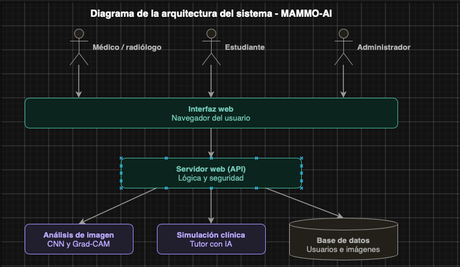

# Diagrama de la arquitectura del sistema

**Elaborado por:** Daniel Esteban Olarte Vasquez
**Programa:** Ingeniería de Sistemas, Universidad Santiago de Cali
**Materia:** Ingeniería de Software
**Herramienta utilizada:** draw.io

## Descripción de los componentes

- **Usuarios:** el médico o radiólogo sube las imágenes para analizarlas, el estudiante practica con la simulación clínica y el administrador se encarga de gestionar el sistema.
- **Interfaz web:** es la parte que ve cada usuario en el navegador, donde inicia sesión y usa las funciones del sistema.
- **Servidor web (API):** recibe lo que pide la interfaz, controla quién puede entrar y se comunica con los módulos y con la base de datos.
- **Análisis de imagen:** usa un modelo de inteligencia artificial (CNN) para analizar la mamografía y, con Grad-CAM, muestra en un mapa de calor las zonas que tuvo en cuenta.
- **Simulación clínica:** ofrece casos prácticos con un tutor de IA para que el estudiante aprenda.
- **Base de datos:** guarda la información de los usuarios, las imágenes y los resultados.
