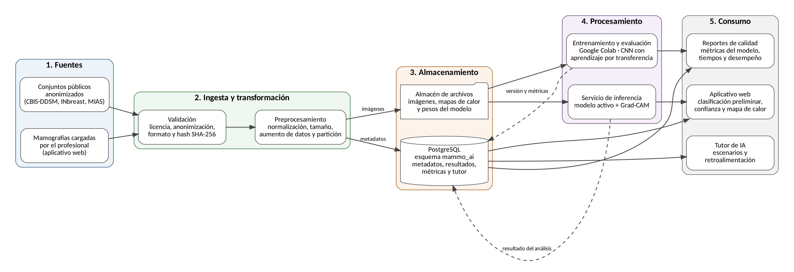
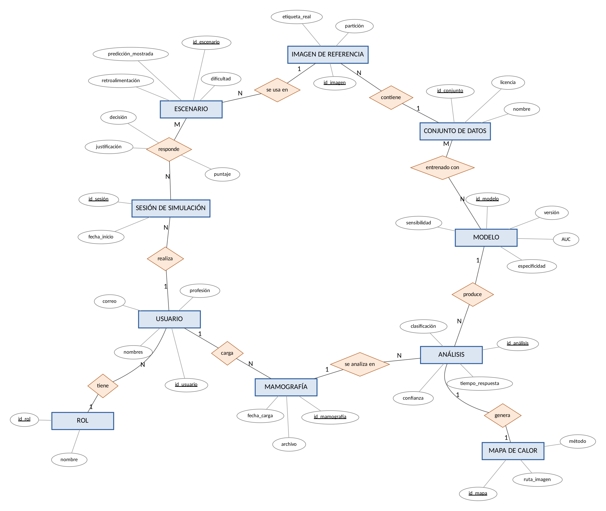
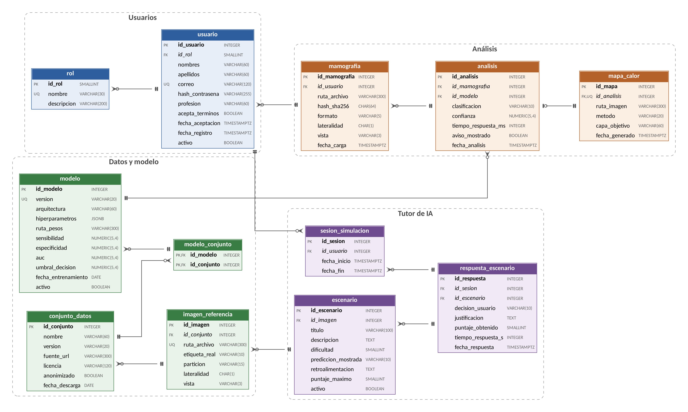

# Arquitectura de datos y diseño de base de datos

**Universidad Santiago de Cali** Facultad de Ingeniería – Programa de Ingeniería de Sistemas

**Arquitectura de datos y diseño de base de datos del sistema MAMMO-AI**

Integrantes: Alvaro Jose Jaramillo Gonzalez - Juan José Herrera Rengifo - Juan Camilo Ospina Daza - Kelvin Andres Palma Viveros - Daniel Esteban Olarte Vasquez

Docente: Jair Enrique Sanclemente Castro Asignatura: Gestión de Proyectos de TI

Santiago de Cali, octubre de 2026

## Introducción

MAMMO-AI es una aplicación web que apoya el análisis preliminar de mamografías. Clasifica cada imagen como normal o sospechosa mediante una red neuronal convolucional, explica el resultado con un mapa de calor Grad-CAM y, además, incluye un tutor de inteligencia artificial que acompaña al profesional de la salud a revisar las recomendaciones del modelo.

Un sistema así depende, en buena medida, de cómo organiza sus datos. Tiene que guardar las imágenes cargadas, los resultados de cada análisis, las versiones del modelo junto con sus métricas y las respuestas de los usuarios en el tutor. Todo esto debe hacerse sin almacenar información que identifique a una paciente, como lo exige la Ley 1581 de 2012.

Este documento presenta la arquitectura de datos de MAMMO-AI y el diseño de su base de datos. El trabajo se organizó en cinco fases: recogida y análisis de requisitos, diseño conceptual, diseño lógico, diseño físico, e implementación y optimización. Los requisitos de partida salen de la Matriz de Trazabilidad de Requisitos del proyecto, y el diseño físico se implementó y probó en PostgreSQL 16.

## Arquitectura de datos

La arquitectura de datos describe cómo se gestionan los datos desde que se recopilan hasta que se transforman, distribuyen y consumen. Es, en otras palabras, el plano técnico de cómo fluyen por los sistemas de almacenamiento (Krantz y Jonker, 2025). Según los mismos autores, sus componentes se agrupan en cuatro frentes: el flujo e integración de los datos, los sistemas de almacenamiento, el acceso y consumo, y la gobernanza y los metadatos.

En MAMMO-AI los datos atraviesan cinco capas, que se muestran en la Figura 1.



*Figura 1. Arquitectura de datos de MAMMO-AI. Elaboración propia.*

**Tabla 1**

*Capas de la arquitectura de datos de MAMMO-AI*

| Capa                         | Función en MAMMO-AI                                                                                                                                                                       |
|------------------------------|-------------------------------------------------------------------------------------------------------------------------------------------------------------------------------------------|
| 1\. Fuentes                  | Conjuntos públicos y anonimizados (CBIS-DDSM y MIAS) para entrenar el modelo, y mamografías cargadas por el profesional desde la aplicación.                                              |
| 2\. Ingesta y transformación | Validación de licencia, anonimización; luego normalización, redimensionamiento, aumento de datos y partición en entrenamiento, validación y prueba.                                       |
| 3\. Almacenamiento           | Un almacén de archivos guarda las imágenes, los mapas de calor del modelo; PostgreSQL guarda los metadatos, los resultados, las métricas y los datos del tutor.                           |
| 4\. Procesamiento            | El entrenamiento en Google Colab registra cada versión del modelo con sus métricas almacenadas; el servicio de inferencia usa el modelo activo, genera el Grad-CAM y guarda el resultado. |
| 5\. Consumo                  | El aplicativo web muestra la clasificación y el mapa de calor, el tutor presenta escenarios y registra respuestas, y los reportes de calidad consultan métricas y tiempos.                |

La decisión central de esta arquitectura es separar los archivos pesados de los datos estructurados. Las imágenes no se guardan dentro de la base de datos; allí solo quedan su ruta, su huella y sus metadatos. Con esto la base de datos se mantiene liviana, los respaldos son más rápidos y las consultas trabajan sobre datos que sí se filtran y relacionan con SQL.

La organización combina dos patrones arquitectónicos que describe Sommerville. La ingesta sigue el patrón *tubería y filtro*: cada etapa transforma los datos y se los pasa a la siguiente. El almacenamiento sigue el patrón *repositorio*: la aplicación, el tutor y los reportes comparten una misma base de datos, en lugar de intercambiar datos directamente entre ellos.

## Diseño de base de datos

El diseño de base de datos se ocupa de la estructura: qué entidades existen, cómo se relacionan y qué restricciones deben cumplir. Si la arquitectura responde por dónde viajan los datos, el diseño responde por cómo quedan organizados una vez almacenados.

En este proceso se decide qué tablas existen, qué atributos tiene cada una, cuáles son sus llaves primarias y foráneas, y qué reglas deben cumplir los datos, todo para atender las necesidades de los usuarios (Casas Roma, s. f.). Como es un problema bastante complejo, el mismo autor propone abordarlo con la estrategia de «divide y vencerás»: el diseño se parte en etapas secuenciales, y el resultado de cada una sirve de punto de partida para la siguiente. Aun así, el proceso permite volver atrás cuando una etapa posterior revela una necesidad nueva.

IBM distingue tres niveles de modelado, que corresponden a las fases centrales de este proceso. El conceptual muestra las entidades y las reglas del negocio. El lógico detalla los atributos y las relaciones sin depender de ninguna tecnología. El físico define las tablas, los índices y los formatos de almacenamiento (Krantz y Jonker, 2025). Sommerville (2011, cap. 5) ubica este trabajo dentro del modelado estructural del sistema, donde los modelos semánticos de datos, como el modelo entidad-relación, describen la información que el software debe gestionar.

En el caso de MAMMO-AI, el proceso se desarrolló en cinco fases, que se describen a continuación.

## Fase 1. Recogida y análisis de requisitos

Los requisitos de datos se tomaron de la Matriz de Trazabilidad de Requisitos del proyecto. Cada requisito funcional se tradujo en la información que el sistema necesita almacenar para poder cumplirlo. Casas Roma (s. f.) divide esta fase en tres subfases: la recogida de los requisitos, su estructuración y refinamiento, y su formalización. En MAMMO-AI, la formalización corresponde a la propia matriz de trazabilidad, donde cada requisito tiene un criterio de aceptación verificable.

Usuarios del sistema. Se identificaron cuatro perfiles: el profesional de la salud, que carga mamografías y consulta la clasificación; el estudiante, que usa el módulo de simulación; el docente, que revisa el desempeño en el tutor; y el administrador, que gestiona usuarios, modelos y escenarios.

**Necesidades de información.**

**Tabla 2**

*Necesidades de información por requisito*

| Requisito                      | Datos que deben almacenarse                                                     |
|--------------------------------|---------------------------------------------------------------------------------|
| 1.1 Clasificar mamografías     | Clasificación, nivel de confianza y versión del modelo que produjo el resultado |
| 2.1 Cargar imágenes            | Archivo, formato, lateralidad, vista, usuario que la cargó y fecha              |
| 3.1 Mapa de calor Grad-CAM     | Ruta del mapa y capa utilizada, asociados a cada análisis                       |
| 4.1 Respuesta en menos de 10 s | Tiempo de respuesta de cada análisis                                            |
| 5.1 Tutor de IA                | Escenarios, sesiones y respuestas de los usuarios                               |
| 6.1 Solo datos públicos        | Conjuntos de datos con fuente, versión, licencia y estado de anonimización      |
| 7.1 Herramienta de apoyo       | Constancia de que el aviso de resultado preliminar se mostró                    |

**Reglas del negocio.** Del análisis también salieron reglas que la base de datos debe hacer cumplir por sí misma, sin depender solo de la aplicación:

1.  Solo se registran conjuntos de datos anonimizados.

2.  Solo puede haber un modelo activo a la vez, y su sensibilidad debe ser igual o superior a 0,85.

3.  Cada análisis genera un único mapa de calor.

4.  Todo resultado se presenta con el aviso de herramienta de apoyo.

5.  Un usuario no puede cargar dos veces la misma imagen.

6.  En una sesión del tutor, cada escenario se responde una sola vez.

Hay una restricción que atraviesa toda esta fase: la base de datos no tiene una tabla de pacientes. Las imágenes de entrenamiento provienen de conjuntos ya anonimizados, y de las imágenes cargadas por los usuarios solo se guardan datos técnicos.

## Fase 2. Diseño conceptual

El diseño conceptual construye un esquema de alto nivel, independiente de la tecnología, a partir de los requisitos de la fase anterior (Casas Roma, s. f.). Dicho de otra forma, describe qué información maneja el sistema sin preocuparse todavía por el motor de base de datos. Lo representamos con un modelo entidad-relación de diez entidades (Figura 2).



*Figura 2. Modelo conceptual entidad-relación de MAMMO-AI. Los atributos subrayados son identificadores. Elaboración propia.*

La Figura 2 usa la notación de Chen. Cada **rectángulo** es una entidad, es decir, algo de lo que el sistema necesita guardar información. Cada **rombo** es una relación entre dos entidades y se nombra con un verbo. Cada **óvalo** es un atributo, y el atributo subrayado es el identificador que distingue a cada ejemplar de la entidad. Los números sobre las líneas indican la cardinalidad: «1» y «N» significan uno a muchos, y «N» y «M» significan muchos a muchos. Por ejemplo, el rombo carga, entre Usuario (1) y Mamografía (N), se lee así: un usuario carga muchas mamografías, y cada mamografía la carga un solo usuario.

Las entidades son Usuario, Rol, Mamografía, Análisis, Mapa de calor, Modelo, Conjunto de datos, Imagen de referencia, Escenario y Sesión de simulación. Sus relaciones y cardinalidades aparecen en la Tabla 3.

**Tabla 3**

*Relaciones y cardinalidades del modelo conceptual*

| Relación                                            | Cardinalidad | Interpretación                                                       |
|-----------------------------------------------------|--------------|----------------------------------------------------------------------|
| Rol – tiene – Usuario                               | 1:N          | Un rol agrupa a varios usuarios                                      |
| Usuario – carga – Mamografía                        | 1:N          | Un usuario carga varias imágenes                                     |
| Mamografía – se analiza en – Análisis               | 1:N          | Una imagen puede volver a analizarse con otra versión del modelo     |
| Modelo – produce – Análisis                         | 1:N          | Cada resultado queda ligado a la versión que lo generó               |
| Análisis – genera – Mapa de calor                   | 1:1          | Cada análisis tiene un único mapa Grad-CAM                           |
| Modelo – entrenado con – Conjunto de datos          | N:M          | Un modelo usa varios conjuntos, y un conjunto sirve a varios modelos |
| Conjunto de datos – contiene – Imagen de referencia | 1:N          | Cada imagen pertenece a un conjunto                                  |
| Imagen de referencia – se usa en – Escenario        | 1:N          | Los casos del tutor usan imágenes con diagnóstico conocido           |
| Usuario – realiza – Sesión de simulación            | 1:N          | Un usuario puede practicar varias veces                              |
| Sesión – responde – Escenario                       | N:M          | En una sesión se responden varios escenarios                         |

La relación *responde* tiene atributos propios: la decisión del usuario, su justificación y el puntaje. Estos datos no pertenecen a la sesión ni al escenario por separado, sino a la combinación de ambos. Ese detalle es importante para el propósito del tutor, porque permite comparar lo que decidió el usuario con lo que sugirió la IA y con el diagnóstico real.

Conviene notar también la diferencia entre Mamografía e Imagen de referencia. La primera es una imagen cargada por un usuario, cuyo diagnóstico real se desconoce. La segunda proviene de un conjunto público y tiene una etiqueta conocida, así que sirve para entrenar y evaluar el modelo, y también para construir los escenarios del tutor.

## Fase 3. Diseño lógico

En esta fase el modelo conceptual se transformó en un modelo relacional de doce tablas, agrupadas en cuatro áreas: usuarios, datos y modelo, análisis, y tutor de IA (Figura 3). Casas Roma (s. f.) organiza este trabajo en tres pasos: revisar el modelo conceptual para detectar las llamadas trampas de diseño, transformarlo al modelo lógico y normalizar el resultado. Ese fue el orden que seguimos.



*Figura 3. Modelo relacional de MAMMO-AI. PK: clave primaria; FK: clave foránea; UQ: valor único. Elaboración propia.*

**Reglas de transformación aplicadas.**

Las relaciones entre tablas se resolvieron así:

**Relaciones 1:N:** la clave primaria del lado «uno» pasa como clave foránea al lado «muchos». Por ejemplo, id_usuario aparece en la tabla mamografia y id_modelo aparece en analisis.

**Relación 1:1:** se resolvió con una clave foránea que, además, es única. En mapa_calor, id_analisis tiene restricción UNIQUE, así que un análisis no puede tener dos mapas. Esa restricción es lo que convierte la relación en 1:1.

**Relaciones N:M:** cada una generó una tabla intermedia. modelo_conjunto une modelos con conjuntos de datos mediante una clave primaria compuesta, y respuesta_escenario une sesiones con escenarios y, además, guarda los atributos propios de la relación.

**Normalización.** El modelo se llevó hasta la tercera forma normal (3FN):

- **Primera forma normal:** todos los atributos son atómicos y no hay grupos repetidos. Por ejemplo, los roles se separaron en su propia tabla, en vez de repetirse como texto en cada usuario. La única excepción justificada son los hiperparámetros del modelo, que se guardan en un campo JSONB porque cambian según la arquitectura de la red y no se consultan por separado.

- **Segunda forma normal:** en modelo_conjunto, que es la única tabla con clave compuesta, no hay atributos que dependan solo de una parte de la clave.

- **Tercera forma normal:** no hay dependencias transitivas. El caso más claro está en el tutor: saber si una respuesta fue correcta parece un dato de respuesta_escenario, pero en realidad depende de la etiqueta real de la imagen. Si se guardara ahí, aparecería una dependencia transitiva y el riesgo de tener datos contradictorios. Por eso no se almacena: se calcula en una vista. Lo mismo ocurre con el dato que indica si el usuario siguió o no la sugerencia de la IA.

## Fase 4. Diseño físico

El diseño físico se implementó en PostgreSQL 16, dentro de un esquema llamado mammo_ai. Elegimos este motor porque es libre, cumple las propiedades ACID y ofrece tres funciones que el diseño aprovecha: restricciones CHECK, el tipo JSONB y los índices parciales. El script completo está en el anexo. Las decisiones de esta fase se tomaron según los tres criterios que propone Casas Roma (s. f.) para el diseño físico: tiempo de respuesta, uso del espacio y rendimiento.

**Tipos de datos.** Cada tipo se eligió según el dato que guarda. Las métricas del modelo y la confianza usan NUMERIC(5,4), porque son valores entre 0 y 1 que no deben perder precisión. La huella SHA-256 usa CHAR(64), ya que siempre mide 64 caracteres. Las fechas usan TIMESTAMPTZ para conservar la zona horaria. Las claves primarias usan SERIAL, un entero que PostgreSQL genera solo (1, 2, 3...) cada vez que se inserta una fila. Las claves foráneas, en cambio, usan INTEGER, porque no generan números nuevos: solo guardan el valor que ya tiene la fila a la que apuntan. Por ejemplo, id_usuario es SERIAL en la tabla usuario e INTEGER en la tabla mamografia.

**Tabla 4**

*Implementación de las reglas del negocio*

| Regla                                 | Implementación                                            |
|---------------------------------------|-----------------------------------------------------------|
| Solo conjuntos anonimizados           | CHECK (anonimizado = TRUE) en conjunto_datos              |
| Modelo activo con sensibilidad ≥ 0,85 | CHECK (activo = FALSE OR sensibilidad \>= 0.85) en modelo |
| Un solo modelo activo                 | Índice único parcial sobre modelo (activo) WHERE activo   |
| Un mapa de calor por análisis         | UNIQUE (id_analisis) en mapa_calor                        |
| Resultado siempre con aviso           | CHECK (aviso_mostrado = TRUE) en analisis                 |
| Sin imágenes duplicadas por usuario   | UNIQUE (id_usuario, hash_sha256) en mamografia            |
| Cada escenario una vez por sesión     | UNIQUE (id_sesion, id_escenario) en respuesta_escenario   |

**Índices.** Además de los que PostgreSQL crea automáticamente para las claves primarias y únicas, creamos índices para las consultas más frecuentes. El más importante es ix_mamografia_usuario (id_usuario, fecha_carga DESC), que permite mostrar rápidamente el historial reciente de cada profesional. Los demás aceleran la búsqueda de análisis por mamografía, de análisis por modelo y fecha, y de respuestas por escenario.

**Integridad referencial.** Los datos que dependen de otros se eliminan en cascada (ON DELETE CASCADE). Si se borra una mamografía, también desaparecen sus análisis y su mapa de calor, y así no quedan registros huérfanos. En cambio, no se permite eliminar un modelo que ya produjo análisis, para conservar la trazabilidad de cada resultado.

**Seguridad.** Aplicamos el principio de mínimo privilegio con dos roles. mammo_app, que usa la aplicación, puede consultar e insertar resultados, pero no modificar modelos ni conjuntos de datos. mammo_lectura solo consulta y está pensado para los reportes de calidad. Las contraseñas de los usuarios se guardan como hash, nunca en texto plano.

## Fase 5. Implementación y optimización

El script se ejecutó en una instancia de PostgreSQL 16 y creó sin errores las doce tablas, los índices, las vistas y los roles. Luego cargamos datos de prueba para comprobar que las reglas del negocio realmente se cumplen:

**Tabla 5**

*Pruebas de las restricciones*

| Prueba                                                 | Resultado esperado | Resultado obtenido                          |
|--------------------------------------------------------|--------------------|---------------------------------------------|
| Activar un modelo con sensibilidad de 0,82             | Rechazo            | Rechazado por ck_modelo_activo_sensibilidad |
| Activar un segundo modelo                              | Rechazo            | Rechazado por ux_modelo_un_activo           |
| Registrar un conjunto no anonimizado                   | Rechazo            | Rechazado por ck_conjunto_anonimizado       |
| Crear un segundo mapa para el mismo análisis           | Rechazo            | Rechazado por la restricción única          |
| Cargar la misma imagen dos veces                       | Rechazo            | Rechazado por uq_mamografia_hash            |
| Guardar un resultado sin aviso                         | Rechazo            | Rechazado por ck_analisis_aviso             |
| La aplicación intenta modificar un modelo              | Rechazo            | Permiso denegado al rol mammo_app           |
| Flujo completo: usuario, carga, análisis, mapa y tutor | Registro correcto  | Registro correcto                           |

**Vistas.** Una vista es una tabla lógica que no guarda datos propios, sino que los obtiene de otras tablas mediante una consulta predefinida, y permite ocultar a cada usuario los detalles de la estructura (Casas Roma, s. f.). Creamos tres vistas para las consultas que el sistema hace con más frecuencia. v_resultado_analisis reúne en una sola consulta lo que muestra la interfaz: clasificación, confianza, mapa de calor y versión del modelo. v_desempeno_tutor calcula si cada respuesta fue correcta, si el usuario siguió a la IA y si la IA se equivocó, lo que permite medir el sesgo de automatización, que es el objetivo central del tutor. v_tiempo_respuesta resume los tiempos por versión del modelo y el porcentaje de análisis que tardaron menos de 10 segundos, con lo que se verifica el requisito 4.1.

**Optimización de consultas.** Con EXPLAIN revisamos el plan de ejecución de la consulta del historial de un usuario. PostgreSQL la resolvió con un *Index Scan* sobre ix_mamografia_usuario, en lugar de recorrer la tabla completa. Como el índice ya está ordenado por fecha descendente, tampoco necesita un paso adicional de ordenamiento.

**Mantenimiento.** Antes de cada hito del proyecto se hará un respaldo con pg_dump. Los tiempos de respuesta se seguirán con la vista v_tiempo_respuesta y, si el volumen de análisis crece, evaluaremos la partición de la tabla analisis por fecha.

## Conclusiones

Separar las imágenes del resto de los datos fue la decisión que más influyó en el diseño. Gracias a eso, la base de datos de MAMMO-AI se concentra en lo que realmente se consulta —resultados, métricas, versiones y respuestas—, mientras los archivos pesados quedan en un almacén aparte.

Recorrer las cinco fases en orden permitió que cada requisito de la matriz de trazabilidad tuviera un lugar concreto en el modelo. Las reglas más críticas, como la sensibilidad mínima del modelo activo, el uso exclusivo de datos anonimizados y el aviso de herramienta de apoyo, no dependen de que la aplicación las respete: la propia base de datos rechaza cualquier dato que las incumpla, como lo confirmaron las pruebas.

La normalización hasta la tercera forma normal tuvo un efecto que va más allá de evitar redundancias. Al calcular, en lugar de almacenar, si una respuesta del tutor fue correcta, la vista de desempeño siempre refleja el diagnóstico real de la imagen. Eso hace confiable la medición del sesgo de automatización, que es una de las razones de ser del proyecto.

El modelo queda preparado para crecer: un nuevo tipo de usuario solo requiere un registro en la tabla rol, y una nueva versión del modelo se registra sin modificar la estructura de las tablas.

## Referencias

Casas Roma, J. (s. f.). *Introducción al diseño de bases de datos* (PID_00213710). Universitat Oberta de Catalunya. <https://n9.cl/riyot6>

Krantz, T. y Jonker, A. (2025). *¿Qué es la arquitectura de datos?* IBM Think. <https://www.ibm.com/mx-es/think/topics/data-architecture>

Sommerville, I. (2011). *Ingeniería de software* (9.ª ed., V. Campos Olguín, Trad.). Pearson Educación. <https://gc.scalahed.com/recursos/files/r161r/w25469w/ingdelsoftwarelibro9_compressed.pdf>

## Anexo A. Script SQL del diseño físico

El script también está en [`database/mammo_ai_bd.sql`](../database/mammo_ai_bd.sql).

```sql
-- =====================================================================
-- MAMMO-AI · Diseño físico de la base de datos
-- Motor: PostgreSQL 16
-- Universidad Santiago de Cali · Ingeniería de Sistemas · 2026B
--
-- Nota de diseño: las imágenes (mamografías, mapas de calor, pesos del
-- modelo) NO se guardan dentro de la base de datos. Se guardan en un
-- almacenamiento de archivos y la base de datos solo registra su ruta,
-- su huella SHA-256 y sus metadatos.
-- =====================================================================

DROP SCHEMA IF EXISTS mammo_ai CASCADE;
CREATE SCHEMA mammo_ai;
SET search_path TO mammo_ai;

-- ---------------------------------------------------------------------
-- 1. Usuarios y roles
-- ---------------------------------------------------------------------
CREATE TABLE rol (
    id_rol        SMALLSERIAL  PRIMARY KEY,
    nombre        VARCHAR(30)  NOT NULL UNIQUE,
    descripcion   VARCHAR(200)
);

CREATE TABLE usuario (
    id_usuario         SERIAL        PRIMARY KEY,
    id_rol             SMALLINT      NOT NULL REFERENCES rol (id_rol),
    nombres            VARCHAR(60)   NOT NULL,
    apellidos          VARCHAR(60)   NOT NULL,
    correo             VARCHAR(120)  NOT NULL UNIQUE,
    hash_contrasena    VARCHAR(255)  NOT NULL,
    profesion          VARCHAR(60),
    acepta_terminos    BOOLEAN       NOT NULL DEFAULT FALSE,
    fecha_aceptacion   TIMESTAMPTZ,
    fecha_registro     TIMESTAMPTZ   NOT NULL DEFAULT now(),
    activo             BOOLEAN       NOT NULL DEFAULT TRUE,
    CONSTRAINT ck_usuario_correo CHECK (correo ~* '^[^@\s]+@[^@\s]+\.[^@\s]+$'),
    CONSTRAINT ck_usuario_terminos CHECK (acepta_terminos = FALSE OR fecha_aceptacion IS NOT NULL)
);

-- ---------------------------------------------------------------------
-- 2. Datos de entrenamiento (conjuntos públicos y anonimizados)
-- ---------------------------------------------------------------------
CREATE TABLE conjunto_datos (
    id_conjunto      SERIAL        PRIMARY KEY,
    nombre           VARCHAR(60)   NOT NULL,
    version          VARCHAR(20)   NOT NULL,
    fuente_url       VARCHAR(300)  NOT NULL,
    licencia         VARCHAR(120)  NOT NULL,
    anonimizado      BOOLEAN       NOT NULL,
    fecha_descarga   DATE          NOT NULL,
    CONSTRAINT uq_conjunto UNIQUE (nombre, version),
    -- Requisito 6.1: solo se aceptan conjuntos anonimizados
    CONSTRAINT ck_conjunto_anonimizado CHECK (anonimizado = TRUE)
);

CREATE TABLE imagen_referencia (
    id_imagen        SERIAL        PRIMARY KEY,
    id_conjunto      INTEGER       NOT NULL REFERENCES conjunto_datos (id_conjunto),
    ruta_archivo     VARCHAR(300)  NOT NULL UNIQUE,
    etiqueta_real    VARCHAR(10)   NOT NULL,
    particion        VARCHAR(15)   NOT NULL,
    lateralidad      CHAR(1),
    vista            VARCHAR(3),
    CONSTRAINT ck_imgref_etiqueta    CHECK (etiqueta_real IN ('normal', 'sospechosa')),
    CONSTRAINT ck_imgref_particion   CHECK (particion IN ('entrenamiento', 'validacion', 'prueba')),
    CONSTRAINT ck_imgref_lateralidad CHECK (lateralidad IN ('I', 'D')),
    CONSTRAINT ck_imgref_vista       CHECK (vista IN ('CC', 'MLO'))
);

-- ---------------------------------------------------------------------
-- 3. Versiones del modelo de clasificación
-- ---------------------------------------------------------------------
CREATE TABLE modelo (
    id_modelo            SERIAL         PRIMARY KEY,
    version              VARCHAR(20)    NOT NULL UNIQUE,
    arquitectura         VARCHAR(60)    NOT NULL,
    hiperparametros      JSONB          NOT NULL DEFAULT '{}'::jsonb,
    ruta_pesos           VARCHAR(300)   NOT NULL,
    sensibilidad         NUMERIC(5,4)   NOT NULL,
    especificidad        NUMERIC(5,4)   NOT NULL,
    auc                  NUMERIC(5,4)   NOT NULL,
    umbral_decision      NUMERIC(5,4)   NOT NULL DEFAULT 0.5,
    fecha_entrenamiento  DATE           NOT NULL,
    activo               BOOLEAN        NOT NULL DEFAULT FALSE,
    CONSTRAINT ck_modelo_metricas CHECK (
        sensibilidad    BETWEEN 0 AND 1 AND
        especificidad   BETWEEN 0 AND 1 AND
        auc             BETWEEN 0 AND 1 AND
        umbral_decision BETWEEN 0 AND 1),
    -- Criterio de aceptación: solo puede quedar activo un modelo con sensibilidad >= 0,85
    CONSTRAINT ck_modelo_activo_sensibilidad CHECK (activo = FALSE OR sensibilidad >= 0.85)
);

-- Solo puede existir un modelo activo a la vez
CREATE UNIQUE INDEX ux_modelo_un_activo ON modelo (activo) WHERE activo;

-- Relación N:M entre modelos y conjuntos de datos usados para entrenarlos
CREATE TABLE modelo_conjunto (
    id_modelo     INTEGER  NOT NULL REFERENCES modelo (id_modelo) ON DELETE CASCADE,
    id_conjunto   INTEGER  NOT NULL REFERENCES conjunto_datos (id_conjunto),
    PRIMARY KEY (id_modelo, id_conjunto)
);

-- ---------------------------------------------------------------------
-- 4. Análisis de mamografías cargadas por los usuarios
-- ---------------------------------------------------------------------
CREATE TABLE mamografia (
    id_mamografia    SERIAL        PRIMARY KEY,
    id_usuario       INTEGER       NOT NULL REFERENCES usuario (id_usuario),
    ruta_archivo     VARCHAR(300)  NOT NULL,
    hash_sha256      CHAR(64)      NOT NULL,
    formato          VARCHAR(5)    NOT NULL,
    lateralidad      CHAR(1),
    vista            VARCHAR(3),
    fecha_carga      TIMESTAMPTZ   NOT NULL DEFAULT now(),
    CONSTRAINT uq_mamografia_hash    UNIQUE (id_usuario, hash_sha256),
    CONSTRAINT ck_mamografia_formato CHECK (formato IN ('DICOM', 'PNG', 'JPG')),
    CONSTRAINT ck_mamografia_lat     CHECK (lateralidad IN ('I', 'D')),
    CONSTRAINT ck_mamografia_vista   CHECK (vista IN ('CC', 'MLO'))
);

CREATE TABLE analisis (
    id_analisis          SERIAL         PRIMARY KEY,
    id_mamografia        INTEGER        NOT NULL REFERENCES mamografia (id_mamografia) ON DELETE CASCADE,
    id_modelo            INTEGER        NOT NULL REFERENCES modelo (id_modelo),
    clasificacion        VARCHAR(10)    NOT NULL,
    confianza            NUMERIC(5,4)   NOT NULL,
    tiempo_respuesta_ms  INTEGER        NOT NULL,
    aviso_mostrado       BOOLEAN        NOT NULL DEFAULT TRUE,
    fecha_analisis       TIMESTAMPTZ    NOT NULL DEFAULT now(),
    CONSTRAINT ck_analisis_clasif    CHECK (clasificacion IN ('normal', 'sospechosa')),
    CONSTRAINT ck_analisis_confianza CHECK (confianza BETWEEN 0 AND 1),
    CONSTRAINT ck_analisis_tiempo    CHECK (tiempo_respuesta_ms > 0),
    -- Requisito 7.1: el resultado siempre se muestra con el aviso de herramienta de apoyo
    CONSTRAINT ck_analisis_aviso     CHECK (aviso_mostrado = TRUE)
);

-- Relación 1:1 con análisis (cada análisis genera un único mapa de calor)
CREATE TABLE mapa_calor (
    id_mapa         SERIAL         PRIMARY KEY,
    id_analisis     INTEGER        NOT NULL UNIQUE REFERENCES analisis (id_analisis) ON DELETE CASCADE,
    ruta_imagen     VARCHAR(300)   NOT NULL,
    metodo          VARCHAR(20)    NOT NULL DEFAULT 'Grad-CAM',
    capa_objetivo   VARCHAR(60)    NOT NULL,
    fecha_generado  TIMESTAMPTZ    NOT NULL DEFAULT now()
);

-- ---------------------------------------------------------------------
-- 5. Tutor de IA y simulación gamificada
-- ---------------------------------------------------------------------
CREATE TABLE escenario (
    id_escenario         SERIAL         PRIMARY KEY,
    id_imagen            INTEGER        NOT NULL REFERENCES imagen_referencia (id_imagen),
    titulo               VARCHAR(100)   NOT NULL,
    descripcion          TEXT           NOT NULL,
    dificultad           SMALLINT       NOT NULL,
    prediccion_mostrada  VARCHAR(10)    NOT NULL,
    retroalimentacion    TEXT           NOT NULL,
    puntaje_maximo       SMALLINT       NOT NULL DEFAULT 10,
    activo               BOOLEAN        NOT NULL DEFAULT TRUE,
    CONSTRAINT ck_escenario_dificultad CHECK (dificultad BETWEEN 1 AND 3),
    CONSTRAINT ck_escenario_prediccion CHECK (prediccion_mostrada IN ('normal', 'sospechosa')),
    CONSTRAINT ck_escenario_puntaje    CHECK (puntaje_maximo > 0)
);

CREATE TABLE sesion_simulacion (
    id_sesion      SERIAL        PRIMARY KEY,
    id_usuario     INTEGER       NOT NULL REFERENCES usuario (id_usuario),
    fecha_inicio   TIMESTAMPTZ   NOT NULL DEFAULT now(),
    fecha_fin      TIMESTAMPTZ,
    CONSTRAINT ck_sesion_fechas CHECK (fecha_fin IS NULL OR fecha_fin >= fecha_inicio)
);

CREATE TABLE respuesta_escenario (
    id_respuesta         SERIAL         PRIMARY KEY,
    id_sesion            INTEGER        NOT NULL REFERENCES sesion_simulacion (id_sesion) ON DELETE CASCADE,
    id_escenario         INTEGER        NOT NULL REFERENCES escenario (id_escenario),
    decision_usuario     VARCHAR(10)    NOT NULL,
    justificacion        TEXT,
    puntaje_obtenido     SMALLINT       NOT NULL DEFAULT 0,
    tiempo_respuesta_s   INTEGER        NOT NULL,
    fecha_respuesta      TIMESTAMPTZ    NOT NULL DEFAULT now(),
    CONSTRAINT uq_respuesta          UNIQUE (id_sesion, id_escenario),
    CONSTRAINT ck_respuesta_decision CHECK (decision_usuario IN ('normal', 'sospechosa')),
    CONSTRAINT ck_respuesta_puntaje  CHECK (puntaje_obtenido >= 0),
    CONSTRAINT ck_respuesta_tiempo   CHECK (tiempo_respuesta_s > 0)
);

-- ---------------------------------------------------------------------
-- 6. Índices para las consultas más frecuentes
-- ---------------------------------------------------------------------
CREATE INDEX ix_usuario_rol            ON usuario (id_rol);
CREATE INDEX ix_imgref_conjunto        ON imagen_referencia (id_conjunto, particion);
CREATE INDEX ix_mamografia_usuario     ON mamografia (id_usuario, fecha_carga DESC);
CREATE INDEX ix_analisis_mamografia    ON analisis (id_mamografia);
CREATE INDEX ix_analisis_modelo_fecha  ON analisis (id_modelo, fecha_analisis);
CREATE INDEX ix_escenario_imagen       ON escenario (id_imagen);
CREATE INDEX ix_sesion_usuario         ON sesion_simulacion (id_usuario);
CREATE INDEX ix_respuesta_escenario    ON respuesta_escenario (id_escenario);

-- ---------------------------------------------------------------------
-- 7. Vistas (los atributos derivados se calculan, no se almacenan)
-- ---------------------------------------------------------------------

-- Resultado completo que consume la interfaz web
CREATE VIEW v_resultado_analisis AS
SELECT a.id_analisis,
       m.id_usuario,
       m.ruta_archivo       AS ruta_mamografia,
       a.clasificacion,
       a.confianza,
       mc.ruta_imagen       AS ruta_mapa_calor,
       mo.version           AS version_modelo,
       a.tiempo_respuesta_ms,
       a.fecha_analisis
FROM analisis a
JOIN mamografia m     ON m.id_mamografia = a.id_mamografia
JOIN modelo mo        ON mo.id_modelo    = a.id_modelo
LEFT JOIN mapa_calor mc ON mc.id_analisis = a.id_analisis;

-- Desempeño en el tutor: si la decisión fue correcta y si el usuario
-- siguió la sugerencia de la IA (mide el sesgo de automatización)
CREATE VIEW v_desempeno_tutor AS
SELECT r.id_respuesta,
       s.id_usuario,
       e.id_escenario,
       e.dificultad,
       r.decision_usuario,
       i.etiqueta_real,
       e.prediccion_mostrada,
       (r.decision_usuario = i.etiqueta_real)            AS decision_correcta,
       (r.decision_usuario = e.prediccion_mostrada)      AS siguio_a_la_ia,
       (e.prediccion_mostrada <> i.etiqueta_real)        AS ia_se_equivoco,
       r.puntaje_obtenido
FROM respuesta_escenario r
JOIN sesion_simulacion s  ON s.id_sesion   = r.id_sesion
JOIN escenario e          ON e.id_escenario = r.id_escenario
JOIN imagen_referencia i  ON i.id_imagen    = e.id_imagen;

-- Cumplimiento del requisito 4.1 (respuesta en menos de 10 segundos)
CREATE VIEW v_tiempo_respuesta AS
SELECT mo.version,
       count(*)                                              AS total_analisis,
       round(avg(a.tiempo_respuesta_ms))                     AS promedio_ms,
       max(a.tiempo_respuesta_ms)                            AS maximo_ms,
       round(100.0 * avg((a.tiempo_respuesta_ms < 10000)::int), 1) AS pct_menor_10s
FROM analisis a
JOIN modelo mo ON mo.id_modelo = a.id_modelo
GROUP BY mo.version;

-- ---------------------------------------------------------------------
-- 8. Roles de acceso (principio de mínimo privilegio)
-- ---------------------------------------------------------------------
DO $$
BEGIN
    IF NOT EXISTS (SELECT 1 FROM pg_roles WHERE rolname = 'mammo_app') THEN
        CREATE ROLE mammo_app LOGIN PASSWORD 'cambiar_en_produccion';
    END IF;
    IF NOT EXISTS (SELECT 1 FROM pg_roles WHERE rolname = 'mammo_lectura') THEN
        CREATE ROLE mammo_lectura NOLOGIN;
    END IF;
END $$;

GRANT USAGE ON SCHEMA mammo_ai TO mammo_app, mammo_lectura;
GRANT SELECT ON ALL TABLES IN SCHEMA mammo_ai TO mammo_lectura;
GRANT SELECT, INSERT, UPDATE ON ALL TABLES IN SCHEMA mammo_ai TO mammo_app;
GRANT USAGE ON ALL SEQUENCES IN SCHEMA mammo_ai TO mammo_app;
-- La aplicación no puede borrar ni modificar los modelos ni los conjuntos de datos
REVOKE INSERT, UPDATE ON modelo, modelo_conjunto, conjunto_datos, imagen_referencia FROM mammo_app;

-- ---------------------------------------------------------------------
-- 9. Datos iniciales
-- ---------------------------------------------------------------------
INSERT INTO rol (nombre, descripcion) VALUES
  ('profesional_salud', 'Carga mamografías y consulta la clasificación preliminar'),
  ('estudiante',        'Usa el módulo de simulación con tutor de IA'),
  ('docente',           'Revisa el desempeño de los estudiantes en el tutor'),
  ('administrador',     'Gestiona usuarios, modelos y escenarios');

INSERT INTO conjunto_datos (nombre, version, fuente_url, licencia, anonimizado, fecha_descarga) VALUES
  ('CBIS-DDSM', '1.0', 'https://www.cancerimagingarchive.net/collection/cbis-ddsm/', 'CC BY 3.0', TRUE, '2026-10-05'),
  ('INbreast',  '1.0', 'https://doi.org/10.1016/j.acra.2011.09.014',                 'Uso académico con solicitud', TRUE, '2026-10-05'),
  ('MIAS',      '1.21','http://peipa.essex.ac.uk/info/mias.html',                     'Uso académico', TRUE, '2026-10-05');
```
