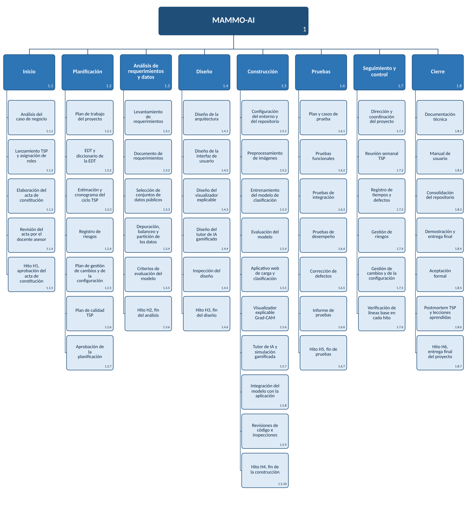

# Estructura de Desglose del Trabajo (EDT)

**Estructura de Desglose del Trabajo (EDT/WBS)**

**MAMMO-AI**

**Universidad Santiago de Cali**

**Facultad de Ingeniería, Programa de Ingeniería de Sistemas**

**Gestión de Proyectos de TI, semestre 2026B**

**11 de octubre de 2026**

## Introducción

La Estructura de Desglose del Trabajo, conocida como EDT o WBS por sus sigla en inglés, descompone de manera jerárquica el alcance total de MAMMO-AI en componentes más pequeños y manejables, de modo que el equipo tenga una visión estructurada de todo lo que debe entregar. MAMMO-AI es una aplicación web de apoyo al análisis de mamografías que las clasifica como normales o sospechosas mediante una red neuronal convolucional entrenada por aprendizaje por transferencia, explica su resultado con mapas de calor Grad-CAM e incluye un tutor de IA gamificado, y se desarrolla durante el semestre 2026B para el Propietario del Proyecto Project Tech TI, con el acompañamiento del docente asesor Jair Enrique Sanclemente Castro.

La EDT se organiza en tres niveles. El primer nivel corresponde al proyecto completo. El segundo recoge las fases de PM²: inicio, planificación, ejecución y cierre, con seguimiento y control como una rama transversal. La ejecución se desagrega en análisis de requerimientos y datos, diseño, construcción y pruebas, de acuerdo con las actividades de desarrollo de la solución. El tercer nivel contiene los paquetes de trabajo, dimensionados conforme a la regla de 8 a 80 horas para que cada uno pueda estimarse, asignarse y controlarse.

La estructura que aquí se presenta comprende todo el trabajo requerido para completar el proyecto. Cualquier labor que no figure en ella, como la validación clínica con pacientes reales o la integración con sistemas hospitalarios, se entiende excluida del alcance, salvo que se incorpore mediante el control de cambios previsto en el paquete 1.7.5. A partir de esta EDT, el equipo construirá el cronograma y la asignación de recursos.

## Vista de esquema

La vista de esquema presenta la EDT con sangría por niveles, lo que facilita su lectura y su modificación, pues la numeración automática actualiza el código de cada elemento.

1.  MAMMO-AI

    1.  Inicio

        1.  Análisis del caso de negocio

        2.  Lanzamiento TSP y asignación de roles

        3.  Elaboración del acta de constitución

        4.  Revisión del acta por el docente asesor

        5.  Aprobación del acta de constitución

    2.  Planificación

        1.  Plan de trabajo del proyecto

        2.  EDT y diccionario de la EDT

        3.  Estimación y cronograma del ciclo TSP

        4.  Registro de riesgos

        5.  Plan de gestión de cambios y de la configuración

        6.  Plan de calidad TSP

        7.  Aprobación de la planificación

    3.  Análisis de requerimientos y datos

        1.  Levantamiento de requerimientos

        2.  Documento de requerimientos

        3.  Selección de conjuntos de datos públicos

        4.  Depuración, balanceo y partición de los datos

        5.  Criterios de evaluación del modelo

        6.  Validación de requerimientos y datos

    4.  Diseño

        1.  Diseño de la arquitectura

        2.  Diseño de la interfaz de usuario

        3.  Diseño del visualizador explicable

        4.  Diseño del tutor de IA gamificado

        5.  Inspección del diseño

        6.  Aprobación del diseño

    5.  Construcción

        1.  Configuración del entorno y del repositorio

        2.  Preprocesamiento de imágenes

        3.  Entrenamiento del modelo de clasificación

        4.  Evaluación del modelo

        5.  Aplicativo web de carga y clasificación

        6.  Visualizador explicable Grad-CAM

        7.  Tutor de IA y simulación gamificada

        8.  Integración del modelo con la aplicación

        9.  Revisiones de código e inspecciones

        10. Integración del modelo en la aplicación

    6.  Pruebas

        1.  Plan y casos de prueba

        2.  Pruebas funcionales

        3.  Pruebas de integración

        4.  Pruebas de desempeño

        5.  Corrección de defectos

        6.  Informe de pruebas

        7.  Consolidación de resultados de pruebas

    7.  Seguimiento y control

        1.  Dirección y coordinación del proyecto

        2.  Reunión semanal TSP

        3.  Registro de tiempos y defectos

        4.  Gestión de riesgos

        5.  Gestión de cambios y de la configuración

        6.  Verificación de líneas base del proyecto

    8.  Cierre

        1.  Documentación técnica

        2.  Manual de usuario

        3.  Consolidación del repositorio

        4.  Demostración y entrega final

        5.  Aceptación formal

        6.  Postmortem TSP y lecciones aprendidas

        7.  Entrega final del proyecto

## Estructura jerárquica

La estructura jerárquica presenta los mismos elementos sin sangría, con el nivel y el código de cada uno, lo que resulta útil para trasladarlos al cronograma y a la herramienta de gestión del proyecto.

| Nivel | Código EDT | Nombre del elemento                              |
|-------|------------|--------------------------------------------------|
| 1     | 1          | MAMMO-AI                                         |
| 2     | 1.1        | Inicio                                           |
| 3     | 1.1.1      | Análisis del caso de negocio                     |
| 3     | 1.1.2      | Lanzamiento TSP y asignación de roles            |
| 3     | 1.1.3      | Elaboración del acta de constitución             |
| 3     | 1.1.4      | Revisión del acta por el docente asesor          |
| 3     | 1.1.5      | Aprobación del acta de constitución              |
| 2     | 1.2        | Planificación                                    |
| 3     | 1.2.1      | Plan de trabajo del proyecto                     |
| 3     | 1.2.2      | EDT y diccionario de la EDT                      |
| 3     | 1.2.3      | Estimación y cronograma del ciclo TSP            |
| 3     | 1.2.4      | Registro de riesgos                              |
| 3     | 1.2.5      | Plan de gestión de cambios y de la configuración |
| 3     | 1.2.6      | Plan de calidad TSP                              |
| 3     | 1.2.7      | Aprobación de la planificación                   |
| 2     | 1.3        | Análisis de requerimientos y datos               |
| 3     | 1.3.1      | Levantamiento de requerimientos                  |
| 3     | 1.3.2      | Documento de requerimientos                      |
| 3     | 1.3.3      | Selección de conjuntos de datos públicos         |
| 3     | 1.3.4      | Depuración, balanceo y partición de los datos    |
| 3     | 1.3.5      | Criterios de evaluación del modelo               |
| 3     | 1.3.6      | Validación de requerimientos y datos             |
| 2     | 1.4        | Diseño                                           |
| 3     | 1.4.1      | Diseño de la arquitectura                        |
| 3     | 1.4.2      | Diseño de la interfaz de usuario                 |
| 3     | 1.4.3      | Diseño del visualizador explicable               |
| 3     | 1.4.4      | Diseño del tutor de IA gamificado                |
| 3     | 1.4.5      | Inspección del diseño                            |
| 3     | 1.4.6      | Aprobación del diseño                            |
| 2     | 1.5        | Construcción                                     |
| 3     | 1.5.1      | Configuración del entorno y del repositorio      |
| 3     | 1.5.2      | Preprocesamiento de imágenes                     |
| 3     | 1.5.3      | Entrenamiento del modelo de clasificación        |
| 3     | 1.5.4      | Evaluación del modelo                            |
| 3     | 1.5.5      | Aplicativo web de carga y clasificación          |
| 3     | 1.5.6      | Visualizador explicable Grad-CAM                 |
| 3     | 1.5.7      | Tutor de IA y simulación gamificada              |
| 3     | 1.5.8      | Integración del modelo con la aplicación         |
| 3     | 1.5.9      | Revisiones de código e inspecciones              |
| 3     | 1.5.10     | Integración del modelo en la aplicación          |
| 2     | 1.6        | Pruebas                                          |
| 3     | 1.6.1      | Plan y casos de prueba                           |
| 3     | 1.6.2      | Pruebas funcionales                              |
| 3     | 1.6.3      | Pruebas de integración                           |
| 3     | 1.6.4      | Pruebas de desempeño                             |
| 3     | 1.6.5      | Corrección de defectos                           |
| 3     | 1.6.6      | Informe de pruebas                               |
| 3     | 1.6.7      | Consolidación de resultados de pruebas           |
| 2     | 1.7        | Seguimiento y control                            |
| 3     | 1.7.1      | Dirección y coordinación del proyecto            |
| 3     | 1.7.2      | Reunión semanal TSP                              |
| 3     | 1.7.3      | Registro de tiempos y defectos                   |
| 3     | 1.7.4      | Gestión de riesgos                               |
| 3     | 1.7.5      | Gestión de cambios y de la configuración         |
| 3     | 1.7.6      | Verificación de líneas base del proyecto         |
| 2     | 1.8        | Cierre                                           |
| 3     | 1.8.1      | Documentación técnica                            |
| 3     | 1.8.2      | Manual de usuario                                |
| 3     | 1.8.3      | Consolidación del repositorio                    |
| 3     | 1.8.4      | Demostración y entrega final                     |
| 3     | 1.8.5      | Aceptación formal                                |
| 3     | 1.8.6      | Postmortem TSP y lecciones aprendidas            |
| 3     | 1.8.7      | Entrega final del proyecto                       |

## Vista tabular

La vista tabular organiza la EDT en columnas por nivel, de manera que cada fase aparece junto a sus paquetes de trabajo.

<table>
<colgroup>
<col style="width: 20%" />
<col style="width: 21%" />
<col style="width: 58%" />
</colgroup>
<thead>
<tr class="header">
<th>Nivel 1</th>
<th>Nivel 2</th>
<th>Nivel 3</th>
</tr>
</thead>
<tbody>
<tr class="odd">
<td rowspan="8">1 MAMMO-AI</td>
<td>1.1 Inicio</td>
<td>
1.1.1 Análisis del caso de negocio

1.1.2 Lanzamiento TSP y asignación de roles

1.1.3 Elaboración del acta de constitución

1.1.4 Revisión del acta por el docente asesor

1.1.5 Aprobación del acta de constitución
</td>
</tr>
<tr class="even">
<td>1.2 Planificación</td>
<td>
1.2.1 Plan de trabajo del proyecto

1.2.2 EDT y diccionario de la EDT

1.2.3 Estimación y cronograma del ciclo TSP

1.2.4 Registro de riesgos

1.2.5 Plan de gestión de cambios y de la configuración

1.2.6 Plan de calidad TSP

1.2.7 Aprobación de la planificación
</td>
</tr>
<tr class="odd">
<td>1.3 Análisis de requerimientos y datos</td>
<td>
1.3.1 Levantamiento de requerimientos

1.3.2 Documento de requerimientos

1.3.3 Selección de conjuntos de datos públicos

1.3.4 Depuración, balanceo y partición de los datos

1.3.5 Criterios de evaluación del modelo

1.3.6 Validación de requerimientos y datos
</td>
</tr>
<tr class="even">
<td>1.4 Diseño</td>
<td>
1.4.1 Diseño de la arquitectura

1.4.2 Diseño de la interfaz de usuario

1.4.3 Diseño del visualizador explicable

1.4.4 Diseño del tutor de IA gamificado

1.4.5 Inspección del diseño

1.4.6 Aprobación del diseño
</td>
</tr>
<tr class="odd">
<td>1.5 Construcción</td>
<td>
1.5.1 Configuración del entorno y del repositorio

1.5.2 Preprocesamiento de imágenes

1.5.3 Entrenamiento del modelo de clasificación

1.5.4 Evaluación del modelo

1.5.5 Aplicativo web de carga y clasificación

1.5.6 Visualizador explicable Grad-CAM

1.5.7 Tutor de IA y simulación gamificada

1.5.8 Integración del modelo con la aplicación

1.5.9 Revisiones de código e inspecciones

1.5.10 Integración del modelo en la aplicación
</td>
</tr>
<tr class="even">
<td>1.6 Pruebas</td>
<td>
1.6.1 Plan y casos de prueba

1.6.2 Pruebas funcionales

1.6.3 Pruebas de integración

1.6.4 Pruebas de desempeño

1.6.5 Corrección de defectos

1.6.6 Informe de pruebas

1.6.7 Consolidación de resultados de pruebas
</td>
</tr>
<tr class="odd">
<td>1.7 Seguimiento y control</td>
<td>
1.7.1 Dirección y coordinación del proyecto

1.7.2 Reunión semanal TSP

1.7.3 Registro de tiempos y defectos

1.7.4 Gestión de riesgos

1.7.5 Gestión de cambios y de la configuración

1.7.6 Verificación de líneas base del proyecto
</td>
</tr>
<tr class="even">
<td>1.8 Cierre</td>
<td>
1.8.1 Documentación técnica

1.8.2 Manual de usuario

1.8.3 Consolidación del repositorio

1.8.4 Demostración y entrega final

1.8.5 Aceptación formal

1.8.6 Postmortem TSP y lecciones aprendidas

1.8.7 Entrega final del proyecto
</td>
</tr>
</tbody>
</table>

## Vista en árbol

La vista en árbol muestra gráficamente la descomposición del proyecto desde el producto final hasta los paquetes de trabajo de cada fase.

## Diccionario de la EDT

El diccionario de la EDT define cada elemento de la estructura y funciona como una declaración de alcance en miniatura de cada paquete de trabajo, de modo que el integrante a quien se asigne sepa con precisión qué debe hacer y qué debe entregar. El esfuerzo en horas de cada paquete se fijará con la estimación de TSP, y el responsable corresponde al rol del equipo indicado en la definición o, en su defecto, al que designe el Director de Proyecto.

| Nivel | Código EDT | Nombre del elemento                              | Definición                                                                                                                                                                                                                                                                                                                       |
|-------|------------|--------------------------------------------------|----------------------------------------------------------------------------------------------------------------------------------------------------------------------------------------------------------------------------------------------------------------------------------------------------------------------------------|
| 1     | 1          | MAMMO-AI                                         | Todo el trabajo necesario para construir y entregar, durante el semestre 2026B, la aplicación web que clasifica mamografías como normales o sospechosas mediante una red neuronal convolucional, con visualización explicable Grad-CAM y un tutor de IA gamificado, como herramienta de apoyo y nunca de diagnóstico definitivo. |
| 2     | 1.1        | Inicio                                           | Trabajo de la fase de inicio de PM², en el que se justifica el proyecto, se conforma el equipo y se aprueba el acta de constitución.                                                                                                                                                                                             |
| 3     | 1.1.1      | Análisis del caso de negocio                     | El Director de Proyecto y el Analista documentan la brecha en el diagnóstico oportuno del cáncer de mama, la escasez de radiólogos subespecialistas, el riesgo de dependencia ciega de la IA y el marco legal aplicable.                                                                                                         |
| 3     | 1.1.2      | Lanzamiento TSP y asignación de roles            | En la reunión de lanzamiento de TSP se integra el equipo, se fijan sus metas y se asignan los roles de Director de Proyecto, Analista, Constructor, Tester, Diseñador y Planeador, junto con los roles de gobernanza de PM².                                                                                                     |
| 3     | 1.1.3      | Elaboración del acta de constitución             | El equipo redacta el acta de constitución con el caso de negocio, el alcance, los entregables, los riesgos, los recursos y la gobernanza del proyecto.                                                                                                                                                                           |
| 3     | 1.1.4      | Revisión del acta por el docente asesor          | El docente asesor, como Responsable de Negocio, revisa la coherencia del alcance y de los entregables con los objetivos académicos.                                                                                                                                                                                              |
| 3     | 1.1.5      | Aprobación del acta de constitución              | El Propietario del Proyecto aprueba el acta de constitución, con lo cual el equipo queda autorizado para pasar a la planificación.                                                                                                                                                                                               |
| 2     | 1.2        | Planificación                                    | Trabajo de la fase de planificación de PM², en el que se definen el plan de trabajo, la EDT, la estimación y el cronograma, los riesgos, los cambios y el plan de calidad.                                                                                                                                                       |
| 3     | 1.2.1      | Plan de trabajo del proyecto                     | El Director de Proyecto y el Planeador elaboran el plan de trabajo con las adaptaciones de PM² previstas para un proyecto académico de un semestre.                                                                                                                                                                              |
| 3     | 1.2.2      | EDT y diccionario de la EDT                      | El equipo descompone el alcance total en paquetes de trabajo y redacta la definición de cada uno en este documento.                                                                                                                                                                                                              |
| 3     | 1.2.3      | Estimación y cronograma del ciclo TSP            | El Planeador estima el tamaño y las horas de cada componente conforme a TSP, organiza la ejecución en ciclos semanales y asigna los recursos humanos, de datos y de herramientas.                                                                                                                                                |
| 3     | 1.2.4      | Registro de riesgos                              | El Director de Proyecto amplía la evaluación inicial de los riesgos R1 a R6 en el registro de riesgos, con su probabilidad, impacto, dueño y respuesta.                                                                                                                                                                          |
| 3     | 1.2.5      | Plan de gestión de cambios y de la configuración | Se formalizan el procedimiento de solicitud, evaluación, decisión y registro de cambios y los elementos de configuración con su responsable de autorización.                                                                                                                                                                     |
| 3     | 1.2.6      | Plan de calidad TSP                              | El equipo fija las metas de calidad, las revisiones e inspecciones que se harán en cada fase y los indicadores de defectos que se medirán.                                                                                                                                                                                       |
| 3     | 1.2.7      | Aprobación de la planificación                   | El Comité de Dirección del Proyecto revisa y aprueba la planificación como línea base para la ejecución.                                                                                                                                                                                                                         |
| 2     | 1.3        | Análisis de requerimientos y datos               | Trabajo que corresponde a la fase de requisitos de TSP.                                                                                                                                                                                                                                                                          |
| 3     | 1.3.1      | Levantamiento de requerimientos                  | El Analista identifica los requerimientos funcionales y no funcionales a partir de las necesidades de los profesionales de la salud, la universidad y los pacientes.                                                                                                                                                             |
| 3     | 1.3.2      | Documento de requerimientos                      | Se documentan los requerimientos funcionales y no funcionales, incluidos los de tiempo de respuesta, seguridad y protección de datos conforme a la Ley 1581 de 2012.                                                                                                                                                             |
| 3     | 1.3.3      | Selección de conjuntos de datos públicos         | El Analista busca y selecciona conjuntos públicos y anonimizados de mamografías y verifica la licencia de uso de cada uno.                                                                                                                                                                                                       |
| 3     | 1.3.4      | Depuración, balanceo y partición de los datos    | Se depuran y combinan los conjuntos seleccionados para aumentar y balancear los datos, y se dividen en particiones de entrenamiento, validación y prueba.                                                                                                                                                                        |
| 3     | 1.3.5      | Criterios de evaluación del modelo               | Antes de entrenar se fijan los criterios de evaluación, con una meta de sensibilidad del 85 % y el reporte de especificidad y AUC.                                                                                                                                                                                               |
| 3     | 1.3.6      | Validación de requerimientos y datos             | Se revisan y validan los requerimientos y los datos seleccionados.                                                                                                                                                                                                                                                               |
| 2     | 1.4        | Diseño                                           | Trabajo que corresponde a la fase de diseño de TSP, a cargo principalmente del Diseñador.                                                                                                                                                                                                                                        |
| 3     | 1.4.1      | Diseño de la arquitectura                        | El Diseñador define la arquitectura de la aplicación web, la integración del modelo de clasificación y la organización del repositorio.                                                                                                                                                                                          |
| 3     | 1.4.2      | Diseño de la interfaz de usuario                 | Se diseñan los prototipos de pantallas para la carga de mamografías, la consulta de la clasificación preliminar y el nivel de confianza.                                                                                                                                                                                         |
| 3     | 1.4.3      | Diseño del visualizador explicable               | Se define cómo se presentarán los mapas de calor Grad-CAM sobre la imagen analizada para que el profesional verifique el resultado.                                                                                                                                                                                              |
| 3     | 1.4.4      | Diseño del tutor de IA gamificado                | Se definen la dinámica de simulación, los retos, la puntuación y la retroalimentación del tutor, incluidos los casos en que el modelo se equivoca.                                                                                                                                                                               |
| 3     | 1.4.5      | Inspección del diseño                            | El equipo inspecciona la arquitectura y la interfaz conforme a TSP, registra los defectos encontrados y aprueba el diseño como línea base.                                                                                                                                                                                       |
| 3     | 1.4.6      | Aprobación del diseño                            | Se revisan y aprueban la arquitectura y la interfaz.                                                                                                                                                                                                                                                                             |
| 2     | 1.5        | Construcción                                     | Trabajo que corresponde a la fase de implementación de TSP, en la que se construyen el modelo y la aplicación web.                                                                                                                                                                                                               |
| 3     | 1.5.1      | Configuración del entorno y del repositorio      | El Constructor configura Python, Google Colab y el repositorio en GitHub con ramas por funcionalidad y ramas protegidas.                                                                                                                                                                                                         |
| 3     | 1.5.2      | Preprocesamiento de imágenes                     | Se desarrollan las rutinas de normalización, redimensionamiento y aumento de datos de las mamografías.                                                                                                                                                                                                                           |
| 3     | 1.5.3      | Entrenamiento del modelo de clasificación        | El Constructor entrena la red neuronal convolucional por aprendizaje por transferencia, con regularización y validación cruzada para reducir el sobreajuste.                                                                                                                                                                     |
| 3     | 1.5.4      | Evaluación del modelo                            | Se mide el desempeño del modelo con la partición de prueba según los criterios definidos y se registran los pesos, hiperparámetros y métricas de cada versión.                                                                                                                                                                   |
| 3     | 1.5.5      | Aplicativo web de carga y clasificación          | Se construye la plataforma que permite cargar mamografías y consultar la clasificación preliminar con su nivel de confianza, con aviso visible de que es una herramienta de apoyo.                                                                                                                                               |
| 3     | 1.5.6      | Visualizador explicable Grad-CAM                 | Se implementa el módulo que muestra los mapas de calor de las regiones que influyeron en la clasificación.                                                                                                                                                                                                                       |
| 3     | 1.5.7      | Tutor de IA y simulación gamificada              | Se implementa el módulo que guía al usuario en la lectura de casos y entrena su criterio frente a las respuestas del modelo.                                                                                                                                                                                                     |
| 3     | 1.5.8      | Integración del modelo con la aplicación         | Se integran el modelo entrenado, el visualizador y el tutor en la aplicación web.                                                                                                                                                                                                                                                |
| 3     | 1.5.9      | Revisiones de código e inspecciones              | Cada integrante revisa su código, el equipo practica inspecciones entre pares antes de integrar los cambios a la rama principal y se registran los defectos conforme a TSP.                                                                                                                                                      |
| 3     | 1.5.10     | Integración del modelo en la aplicación          | Se integra el modelo entrenado en la aplicación.                                                                                                                                                                                                                                                                                 |
| 2     | 1.6        | Pruebas                                          | Trabajo que corresponde a la fase de integración y pruebas de sistema de TSP, a cargo del Tester.                                                                                                                                                                                                                                |
| 3     | 1.6.1      | Plan y casos de prueba                           | El Tester define el plan de pruebas y los casos de prueba a partir de los requerimientos y de los criterios de éxito.                                                                                                                                                                                                            |
| 3     | 1.6.2      | Pruebas funcionales                              | Se verifica que cada requerimiento funcional esté implementado y opere conforme a lo especificado.                                                                                                                                                                                                                               |
| 3     | 1.6.3      | Pruebas de integración                           | Se verifica el funcionamiento conjunto del modelo, la aplicación web, el visualizador y el tutor.                                                                                                                                                                                                                                |
| 3     | 1.6.4      | Pruebas de desempeño                             | Se comprueban la sensibilidad del modelo frente a la meta del 85 % y que el resultado y el mapa de calor se muestren en menos de 10 segundos por imagen.                                                                                                                                                                         |
| 3     | 1.6.5      | Corrección de defectos                           | El Constructor corrige los defectos encontrados y el Tester repite las pruebas afectadas.                                                                                                                                                                                                                                        |
| 3     | 1.6.6      | Informe de pruebas                               | El Tester consolida los resultados de las pruebas en el informe correspondiente.                                                                                                                                                                                                                                                 |
| 3     | 1.6.7      | Consolidación de resultados de pruebas           | Se consolidan los resultados en el informe de pruebas.                                                                                                                                                                                                                                                                           |
| 2     | 1.7        | Seguimiento y control                            | Trabajo de dirección y control que se ejecuta de forma transversal durante todo el proyecto.                                                                                                                                                                                                                                     |
| 3     | 1.7.1      | Dirección y coordinación del proyecto            | Dirección general del proyecto y coordinación del equipo a cargo del Director de Proyecto.                                                                                                                                                                                                                                       |
| 3     | 1.7.2      | Reunión semanal TSP                              | Reunión semanal con acta breve de avances, valor ganado, acuerdos y riesgos, que reemplaza los informes formales de estado de PM².                                                                                                                                                                                               |
| 3     | 1.7.3      | Registro de tiempos y defectos                   | Cada integrante registra sus tiempos y los defectos encontrados en los formatos de TSP, lo que permite medir el avance y la calidad del producto.                                                                                                                                                                                |
| 3     | 1.7.4      | Gestión de riesgos                               | Seguimiento del registro de riesgos y aplicación de las respuestas previstas.                                                                                                                                                                                                                                                    |
| 3     | 1.7.5      | Gestión de cambios y de la configuración         | Trámite de las solicitudes de cambio, actualización del registro de cambios y control de las versiones de los elementos de configuración.                                                                                                                                                                                        |
| 3     | 1.7.6      | Verificación de líneas base del proyecto         | En las revisiones de seguimiento se verifica que la versión entregada corresponda a la línea base aprobada.                                                                                                                                                                                                                      |
| 2     | 1.8        | Cierre                                           | Trabajo de la fase de cierre de PM², con la documentación, la entrega y la aceptación de los productos del proyecto.                                                                                                                                                                                                             |
| 3     | 1.8.1      | Documentación técnica                            | Se consolidan la arquitectura, los requerimientos y el informe de pruebas en la documentación técnica del proyecto.                                                                                                                                                                                                              |
| 3     | 1.8.2      | Manual de usuario                                | Se elabora la guía de uso de la aplicación, que orienta al usuario a emplearla con criterio propio y sin aceptar ni rechazar sus resultados a ciegas.                                                                                                                                                                            |
| 3     | 1.8.3      | Consolidación del repositorio                    | Se deja el repositorio con el código, el modelo, la documentación completa y los scripts y el registro de los conjuntos de datos, sin redistribuir datos de licencia restrictiva.                                                                                                                                                |
| 3     | 1.8.4      | Demostración y entrega final                     | El equipo presenta la aplicación en funcionamiento y entrega los productos al Propietario del Proyecto y al docente asesor.                                                                                                                                                                                                      |
| 3     | 1.8.5      | Aceptación formal                                | El Propietario del Proyecto acepta formalmente los entregables.                                                                                                                                                                                                                                                                  |
| 3     | 1.8.6      | Postmortem TSP y lecciones aprendidas            | El equipo compara lo planificado con lo ejecutado en tamaño, esfuerzo, cronograma y calidad, y documenta las lecciones aprendidas para que futuros equipos puedan continuar el proyecto.                                                                                                                                         |
| 3     | 1.8.7      | Entrega final del proyecto                       | Se entrega el proyecto al cierre del semestre 2026B.                                                                                                                                                                                                                                                                             |

## Glosario de términos

Los siguientes términos se incluyen para facilitar la lectura del documento por personas que no estén familiarizadas con la gestión de proyectos ni con las metodologías del proyecto.

Código EDT: Identificador único que se asigna a cada elemento de la EDT para señalar su ubicación jerárquica dentro de la estructura.

Elemento de la EDT: Componente de la estructura, ubicado en cualquier nivel, que puede contener trabajo, otros elementos o paquetes de trabajo.

Paquete de trabajo: Entregable o componente de trabajo del nivel más bajo de cada rama de la EDT, que se estima, asigna y controla como una unidad.

Diccionario de la EDT: Documento que define el alcance de cada elemento de la EDT y sirve de referencia para quien ejecuta cada paquete de trabajo.

Regla 8/80: Criterio según el cual un paquete de trabajo debe requerir entre ocho y ochenta horas de esfuerzo.

PM²: Metodología de gestión de proyectos que organiza el trabajo en las fases de inicio, planificación, ejecución y cierre, con seguimiento y control transversal.

TSP: Team Software Process, metodología de desarrollo de software en equipo que define roles, planificación detallada, registro de tiempos y defectos, revisiones e inspecciones y postmortem.

Valor ganado: Medida del avance del proyecto que compara el trabajo terminado con el planificado.

Postmortem: Fase final de TSP en la que el equipo compara lo planificado con lo ejecutado y documenta las mejoras para ciclos futuros.

Grad-CAM: Técnica que genera mapas de calor sobre la imagen para mostrar las regiones que más influyeron en la decisión de una red neuronal convolucional.

Aprendizaje por transferencia: Técnica que reutiliza una red neuronal entrenada previamente y la ajusta a una tarea nueva, como la clasificación de mamografías.
