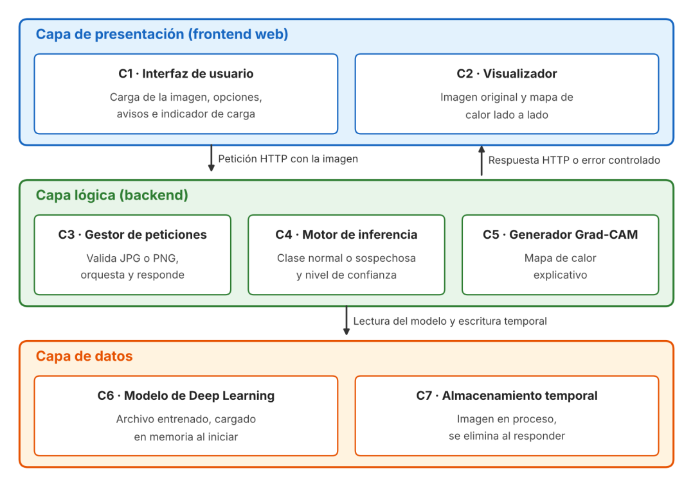
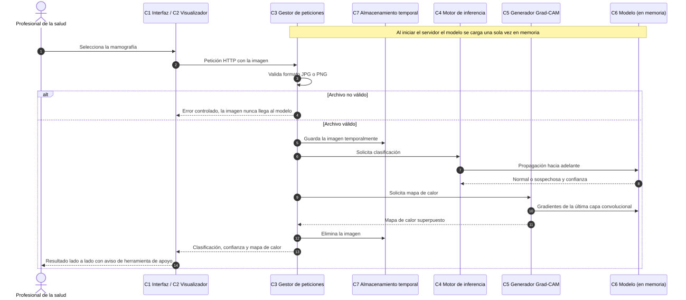
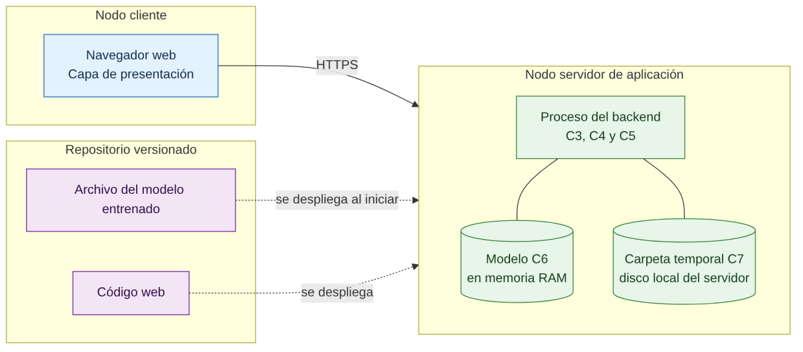

# Justificación de la arquitectura de software

Proyecto MAMMO-AI. Aplicación web de apoyo al diagnóstico en mamografía.

## 1. Información general y alcance

Este apartado documenta y justifica la arquitectura de software definida para MAMMO-AI, aplicación web de apoyo al diagnóstico que recibe una mamografía en formato JPG o PNG, la clasifica como normal o sospechosa mediante un modelo de aprendizaje profundo entrenado por transferencia de aprendizaje, informa el nivel de confianza de esa clasificación y presenta un mapa de calor Grad-CAM que señala las regiones de la imagen que más pesaron en la decisión. La herramienta no sustituye el criterio del profesional de la salud, y esa condición, que la arquitectura recoge en la capa de presentación mediante avisos visibles, delimita el alcance de todo lo que aquí se justifica.

Para documentar la arquitectura se siguió la orientación que comparten el Instituto de Ingeniería del Software (SEI), con su propuesta de vistas y más allá, y el estándar IEEE 1471-2000, cuyo marco conceptual fue tomado más adelante por la norma ISO/IEC/IEEE 42010. Ambos enfoques coinciden en que no debe documentarse un número fijo de vistas, sino aquellas que resulten útiles para las personas involucradas, y en que toda descripción arquitectónica debe ir acompañada de su justificación. Por esa razón, en lugar de diligenciar mecánicamente las cinco vistas del modelo 4+1 de Kruchten, primero se identificaron los interesados y sus intereses, luego se seleccionaron las vistas que los atienden y, finalmente, se justificó el estilo en capas frente a las alternativas que el equipo tuvo en cuenta.

| Elemento | Descripción |
|---|---|
| Sistema | MAMMO-AI, aplicación web de apoyo al diagnóstico en mamografía |
| Estilo arquitectónico | Arquitectura en capas (presentación, lógica y datos) |
| Metodología de desarrollo | Team Software Process (TSP) |
| Documento base | Arquitectura de software elaborada por el equipo, que define los siete componentes, sus relaciones, la administración de la calidad y la administración del proyecto |
| Estado | Versión 1.0 para revisión del equipo |

## 2. Personal involucrado y sus intereses

El estándar IEEE 1471 exige identificar a las personas involucradas y los intereses que la arquitectura debe satisfacer, pues una descripción que deje por fuera alguno de esos intereses se considera incompleta. En MAMMO-AI identificamos seis interesados, entre ellos uno indirecto, el paciente, cuya imagen circula por el sistema aunque nunca lo opere, y cuyo interés en la privacidad termina por condicionar una de las decisiones más importantes del diseño, que es la ausencia de almacenamiento persistente.

| Interesado | Intereses que la arquitectura debe atender |
|---|---|
| Profesional de la salud (usuario final) | Cargar la imagen sin dificultad, obtener la clasificación y la confianza en pocos segundos, entender por qué el modelo decidió así y saber con claridad que se trata de una herramienta de apoyo |
| Paciente (interesado indirecto) | Que su mamografía no quede almacenada ni expuesta una vez termine el análisis |
| Docente y evaluadores del proyecto | Trazabilidad entre requisitos y diseño, evidencia del cumplimiento de las metas de sensibilidad y tiempo de respuesta, y justificación de las decisiones |
| Equipo del modelo y de Grad-CAM | Poder entrenar, reentrenar o cambiar la red neuronal sin afectar la aplicación web, con una interfaz estable hacia el backend |
| Equipo de presentación | Contar con endpoints documentados y respuestas de formato fijo para construir la interfaz en paralelo con el modelo |
| Responsable de calidad | Puntos de prueba bien delimitados, posibilidad de medir tiempos por etapa y errores controlados ante entradas inválidas |

## 3. Selección de las vistas

Para escoger las vistas se aplicó el procedimiento de tres pasos que propone el SEI. En el primer paso se elaboró la lista de vistas candidatas y se estableció para cada interesado el grado de información que necesita de cada una, con los valores requerido a detalle (D), de manera general (G) o ninguno (N), tal como se observa en la siguiente matriz.

| Interesado | Módulos y capas | Componentes y conectores | Despliegue | Código | Escenarios |
|---|---|---|---|---|---|
| Profesional de la salud | N | N | N | N | G |
| Paciente | N | N | G | N | N |
| Docente y evaluadores | G | G | G | G | D |
| Equipo del modelo y Grad-CAM | D | D | G | D | G |
| Equipo de presentación | D | G | N | D | G |
| Responsable de calidad | G | D | D | G | D |

En el segundo paso se combinaron las vistas para que el conjunto fuera manejable en un proyecto de este tamaño. La vista de código se integró a la de módulos y capas, porque cada capa corresponde a una carpeta del repositorio y separarlas solo repetiría la misma información, mientras que la vista de procesos del modelo 4+1 quedó absorbida en la de componentes y conectores, que describe el sistema en tiempo de ejecución. En el tercer paso se priorizaron las cuatro vistas resultantes según el número de interesados que las requieren a detalle y su peso en las decisiones, de manera que primero se documenta la vista de módulos y capas, sobre la cual se reparte el trabajo del equipo, después la de componentes y conectores, donde se juegan el rendimiento y la privacidad, luego los escenarios, que sirven para validar y probar, y por último la de despliegue.

## 4. Justificación del estilo arquitectónico

Según Shaw y Garlan, un estilo arquitectónico describe unos elementos, unos conectores, una topología y un conjunto de restricciones sobre su interacción. En el estilo en capas los elementos se agrupan en niveles, cada nivel ofrece servicios al que está encima y consume únicamente los del que está debajo, de modo que un cambio interno en una capa no se propaga mientras se respete su interfaz. El equipo eligió este estilo por cuatro razones que se desprenden del problema y no de una preferencia general.

La primera es que MAMMO-AI tiene tres responsabilidades que por naturaleza están separadas, a saber, la interacción con el profesional de la salud, el procesamiento de la imagen con la inferencia y la explicación, y los recursos que ese procesamiento consume, que son el modelo entrenado y los archivos temporales. La segunda es que el componente más volátil del sistema es el modelo, pues la meta de sensibilidad del 60 % puede obligar a reentrenarlo o a cambiar la red completa, y al ubicarlo en la capa inferior, detrás del Motor de Inferencia, ese cambio queda contenido sin tocar la aplicación web. La tercera es que la separación por capas coincide con la organización del equipo bajo TSP, en el que cada integrante asume una capa y todos trabajan en paralelo desde el inicio, siempre que se acuerde temprano el contrato de comunicación entre el frontend y el backend. La cuarta es que el acceso a los datos queda concentrado en un solo punto, el Gestor de Peticiones, lo que facilita garantizar que ninguna imagen permanezca en el servidor.

Antes de adoptar esta decisión se evaluaron otras alternativas, cuyo análisis cualitativo se resume a continuación.

| Alternativa | Ventaja que ofrecía | Razón para descartarla |
|---|---|---|
| Aplicación monolítica sin separación de responsabilidades | Es la forma más rápida de obtener un primer prototipo funcional | Acopla el modelo con la interfaz, de modo que cada reentrenamiento obliga a modificar la aplicación web, e impide que el equipo trabaje en paralelo |
| Microservicios independientes para la web, la inferencia y Grad-CAM | Permite escalar y desplegar cada servicio por separado | Introduce una complejidad de orquestación, red y despliegue desproporcionada para un prototipo académico con un solo modelo y bajo volumen de uso, y agrega latencia entre servicios que compromete la meta de diez segundos |
| Tuberías y filtros como estilo principal | Refleja con fidelidad la secuencia de validar, clasificar y explicar | No resuelve por sí solo la separación entre la presentación y el procesamiento, aunque se aprovecha dentro de la capa lógica, como se explica enseguida |

Conviene mencionar que la arquitectura es en capas como estilo dominante, pero dentro de la capa lógica el procesamiento de cada petición sigue una secuencia fija de validación, inferencia y explicación que se comporta como una tubería, y documentarlo así evita presentar el diseño como algo más puro de lo que es. Del mismo modo, el desacoplamiento entre el Motor de Inferencia y el Generador Grad-CAM es un desacoplamiento de responsabilidades y no de dependencias, porque el método Grad-CAM necesita los gradientes de la última capa convolucional de la red y, por lo tanto, ambos componentes consumen la misma instancia del modelo cargada en memoria. Esa decisión se justifica porque evita cargar dos veces el modelo y conserva, al mismo tiempo, la posibilidad de probar el mapa de calor de forma independiente.

El estilo elegido también tiene costos que el equipo asume de forma consciente. Cada petición atraviesa varias capas, lo que añade una sobrecarga menor de procesamiento, y la disciplina de comunicar solo capas adyacentes exige que el frontend nunca acceda directamente al modelo ni a la carpeta temporal, regla que debe verificarse en las revisiones de código.

## 5. Vistas de la arquitectura

### 5.1 Vista de módulos y capas

Esta vista muestra la descomposición del sistema en sus tres capas y siete componentes, y atiende sobre todo a los equipos de desarrollo, que la necesitan a detalle para repartir y construir el trabajo. La presentación primaria es la figura 1, y el catálogo de elementos que la acompaña describe la responsabilidad de cada componente y la interfaz que ofrece o consume.

*Figura 1. Presentación primaria de la vista de módulos y capas de MAMMO-AI.*

| Componente | Capa | Responsabilidad | Interfaz |
|---|---|---|---|
| C1 Interfaz de usuario | Presentación | Permitir la carga de la imagen y la selección de opciones, mostrar los avisos de herramienta de apoyo y el indicador de carga | Consume el endpoint de análisis mediante HTTP |
| C2 Visualizador | Presentación | Mostrar lado a lado la imagen original y la procesada con el mapa de calor, junto con la clasificación y la confianza | Recibe la respuesta del backend |
| C3 Gestor de peticiones | Lógica | Recibir la imagen, validar que sea JPG o PNG, guardarla temporalmente, coordinar el análisis y devolver el resultado o un error controlado | Expone endpoints documentados e invoca a C4, C5 y C7 |
| C4 Motor de inferencia | Lógica | Pasar la imagen por la red neuronal y obtener la clase normal o sospechosa con su nivel de confianza | Recibe una imagen y devuelve clase y confianza, y usa C6 |
| C5 Generador Grad-CAM | Lógica | Generar el mapa de calor explicativo a partir de la imagen y de los gradientes del modelo | Recibe una imagen y devuelve el mapa superpuesto, y usa C6 |
| C6 Modelo de Deep Learning | Datos | Contener la red entrenada por transferencia de aprendizaje, que se carga en memoria al iniciar el servidor | Es consumido por C4 y C5 |
| C7 Almacenamiento temporal | Datos | Conservar la imagen únicamente mientras se procesa | Es usado solo por C3, que la crea y la elimina |

En cuanto a la organización del código, que esta vista absorbe, el repositorio versionado separa en carpetas distintas el código de la aplicación web y el archivo final del modelo entrenado, tal como lo dispuso el equipo en su control de cambios, de forma que la estructura física del proyecto reproduce la estructura lógica de las capas y cada integrante trabaja sobre su propia carpeta con un riesgo bajo de conflictos al integrar.

### 5.2 Vista de componentes y conectores

Esta vista describe el comportamiento del sistema en tiempo de ejecución y es la que más interesa al responsable de calidad y al equipo del modelo, porque allí se decide si se cumplen el tiempo de respuesta y la protección de la imagen. La figura 2 muestra el recorrido completo de una petición.

*Figura 2. Secuencia de ejecución de un análisis, con el flujo alterno de archivo no válido.*

La decisión de ejecución más relevante es que el modelo se carga una sola vez en memoria al iniciar el servidor y no en cada petición, pues leer el archivo de pesos y reconstruir la red puede tardar varios segundos y consumiría por sí solo buena parte del margen de diez segundos. A partir de allí, la interfaz envía la imagen al Gestor de Peticiones mediante una petición HTTP sincrónica, mientras el usuario observa el indicador de carga, y el gestor valida el formato antes de cualquier otra operación, de modo que un archivo que no sea JPG o PNG se rechaza con un mensaje claro sin llegar nunca al modelo ni consumir recursos de cómputo.

Superada la validación, el gestor guarda la imagen en la carpeta temporal, solicita la clasificación al Motor de Inferencia y el mapa de calor al Generador Grad-CAM, elimina la imagen y devuelve en una sola respuesta la clase, la confianza y el mapa superpuesto. Los conectores son, por lo tanto, de dos clases, el de solicitud y respuesta HTTP entre el navegador y el servidor, y las llamadas locales dentro del mismo proceso entre los componentes del backend, que no agregan latencia de red. Se recomienda que la eliminación del archivo temporal se ejecute siempre, incluso cuando la inferencia falle, para que la garantía de privacidad no dependa de que el análisis termine bien.

### 5.3 Vista de despliegue

La vista de despliegue relaciona los componentes con los nodos de hardware en los que se ejecutan y atiende los requisitos no funcionales de privacidad y rendimiento. Como se aprecia en la figura 3, el sistema se ejecuta en dos nodos, el navegador del usuario, que aloja la capa de presentación, y un servidor de aplicación, donde corren los tres componentes del backend con el modelo en memoria RAM y la carpeta temporal en el disco local.

*Figura 3. Vista de despliegue de MAMMO-AI.*

Aunque el documento base deja abierta la posibilidad de que el almacenamiento temporal esté en una carpeta local o en la nube, para esta versión se justifica preferir el disco local del servidor, porque la imagen no sale del nodo que la procesa y se reduce la superficie de exposición de un dato sensible. Se recomienda además que la comunicación entre el navegador y el servidor se haga por HTTPS, de manera que la mamografía viaje cifrada. El equipo maneja dos configuraciones físicas, una de desarrollo y pruebas en el equipo de cada integrante, y otra de demostración en un único servidor, que es donde el responsable de calidad debe medir los tiempos definitivos.

### 5.4 Escenarios

Siguiendo la propuesta de Kruchten, los escenarios relacionan las vistas anteriores entre sí y sirven para validar la arquitectura, además de convertirse en casos de prueba para el responsable de calidad.

En el primer escenario, que es el análisis exitoso, el profesional de la salud carga una mamografía en formato PNG, la interfaz muestra el indicador de carga, el backend valida, clasifica y genera el mapa de calor, y en menos de diez segundos el visualizador presenta la imagen original y la procesada lado a lado, con la clasificación, la confianza y el aviso de que el resultado es solo de apoyo. Este escenario recorre las tres capas y pone a prueba el rendimiento, la usabilidad y la explicabilidad.

En el segundo escenario el usuario intenta subir un archivo PDF, el Gestor de Peticiones lo rechaza en la validación de formato y la interfaz muestra un mensaje de error comprensible, sin que el archivo llegue al modelo ni quede guardado en el servidor, con lo cual se comprueba el manejo controlado de errores.

En el tercer escenario el modelo no alcanza la sensibilidad del 60 % y el equipo decide cambiar la red neuronal, de modo que entrena la nueva red, reemplaza el archivo en la carpeta del modelo y reinicia el servidor, sin modificar una sola línea del frontend. La condición para que esto funcione es que el Motor de Inferencia conserve su interfaz, es decir, que siga recibiendo una imagen y devolviendo clase y confianza, y que se actualice en el Generador Grad-CAM la referencia a la última capa convolucional de la nueva red, que cambia de nombre y de forma con cada arquitectura de red. Este escenario valida la mantenibilidad.

En el cuarto escenario, una vez entregado un resultado, el responsable de calidad revisa la carpeta temporal del servidor y verifica que no quede ninguna copia de la imagen analizada, con lo cual se comprueba en la práctica el atributo de privacidad.

## 6. Análisis de los atributos de calidad

Tanto el SEI como el IEEE recomiendan acompañar las vistas con algún análisis cualitativo o cuantitativo que permita predecir si la arquitectura satisface los atributos de calidad. La siguiente tabla relaciona cada atributo con la decisión arquitectónica que lo sostiene y con la forma de verificarlo.

| Atributo | Decisión arquitectónica que lo sostiene | Forma de verificarlo |
|---|---|---|
| Usabilidad | Separación de la presentación respecto de la lógica, que permite diseñar una interfaz clara con avisos visibles e indicador de carga | Prueba con usuarios sobre la comprensión del resultado y del carácter de apoyo de la herramienta |
| Rendimiento | Modelo cargado una sola vez en memoria, llamadas locales dentro del backend y un solo nodo de procesamiento | Medición del tiempo total y por etapa en la configuración de demostración, con meta de diez segundos |
| Seguridad y privacidad | Sin base de datos persistente para imágenes, almacenamiento temporal eliminado tras cada respuesta, acceso a los datos solo por C3 y transporte cifrado | Escenario cuatro y revisión de que los registros del sistema no guarden imágenes |
| Mantenibilidad | Modelo aislado en la capa de datos detrás de una interfaz estable del Motor de Inferencia | Escenario tres, con reemplazo del modelo sin cambios en el frontend |
| Explicabilidad | Generador Grad-CAM como componente propio, probado de forma independiente | Inspección visual de los mapas de calor sobre un conjunto de imágenes de prueba |

Para el rendimiento se propone además un modelo cuantitativo sencillo, según el cual el tiempo total de respuesta es la suma del tiempo de transferencia de la imagen, el de validación, el de inferencia, el de generación del mapa de calor y el de envío de la respuesta, y esa suma no debe superar diez segundos. Como la carga del modelo ocurre al iniciar el servidor, queda por fuera de esa suma, y si el Gestor de Peticiones registra la hora de inicio y fin de cada etapa, el responsable de calidad puede identificar con precisión cuál consume más tiempo en caso de que la meta no se cumpla.

El análisis también deja ver dos tensiones entre atributos que el equipo debe administrar. La primera se da entre el rendimiento y la explicabilidad, porque Grad-CAM exige una propagación adicional hacia atrás para calcular los gradientes y es, por lo general, la etapa más costosa después de la inferencia, de suerte que, si la meta de tiempo se ve comprometida, la primera optimización consiste en reutilizar la misma propagación hacia adelante para la clasificación y para el mapa de calor. La segunda se da entre la privacidad y la evidencia que exige la calidad, puesto que el responsable de calidad necesita documentar pruebas sin conservar mamografías reales, razón por la cual las pruebas deben hacerse con imágenes de conjuntos de datos públicos y los registros deben guardar solo tiempos, resultados y códigos de error, nunca la imagen.

## 7. Consistencia entre las vistas

El estándar IEEE 1471 pide registrar cómo se corresponden los elementos de las distintas vistas y las inconsistencias que se encuentren. La siguiente tabla muestra que cada componente aparece de forma coherente en todas las vistas en las que participa.

| Componente | Módulos y capas | Componentes y conectores | Despliegue | Escenarios |
|---|---|---|---|---|
| C1 Interfaz de usuario | Presentación | Origen de la petición HTTP | Navegador | 1 y 2 |
| C2 Visualizador | Presentación | Destino de la respuesta | Navegador | 1 |
| C3 Gestor de peticiones | Lógica | Orquestador de la secuencia | Servidor | 1, 2 y 4 |
| C4 Motor de inferencia | Lógica | Clasificación | Servidor | 1 y 3 |
| C5 Generador Grad-CAM | Lógica | Explicación | Servidor | 1 y 3 |
| C6 Modelo | Datos | Recurso en memoria | Servidor, RAM | 1 y 3 |
| C7 Almacenamiento temporal | Datos | Recurso de vida corta | Servidor, disco local | 1 y 4 |

Se encontró una inconsistencia terminológica en el documento base, que en la descripción de componentes denomina Backend a la capa intermedia y en la división de tareas la llama capa de Lógica. Ambas expresiones se refieren a la misma capa y, para evitar confusiones, en esta justificación se emplea la denominación capa lógica, o backend, de forma unificada.

## 8. Guía de variabilidad, supuestos y restricciones

La arquitectura admite varios puntos de variación sin perder su estructura. La red neuronal puede sustituirse por otra arquitectura preentrenada siempre que se conserve la interfaz del Motor de Inferencia y se actualice la capa objetivo de Grad-CAM, el almacenamiento temporal puede trasladarse a la nube si el despliegue lo exige, siempre con eliminación automática y en la misma región del servidor, la capa de presentación puede reconstruirse con otra tecnología web sin afectar el backend, y la capa lógica puede recibir nuevos componentes, como un módulo de tutoría, siempre que se comuniquen con la presentación a través del Gestor de Peticiones.

El diseño descansa, a su vez, en varios supuestos que conviene dejar explícitos, a saber, que el sistema atiende un volumen bajo de peticiones propio de un prototipo académico y por ello basta un solo servidor, que las imágenes de entrada llegan en formato JPG o PNG y no en el formato médico DICOM, que la clasificación es binaria entre normal y sospechosa, y que el servidor de demostración tiene memoria suficiente para mantener el modelo cargado de forma permanente. Si alguno de estos supuestos cambiara, por ejemplo si se exigiera procesar DICOM o atender muchos usuarios a la vez, la arquitectura debería revisarse, en particular la validación de C3 y la vista de despliegue.

## 9. Impacto en la administración del proyecto

La arquitectura en capas no solo organiza el software, sino también el trabajo del equipo bajo TSP. Juan José y Álvaro se encargan de la capa lógica en lo relativo al modelo de Deep Learning, su entrenamiento y el Generador Grad-CAM, Kelvin se encarga de la capa de presentación, con la interfaz web, la carga de imágenes y la visualización del mapa de calor, y Juan Camilo asume la calidad, con las pruebas de comunicación entre frontend y backend, la medición de tiempos y la documentación de la evidencia. Esta división funciona porque las capas tienen fronteras claras, pero exige que el contrato del endpoint de análisis, esto es, qué se envía, qué se recibe y cómo se reportan los errores, se acuerde y documente al inicio, ya que es el único artefacto que comparten todos los integrantes.

En la gestión de riesgos, el principal es no alcanzar la sensibilidad esperada del 60 %, y la arquitectura lo mitiga al permitir cambiar la red neuronal sin afectar el desarrollo de la página web, como se demostró en el tercer escenario. En el control de cambios, la separación entre la carpeta del código web y la del modelo entrenado permite versionar cada parte por su lado, y si el archivo del modelo excede los límites de tamaño del repositorio, debe versionarse con un mecanismo para archivos grandes, de modo que cada versión del modelo quede asociada a las métricas con que fue aprobada.

## 10. Matriz de trazabilidad

Para cerrar la justificación, la siguiente matriz relaciona los requisitos del sistema con los componentes que los satisfacen y con la forma de comprobarlos, lo que permite verificar que ningún requisito quedó sin respaldo en la arquitectura y que ningún componente existe sin un requisito que lo explique.

| Requisito | Componentes | Verificación |
|---|---|---|
| Cargar una imagen en formato JPG o PNG | C1 y C3 | Pruebas con un JPG, un PNG y un archivo no válido |
| Clasificar la imagen como normal o sospechosa con nivel de confianza | C4 y C6 | Evaluación sobre un conjunto de prueba independiente |
| Generar el mapa de calor explicativo | C5 y C6 | Inspección visual de los mapas sobre imágenes de prueba |
| Mostrar la imagen original y la procesada lado a lado | C2 | Prueba de interfaz en distintos tamaños de pantalla |
| Responder en no más de diez segundos | C3, C4, C5 y C6 | Medición del tiempo total y por etapa en el servidor de demostración |
| No conservar las imágenes de los pacientes | C3 y C7 | Revisión de la carpeta temporal y de los registros tras cada análisis |
| Alcanzar una sensibilidad mínima del 60 % | C6 | Cálculo de la sensibilidad sobre el conjunto de prueba |
| Advertir que es una herramienta de apoyo | C1 y C2 | Revisión de que el aviso aparezca junto a cada resultado |
| Manejar los errores de forma controlada | C3 | Escenario dos y pruebas con entradas inválidas |

## 11. Conclusión

La arquitectura en capas de MAMMO-AI se justifica porque responde a las particularidades del problema y no a una plantilla genérica, en cuanto separa la interacción con el usuario del procesamiento con inteligencia artificial, aísla el modelo, que es el componente con mayor probabilidad de cambio, concentra en un único punto el manejo de una información tan sensible como una mamografía y permite que un equipo de cuatro personas trabaje en paralelo bajo TSP. Las alternativas de monolito y microservicios fueron descartadas por razones concretas de acoplamiento y de complejidad, los costos del estilo elegido quedaron identificados y las tensiones entre rendimiento, explicabilidad y privacidad cuentan con una estrategia para administrarlas, de manera que la documentación aquí presentada permite, además, evaluar en cualquier momento si la arquitectura sigue satisfaciendo los intereses de todas las personas involucradas.

## Referencias

Clements, P., Bachmann, F., Bass, L., Garlan, D., Ivers, J., Little, R., Nord, R., & Stafford, J. (2002). Documenting software architectures. Views and beyond. Addison-Wesley.

Gómez, O. (s. f.). Documentando la arquitectura de software. Principios básicos. www.osgg.net

IEEE Architecture Working Group. (2000). IEEE Std 1471-2000. Recommended practice for architectural description of software-intensive systems. IEEE.

Kruchten, P. (1995). The 4+1 view model of architecture. IEEE Software, 12(6), 42-50.

Selvaraju, R. R., Cogswell, M., Das, A., Vedantam, R., Parikh, D., & Batra, D. (2017). Grad-CAM. Visual explanations from deep networks via gradient-based localization. En Proceedings of the IEEE International Conference on Computer Vision (pp. 618-626).

Shaw, M., & Garlan, D. (1996). Software architecture. Perspectives on an emerging discipline. Prentice Hall.
