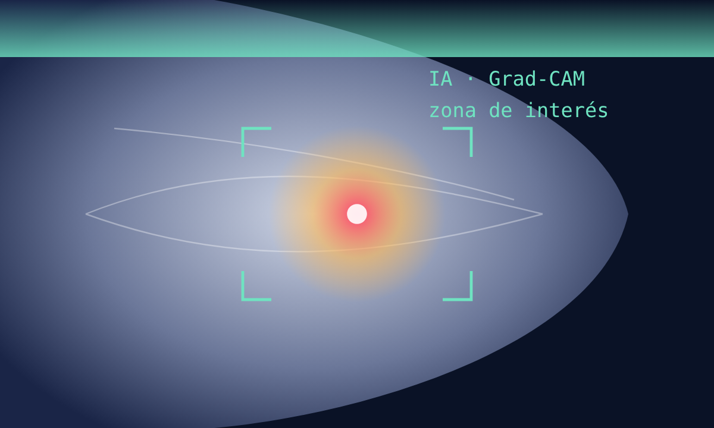
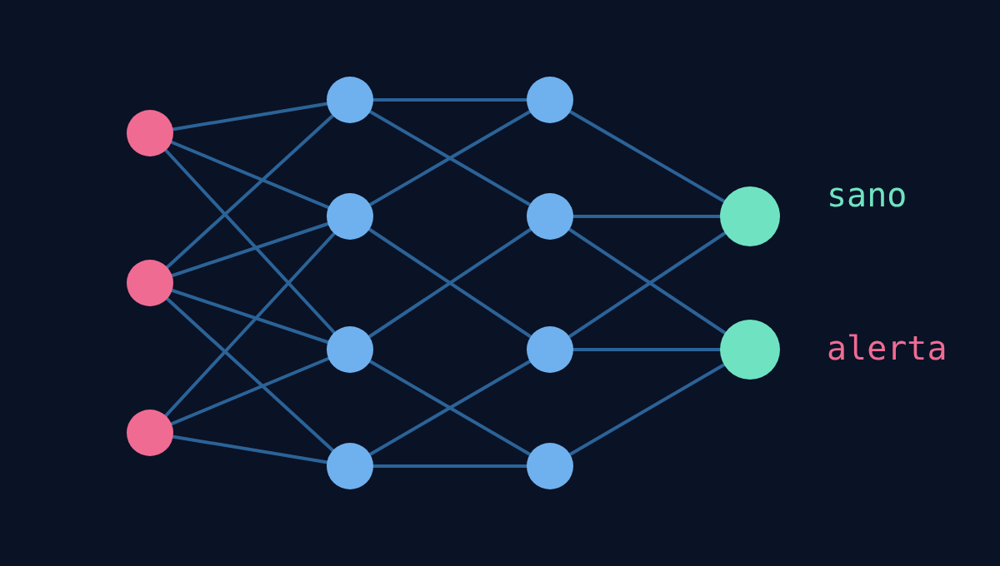
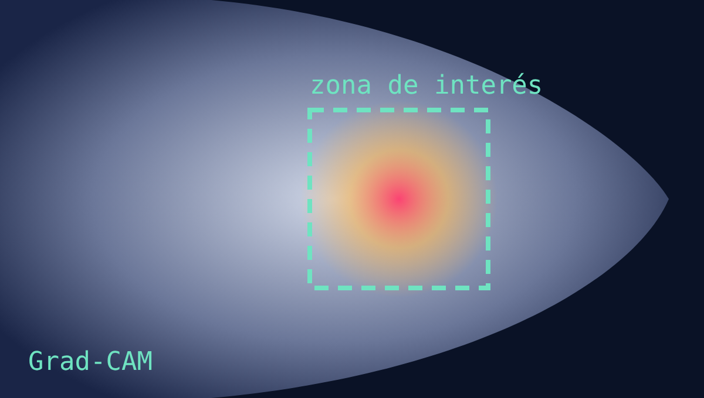
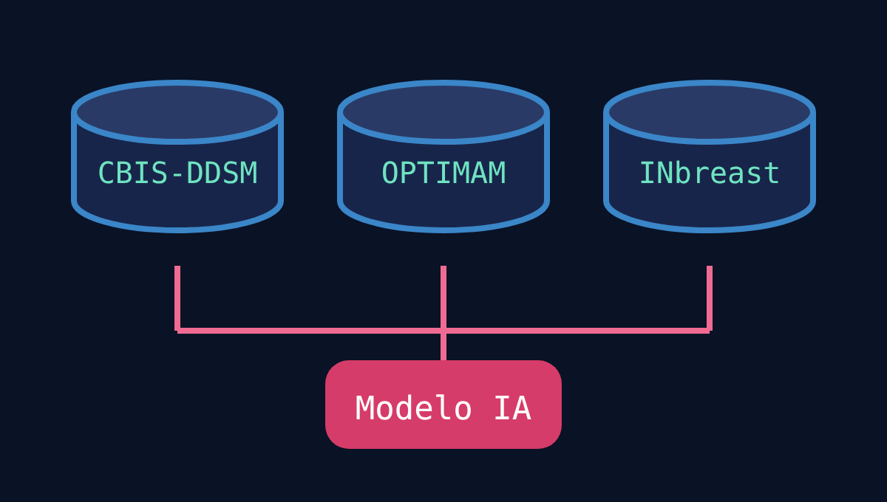

# Metodología del proyecto

Cómo vamos a organizarnos con TSP y PMBOK. Esta página resume la presentación interactiva del equipo, que está en [`originales/Metodologia_del_proyecto_MAMMO-AI.html`](originales/Metodologia_del_proyecto_MAMMO-AI.html).

## ¿Qué es MAMMO-AI?

Es un proyecto que apenas estamos empezando: una aplicación web para apoyar el análisis preliminar de mamografías con inteligencia artificial.

- **App web:** será una aplicación web para apoyar el análisis preliminar de mamografías. Tendrá un módulo de análisis de imagen y un módulo de simulación clínica con juegos y un tutor de IA.
- **Deep learning:** vamos a usar redes neuronales (CNN) con transfer learning y ajuste fino. Se entrenarán con bases de datos públicas como CBIS-DDSM, OPTIMAM, INbreast y MIAS.
- **Explicable:** la IA no solo dará un resultado; también mostrará en qué zona de la imagen se fijó. Para eso usaremos Grad-CAM (mapas de calor), SHAP y LIME.

## El proyecto en imágenes

| | |
|---|---|
|  | **La mamografía.** Es la imagen de la mama que analiza el sistema. MAMMO-AI busca apoyar el análisis preliminar de estas imágenes con inteligencia artificial. |
|  | **Red neuronal (CNN).** Es el modelo de deep learning que aprende a reconocer patrones en las imágenes. Usaremos transfer learning y ajuste fino sobre datos públicos. |
|  | **Mapa de calor.** Muestra en qué zona de la imagen se fijó la IA (Grad-CAM). |
|  | **La aplicación web.** Donde se sube la imagen y se ve el resultado. |
|  | **Simulación con tutor IA.** Es un módulo de simulación clínica en forma de juego. Un agente tutor de IA acompaña a la persona mientras practica. |
|  | **Datos públicos.** Para entrenar el modelo usaremos bases de datos públicas de mamografías: CBIS-DDSM, OPTIMAM, INbreast y MIAS. |

## Dos marcos de trabajo combinados

Se complementan: uno nos guía en el desarrollo y el otro en la gestión.

- **TSP (Team Software Process), cómo desarrollamos:** es la metodología principal de desarrollo, creada por el Software Engineering Institute (SEI). Se trabaja por ciclos: cada uno inicia con un lanzamiento donde se definen objetivos, se estima el esfuerzo y se asignan roles. Los roles de líder, planificador y gestor de calidad rotan.
- **PMBOK (guía de gestión de proyectos), cómo gestionamos:** es la guía que usamos para gestionar el proyecto. Aporta los procesos de alcance, tiempo, riesgos y calidad, mientras TSP organiza la ejecución en ciclos.

## TSP: trabajo por ciclos

Cada ciclo tiene cuatro fases y termina con un postmortem:

**Lanzamiento → Análisis → Diseño → Construcción → Pruebas → Postmortem ↺**

1. **Análisis:** definir los requerimientos funcionales y no funcionales del módulo de mamografía. También se depuran los conjuntos de datos públicos.
2. **Diseño:** se diseña la arquitectura de la aplicación web y la base de datos, y se planea cómo conectar el modelo de IA con la interfaz.
3. **Construcción:** se programa de forma incremental. Se entrenan y ajustan los modelos de deep learning y los visualizadores explicables. El código se revisa entre compañeros.
4. **Pruebas:** pruebas funcionales y de integración. Se evalúa el desempeño del modelo y cómo se comporta frente a los criterios clínicos. Al final del ciclo se hace el postmortem: lecciones aprendidas y mejoras.

## PMBOK: gestión del proyecto

Lo usamos como apoyo para tener todo bajo control.

- **Alcance:** definir con claridad cuáles son los módulos del proyecto, para saber qué sí y qué no vamos a hacer.
- **Tiempo:** un cronograma con hitos de entrega por semestre, que nos ayuda a saber si vamos a tiempo.
- **Riesgos:** técnicos (calidad de los datos y sobreajuste del modelo), organizacionales (rotación de estudiantes) y éticos (privacidad del paciente).
- **Calidad:** pruebas unitarias, integración continua y revisión de código, para cuidar que el proyecto salga bien hecho.

> **TSP organiza cómo construimos. PMBOK, cómo lo gestionamos.**
