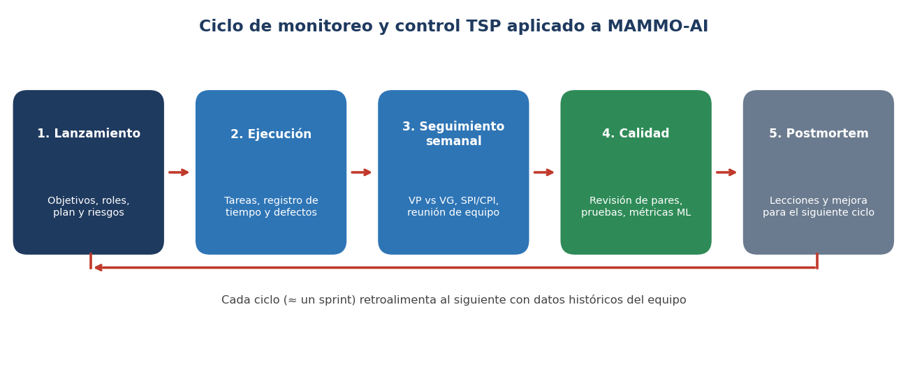
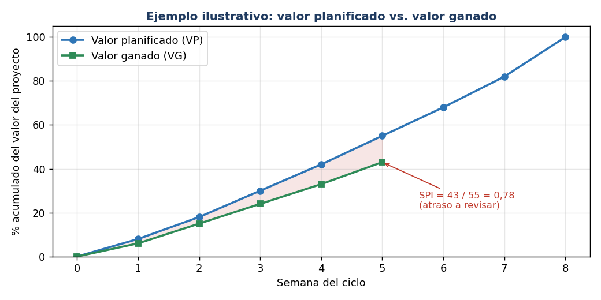

# Monitoreo y control con TSP

Formatos, plantillas, métricas y herramientas para el monitoreo y control de la metodología TSP.

Proyecto MAMMO-AI · ONCO-AI_USC

Gestión de Proyectos de TI · Grupo 1

**Integrantes:** Kelvin Andres Palma, Daniel Esteban Olarte Vasquez, Alvaro Jose Jaramillo Gonzalez, Juan Camilo Ospina Daza y Juan José Herrera Rengifo.

## 1. Contexto y alcance

En nuestro informe definimos que el módulo de mamografía de ONCO-AI_USC se va a desarrollar con la metodología Team Software Process (TSP) y la guía PMBOK. Del TSP nos sirven sobre todo los roles rotativos, planear con datos del propio equipo, la revisión entre compañeros, las pruebas y el postmortem al final de cada ciclo. En este documento reunimos lo que necesitamos para hacerle seguimiento y control al proyecto: la herramienta, los formatos, las plantillas y las métricas.

En el informe también organizamos el trabajo por sprints de Scrum. Para no mezclar las dos cosas, decidimos que cada sprint sea un ciclo TSP: al comienzo hacemos el lanzamiento, cada semana revisamos el avance y al cerrar hacemos el postmortem.

*Figura 1. Ciclo de monitoreo y control TSP que vamos a seguir.*

## 2. Herramienta principal: Process Dashboard

Process Dashboard es una herramienta gratuita y de código abierto hecha para trabajar con PSP y TSP. Según su sitio oficial, la empezó la Fuerza Aérea de Estados Unidos en 1998 y se usa bajo licencia GNU GPL. Con ella podemos:

- **Recolectar datos:** tiempos, defectos, tamaño y lo planeado contra lo real.

- **Planear:** trae scripts, plantillas y formularios, además de PROBE y valor ganado.

- **Hacer seguimiento:** apoya el cálculo del valor ganado.

- **Analizar:** genera gráficos y reportes con la tendencia de los datos.

- **Exportar:** los datos se pueden pasar a Excel o a texto.

| **Recurso**      | **Descripción**                                                       | **Enlace**                                                                     |
|------------------|-----------------------------------------------------------------------|--------------------------------------------------------------------------------|
| Sitio oficial    | Página principal del proyecto Process Dashboard.                      | [processdash.com](https://www.processdash.com/)                                |
| Antecedentes TSP | Explica qué es el PSP, qué es el TSP y por qué crear una herramienta. | [processdash.com/background/#tsp](https://www.processdash.com/background/#tsp) |
| Funcionalidad    | Funciones, capturas de pantalla, tour rápido y manual de usuario.     | [processdash.com/functionality/](https://www.processdash.com/functionality/)   |
| Descarga         | Está en la opción «Download» del menú del sitio.                      | [processdash.com](https://www.processdash.com/)                                |

### Herramientas complementarias

En el planteamiento del problema dijimos que muchos proyectos académicos no tienen control de versiones, trazabilidad de los datos ni pruebas. Por eso sumamos estas herramientas:

| **Herramienta**          | **Uso en el proyecto**                                                            | **Enlace**                             |
|--------------------------|-----------------------------------------------------------------------------------|----------------------------------------|
| GitHub / GitHub Projects | Repositorio compartido, revisión de código con pull requests y tablero de tareas. | [github.com](https://github.com)       |
| DVC                      | Versionar datasets y modelos para saber con qué datos se entrenó cada uno.        | [dvc.org](https://dvc.org)             |
| MLflow                   | Guardar los experimentos, parámetros y métricas de los modelos.                   | [mlflow.org](https://mlflow.org)       |
| SEI – Carnegie Mellon    | Institución que mantiene el TSP; tiene la documentación oficial.                  | [sei.cmu.edu](https://www.sei.cmu.edu) |

## 3. Roles TSP y responsabilidades de control

En el informe dijimos que los roles van a rotar. Esta es la asignación que proponemos para el primer ciclo; la podemos cambiar entre todos.

| **Rol**                          | **Responsabilidad de monitoreo y control**                                         | **Integrante (propuesto)**     |
|----------------------------------|------------------------------------------------------------------------------------|--------------------------------|
| Líder de equipo                  | Dirige las reuniones semanales, aprueba el plan del ciclo y resuelve impedimentos. | Kelvin Andres Palma            |
| Planificador                     | Mantiene el plan de tareas, calcula VP, VG, SPI y CPI y reporta desviaciones.      | Daniel Esteban Olarte Vasquez  |
| Gestor de calidad                | Controla el registro de defectos, las revisiones de pares y las pruebas.           | Alvaro Jose Jaramillo Gonzalez |
| Gestor de desarrollo / modelo    | Supervisa el avance técnico del modelo de IA, Grad-CAM y la integración web.       | Juan Camilo Ospina Daza        |
| Gestor de soporte y cumplimiento | Administra repositorio, datos, riesgos y cumplimiento legal (Ley 1581, Ley 527).   | Juan José Herrera Rengifo      |

## 4. Formatos y plantillas

Hicimos las plantillas con base en los formularios del TSP (LAUNCH, TASK, SCHEDULE, LOGT, LOGD, WEEK, ITL y POSTMORTEM) y las adaptamos a MAMMO-AI. Las filas llenas son ejemplos; después las cambiamos por los datos reales.

### 4.1 Lanzamiento del ciclo (LAUNCH)

| **Campo**           | **Contenido**                                                                                                                                                     |
|---------------------|-------------------------------------------------------------------------------------------------------------------------------------------------------------------|
| Ciclo / sprint      | Ciclo 1 (completar fechas de inicio y fin).                                                                                                                       |
| Objetivos del ciclo | 1\) Entrenar y validar el modelo de clasificación de mamografías. 2) Integrar el visor con Grad-CAM en Clínica AI Web. 3) Configurar el tutor IA en ONCO-SIM Web. |
| Metas medibles      | Sensibilidad ≥ 0,90 · AUC ≥ 0,90 · SPI ≥ 0,90 · 100 % de experimentos registrados.                                                                                |
| Entregables         | Modelo entrenado, visor web, escenario ONCO-SIM, documentación y postmortem.                                                                                      |
| Supuestos           | Uso de datos públicos desidentificados (CBIS-DDSM u otros); infraestructura de costo cercano a cero.                                                              |
| Roles del ciclo     | Ver sección 3.                                                                                                                                                    |
| Riesgos principales | Ver registro de riesgos (4.6).                                                                                                                                    |

### 4.2 Plan de tareas y cronograma (TASK / SCHEDULE)

El VP % es el porcentaje del valor total del proyecto que aporta cada tarea (horas de la tarea ÷ horas totales planeadas). Una tarea solo suma valor cuando está terminada al 100 %.

| **ID** | **Tarea**                                    | **Resp.** | **Horas plan** | **VP %** | **Sem. plan** | **Horas reales** | **Fecha real** | **VG %** |
|--------|----------------------------------------------|-----------|----------------|----------|---------------|------------------|----------------|----------|
| T01    | Definir alcance y requisitos del módulo      | Líder     | 6              | 6        | 1             |                  |                |          |
| T02    | Verificar datasets públicos desidentificados | Soporte   | 8              | 8        | 2             |                  |                |          |
| T03    | Preprocesar y dividir datos (train/val/test) | Modelo    | 10             | 10       | 3             |                  |                |          |
| T04    | Entrenar CNN (transfer learning)             | Modelo    | 20             | 20       | 4             |                  |                |          |
| T05    | Evaluar modelo (AUC, sensibilidad)           | Calidad   | 8              | 8        | 5             |                  |                |          |
| T06    | Implementar mapas de calor Grad-CAM          | Modelo    | 10             | 10       | 5             |                  |                |          |
| T07    | Integrar visor en Clínica AI Web             | Modelo    | 14             | 14       | 6             |                  |                |          |
| T08    | Configurar tutor IA en ONCO-SIM Web          | Líder     | 12             | 12       | 7             |                  |                |          |
| T09    | Pruebas unitarias e integración              | Calidad   | 8              | 8        | 8             |                  |                |          |
| T10    | Documentación y postmortem                   | Planif.   | 4              | 4        | 8             |                  |                |          |
|        | TOTAL                                        |           | 100            | 100      |               |                  |                |          |

### 4.3 Registro de tiempo (LOGT)

| **Fecha**      | **Inicio** | **Fin** | **Interrupción (min)** | **Tiempo neto (min)** | **Fase**      | **Tarea** | **Comentarios**              |
|----------------|------------|---------|------------------------|-----------------------|---------------|-----------|------------------------------|
| \_\_/\_\_/2026 | 14:00      | 16:00   | 10                     | 110                   | Entrenamiento | T04       | Ajuste fino de capas finales |
|                |            |         |                        |                       |               |           |                              |
|                |            |         |                        |                       |               |           |                              |

### 4.4 Registro de defectos (LOGD)

Tipos de defecto que vamos a usar: datos, preprocesamiento, modelo, interfaz, integración, documentación y seguridad/privacidad. Fases: requisitos, diseño, codificación, revisión, pruebas, producción.

| **ID** | **Fecha**      | **Tipo** | **Fase de inyección** | **Fase de remoción** | **Tiempo de corrección (min)** | **Descripción**                                     |
|--------|----------------|----------|-----------------------|----------------------|--------------------------------|-----------------------------------------------------|
| D01    | \_\_/\_\_/2026 | Datos    | Preprocesamiento      | Revisión             | 30                             | Imágenes duplicadas en el conjunto de entrenamiento |
| D02    |                |          |                       |                      |                                |                                                     |
| D03    |                |          |                       |                      |                                |                                                     |

### 4.5 Resumen semanal de estado (WEEK)

| **Indicador**                                       | **Semana actual** | **Acumulado** | **Meta**            |
|-----------------------------------------------------|-------------------|---------------|---------------------|
| Horas planificadas                                  |                   |               | 10 h por integrante |
| Horas reales                                        |                   |               |                     |
| Valor planificado (VP %)                            |                   |               |                     |
| Valor ganado (VG %)                                 |                   |               |                     |
| SPI = VG ÷ VP                                       |                   |               | ≥ 0,90              |
| CPI = horas plan ÷ horas reales (tareas terminadas) |                   |               | 0,90 a 1,10         |
| Tareas completadas / pendientes                     |                   |               |                     |
| Defectos registrados / removidos                    |                   |               |                     |
| Problemas y riesgos nuevos                          |                   |               |                     |
| Acciones acordadas y responsables                   |                   |               |                     |

### 4.6 Registro de riesgos e incidencias (ITL)

Llenamos esta tabla con los riesgos que mencionamos en el informe: técnicos (calidad de los datos y sobreajuste), organizacionales (rotación de estudiantes) y éticos (privacidad del paciente).

| **ID** | **Riesgo**                                   | **Tipo**       | **Prob.** | **Impacto** | **Mitigación**                                                              | **Resp.** | **Estado** |
|--------|----------------------------------------------|----------------|-----------|-------------|-----------------------------------------------------------------------------|-----------|------------|
| R01    | Baja calidad o desbalance de los datos       | Técnico        | Media     | Alto        | Validar y balancear datos; registrar versión con DVC                        | Modelo    | Abierto    |
| R02    | Sobreajuste del modelo                       | Técnico        | Media     | Alto        | Transferencia de aprendizaje, validación cruzada, datos de prueba separados | Modelo    | Abierto    |
| R03    | Rotación o salida de integrantes             | Organizacional | Media     | Medio       | Documentar, rotar roles y revisar código en pares                           | Líder     | Abierto    |
| R04    | Uso indebido de datos sensibles del paciente | Ético / legal  | Baja      | Alto        | Solo datos públicos desidentificados; cumplir Ley 1581 de 2012              | Soporte   | Abierto    |
| R05    | Sesgo de automatización en el usuario        | Ético          | Media     | Alto        | Justificación obligatoria y escenarios ONCO-SIM                             | Líder     | Abierto    |

### 4.7 Lista de verificación de revisión de pares

| **N.º** | **Elemento a verificar**                                                                        | **Cumple (Sí/No)** | **Observaciones** |
|---------|-------------------------------------------------------------------------------------------------|--------------------|-------------------|
| 1       | El código sigue el estándar del equipo y está en una rama con pull request.                     |                    |                   |
| 2       | Hay pruebas unitarias para las funciones nuevas.                                                |                    |                   |
| 3       | El experimento queda registrado (semilla, versión de datos, parámetros y métricas).             |                    |                   |
| 4       | Los datos usados están desidentificados y con su fuente documentada.                            |                    |                   |
| 5       | Grad-CAM se verifica sobre ejemplos acertados y fallidos.                                       |                    |                   |
| 6       | La interfaz exige justificación del usuario antes de aceptar o rechazar la sugerencia de la IA. |                    |                   |
| 7       | Los defectos encontrados se registraron en el LOGD.                                             |                    |                   |

### 4.8 Acta de reunión semanal

| **Campo**              | **Contenido**                                       |
|------------------------|-----------------------------------------------------|
| Fecha / asistentes     |                                                     |
| Revisión del WEEK      | VP, VG, SPI y CPI de la semana.                     |
| Avance por rol         | Líder, planificador, calidad, desarrollo y soporte. |
| Riesgos e impedimentos |                                                     |
| Decisiones y acciones  | Qué, quién y para cuándo.                           |
| Próxima reunión        |                                                     |

### 4.9 Postmortem del ciclo (POSTMORTEM)

| **Pregunta**                                                                         | **Respuesta del equipo** |
|--------------------------------------------------------------------------------------|--------------------------|
| ¿Se cumplieron las metas del ciclo? (plan vs. real de horas, VG final y entregables) |                          |
| ¿Cuáles fueron las principales desviaciones y sus causas?                            |                          |
| Resumen de defectos: cantidad, tipos y fase donde se encontraron                     |                          |
| ¿Qué funcionó bien y debe mantenerse?                                                |                          |
| ¿Qué debe mejorar en el siguiente ciclo?                                             |                          |
| Lecciones aprendidas para el siguiente semestre                                      |                          |

## 5. Métricas de monitoreo y control

Las metas son una propuesta inicial. Después del primer ciclo las ajustamos con los datos reales del equipo, porque el TSP se basa en planear con datos históricos.

### 5.1 Cronograma y esfuerzo

| **Métrica**                              | **Fórmula**                                                           | **Meta**    | **Frecuencia** |
|------------------------------------------|-----------------------------------------------------------------------|-------------|----------------|
| Valor planificado (VP)                   | Suma del VP % de las tareas que debían estar terminadas a la fecha    | —           | Semanal        |
| Valor ganado (VG)                        | Suma del VP % de las tareas realmente terminadas                      | —           | Semanal        |
| Índice de desempeño del cronograma (SPI) | VG ÷ VP                                                               | ≥ 0,90      | Semanal        |
| Índice de desempeño del costo (CPI)      | Horas planificadas de tareas terminadas ÷ horas reales de esas tareas | 0,90 – 1,10 | Semanal        |
| Horas de tarea por semana                | Horas netas registradas por integrante                                | ≈ 10 h      | Semanal        |
| Precisión de la estimación               | (Horas reales − horas plan) ÷ horas plan                              | ± 15 %      | Por ciclo      |

*Figura 2. Ejemplo ilustrativo de seguimiento con valor ganado (datos de muestra, no reales).*

### 5.2 Calidad del proceso y del código

| **Métrica**                       | **Fórmula**                                                      | **Meta**                | **Frecuencia** |
|-----------------------------------|------------------------------------------------------------------|-------------------------|----------------|
| Densidad de defectos              | Defectos encontrados ÷ KLOC (o por módulo)                       | Decreciente por ciclo   | Por ciclo      |
| Rendimiento de fase (yield)       | Defectos removidos en la fase ÷ defectos presentes en esa fase   | ≥ 70 % antes de pruebas | Por ciclo      |
| Tasa de revisión                  | Líneas de código revisadas ÷ horas de revisión                   | ≤ 200 LOC/h             | Por revisión   |
| Relación apreciación/fallo (A/FR) | Tiempo de revisión ÷ tiempo de pruebas y corrección              | ≥ 2,0                   | Por ciclo      |
| Cobertura de pruebas unitarias    | Líneas cubiertas ÷ líneas totales                                | ≥ 70 %                  | Por sprint     |
| Reproducibilidad                  | Experimentos con semilla, datos y parámetros registrados ÷ total | 100 %                   | Por sprint     |

### 5.3 Calidad del modelo de IA

En el informe vimos que los modelos CNN para mamografía llegan a precisiones mayores al 90 % y a un AUC cercano a 0,95, así que tomamos eso como referencia.

| **Métrica**              | **Fórmula**                                   | **Meta** | **Frecuencia**    |
|--------------------------|-----------------------------------------------|----------|-------------------|
| Sensibilidad (recall)    | VP ÷ (VP + FN)                                | ≥ 0,90   | Por entrenamiento |
| Especificidad            | VN ÷ (VN + FP)                                | ≥ 0,85   | Por entrenamiento |
| AUC-ROC                  | Área bajo la curva ROC                        | ≥ 0,90   | Por entrenamiento |
| F1                       | 2 · precisión · recall ÷ (precisión + recall) | ≥ 0,85   | Por entrenamiento |
| Tasa de falsos negativos | FN ÷ (FN + VP)                                | ≤ 0,10   | Por entrenamiento |

Ojo: en esta tabla VP, VN, FP y FN son verdaderos positivos, verdaderos negativos, falsos positivos y falsos negativos del modelo. No es lo mismo que el valor planificado (VP) de la sección 5.1.

### 5.4 Factor humano (sesgo de automatización)

| **Métrica**                         | **Fórmula**                                                 | **Para qué sirve**                     |
|-------------------------------------|-------------------------------------------------------------|----------------------------------------|
| Tasa de aceptación de la IA         | Sugerencias aceptadas ÷ sugerencias mostradas               | Ver cuánto depende el usuario de la IA |
| Aceptación cuando la IA se equivoca | Errores del modelo aceptados ÷ errores del modelo mostrados | Muestra el sesgo de automatización     |
| Rechazo cuando la IA acierta        | Aciertos rechazados ÷ aciertos mostrados                    | Muestra el rechazo a la IA             |
| Decisiones justificadas             | Decisiones con justificación ÷ decisiones totales           | Confirmar que razona (meta 100 %)      |

## 6. Guía rápida para usar Process Dashboard

1.  Descargar e instalar Process Dashboard desde la opción «Download» de processdash.com.

2.  Crear el proyecto del equipo y registrar a los integrantes con sus roles (sección 3).

3.  Cargar el plan de tareas de la sección 4.2 con las horas y el valor planeado.

4.  Anotar el tiempo con el cronómetro de la herramienta (o en el LOGT) y los defectos en el LOGD.

5.  Cada semana revisar los gráficos de valor ganado y llenar el WEEK.

6.  Exportar los datos a Excel para tenerlos como evidencia y usarlos en el postmortem.

**Nota:** la ubicación de cada opción puede cambiar según la versión, así que hay que mirar el manual de usuario y el tour rápido que están en processdash.com/functionality/.

## 7. Conclusión

Con estos formatos y métricas el equipo puede saber cada semana si va a tiempo, cuánto se demora cada tarea y si el modelo y la interfaz cumplen con la calidad que nos propusimos. Lo siguiente es descargar Process Dashboard, cargar el plan de tareas y empezar a registrar tiempos y defectos desde el primer ciclo.
