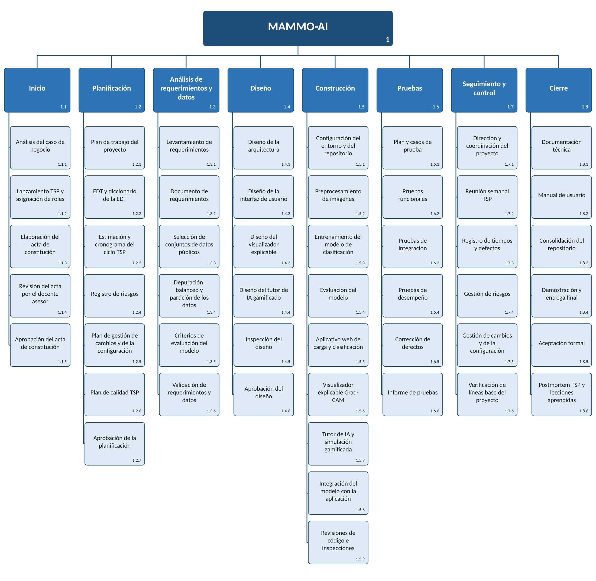

# Plan de Gestión del Alcance

**Plan de Gestión de Alcance**

**MAMMO-AI**

**Universidad Santiago de Cali – Facultad de Ingeniería, Programa Ingeniería de Sistemas**

**Calle 5 \#6 – 60**

**Cali, Valle del Cauca**

**11/10/2026**

## Introducción

La Gestión del Alcance es el conjunto de procesos que aseguran que el proyecto incluya todo el trabajo requerido para completarlo, excluyendo todo el trabajo que no sea necesario para completarlo. El Plan de Gestión del Alcance detalla cómo se definirá, desarrollará y verificará el alcance del proyecto. Define claramente quién es responsable de gestionar el alcance del proyecto y sirve como guía para gestionar y controlar el alcance.

La Gestión del Alcance del Proyecto sigue un proceso de cinco pasos: Recopilar los Requisitos, Definir el Alcance, Crear la EDT, Verificar el Alcance y Controlar el Alcance.

1)  Recopilar los Requisitos – este primer paso es el proceso mediante el cual definimos y documentamos los requisitos necesarios para cumplir todos los objetivos del proyecto. La base de este proceso es el acta de constitución del proyecto y el registro de interesados. A partir de estos, el equipo puede identificar los requisitos, discutir de forma conjunta los detalles asociados al cumplimiento de cada requisito, realizar entrevistas y discusiones de seguimiento para aclarar los requisitos, y documentar los requisitos con el detalle suficiente para medirlos una vez que el proyecto inicie la fase de ejecución. Esta documentación también sirve como entrada para el siguiente paso del proceso, que es definir el alcance.

2)  Definir el Alcance – este paso es crítico para el éxito del proyecto, ya que requiere el desarrollo de una descripción detallada del proyecto/producto que incluya los entregables, los supuestos y las restricciones, y establece el marco dentro del cual debe realizarse el trabajo del proyecto.

3)  Crear la EDT – este proceso descompone los entregables del proyecto en componentes progresivamente más pequeños y manejables, que en el nivel más bajo se denominan paquetes de trabajo. Esta estructura jerárquica permite una mayor simplicidad en la programación, la estimación de costos, el seguimiento y el control del proyecto.

4)  Verificar el Alcance – este es el proceso mediante el cual el equipo del proyecto obtiene la aceptación formal de todos los entregables por parte del propietario y/o el cliente.

5)  Controlar el Alcance – este es el proceso de monitorear/controlar el alcance del proyecto/producto, así como de gestionar cualquier cambio en la línea base del alcance. Pueden ser necesarios cambios en el alcance del proyecto, pero es imprescindible que se controlen e integren para evitar la corrupción del alcance (scope creep).

El Plan de Gestión del Alcance proporciona el marco del alcance para este proyecto. Este plan documenta el enfoque de la gestión del alcance; los roles y responsabilidades relacionados con el alcance del proyecto; la definición del alcance; las medidas de verificación y control; el control de cambios del alcance; y la estructura de desglose del trabajo del proyecto. Toda comunicación del proyecto relacionada con su alcance debe ajustarse al Plan de Gestión del Alcance.

Este Proyecto consiste en analizar, diseñar, construir y probar MAMMO-AI, un aplicativo web de apoyo para el análisis preliminar de mamografías mediante el uso de la IA. Se clasifican las imágenes como normales o sospechosas mediante una red neuronal convolucional entrenada por aprendizaje de transferencia, explicando el resultado con mapas de calor Grad-CAM e incluye un módulo de simulación gamificada en el que la inteligencia artificial acompaña al profesional de la salud en la toma de decisiones, con el objetivo de mitigar el sesgo de automatización. Aquí se contempla el análisis de requerimientos y de los datasets de los datos públicos que se emplean, el diseño de la arquitectura, el entrenamiento del modelo y las pruebas. El proyecto se desarrolla durante el semestre académico 2026B aplicando la metodología Team Software Process (TSP) y utiliza exclusivamente conjuntos de datos públicos o anónimos. No se preveé el uso de recursos externos o la subcontratación del proyecto.

## Enfoque de la Gestión del Alcance

Es importante que el enfoque para gestionar el alcance del proyecto esté claramente definido y documentado en detalle. Esta sección proporciona un resumen del Plan de Gestión del Alcance, en el cual se aborda lo siguiente:

- Quién tiene la autoridad y la responsabilidad de la gestión del alcance

- Cómo se define el alcance (p. ej., Declaración del Alcance, EDT, Diccionario de la EDT, Enunciado del Trabajo, etc.)

- Cómo se mide y verifica el alcance (p. ej., Listas de Verificación de Calidad, Línea Base del Alcance, Mediciones del Desempeño del Trabajo, etc.)

- El proceso de cambio del alcance (quién lo inicia, quién lo autoriza, etc.)

- Quién es responsable de aceptar el entregable final del proyecto y aprueba la aceptación del alcance del proyecto

Para este proyecto, la gestión de alcance será responsabilidad exclusiva del Director del Proyecto, Alvaro Jose Jaramillo Gonzales, el cual también toma el rol de Líder de Equipo dentro de la metodología Team Software Process (TSP). El Director del Proyecto cuenta con el apoyo del Gestor de Planificación, encargado de mantener actualizados la EDT y el cronograma, y también cuenta con el apoyo del Gestor de Calidad, encargado de verificar los entregables.

El alcance del proyecto se define mediante el Acta de Constitución del Proyecto, la Declaración del Alcance, la Estructura de Desglose de Trabajo (EDT) y el Diccionario de la EDT.

Se medirá y verificará el alcance haciendo uso de listas de verificación de calidad por cada entregable, la línea base del alcance y los criterios de adaptación definidos en el Acta de Constitución del Proyecto (Por ejemplo, una sensibilidad del modelo superior al 85%). Además, se usará propiamente del TSP las mediciones de desempeño del trabajo: Las horas planeadas en contraste a las horas reales, el porcentaje de avance de cada trabajo y los defectos encontrados en las revisiones.

Los cambios de alcance pueden proponerse por parte de cualquier miembro activo del equipo del proyecto, por el propietario del proyecto o el docente asesor. Todas las solicitudes de cambio se presentan por escrito al Director del Proyecto, quien evaluara su impacto en el proyecto junto al equipo. Los cambios menores que no afecte a los entregables o los criterios de éxito, serán aprobados por el Director del Proyecto. Los cambios mayores se presentarán ante el Propietario del Proyecto, el docente asesor y el Director del Proyecto. Una vez aprobado cualquier cambio, se realizarán los cambios y actualizaran todos los documentos del proyecto y comunicará la realización del cambio a todos los interesados.

En base a la retroalimentación y los aporte de los miembros del equipo, el responsable de la aceptación del alcance proyecto es el Propietario del Proyecto.

## Roles y Responsabilidades

El Propietario del Proyecto, el docente asesor, el Director del Proyecto y el equipo de trabajo desempeñan los roles claves para la gestión de alcance en este proyecto, De acuerdo con la metodología TSP, además de su rol técnico, cada integrante tiene un rol de gestión: El líder de equipo, Gestor de Planificación, Gestor de Desarrollo, para asegurarse de que el trabajo realizado en el proyecto se mantenga dentro del alcance establecido a lo largo de la duración del proyecto, La siguiente tabla define los roles y responsabilidades para la gestión de alcance de este proyecto.

<table>
<colgroup>
<col style="width: 21%" />
<col style="width: 22%" />
<col style="width: 56%" />
</colgroup>
<thead>
<tr class="header">
<th><strong>Nombre</strong></th>
<th><strong>Rol</strong></th>
<th><strong>Responsabilidades</strong></th>
</tr>
</thead>
<tbody>
<tr class="odd">
<td>Jair Enrique Sanclemente</td>
<td>Propietario del Proyecto</td>
<td><ul>
<li>
Aprobar o rechazar las solicitudes de cambio de alcance mayores
</li>
<li>
Evaluar la necesidad de las solicitudes de cambio de alcance
</li>
<li>
Aceptar los entregables del proyecto
</li>
</ul></td>
</tr>
<tr class="even">
<td>Jair Enrique Sanclemente</td>
<td>Docente Asesor</td>
<td><ul>
<li>
Validar que el alcance del proyecto cumpla los objetivos
</li>
<li>
Tomar voz sobre las solicitudes de cambios del alcance mayores
</li>
<li>
Revisar los entregables
</li>
</ul></td>
</tr>
<tr class="odd">
<td>Alvaro Jose Jaramillo</td>
<td>Director del Proyecto/Líder del Equipo</td>
<td><ul>
<li>
Medir y verificar el alcance del proyecto
</li>
<li>
Validar las solicitudes de cambio de alcance
</li>
<li>
Aprobar cambios de alcance menores
</li>
<li>
Participar en las evaluaciones de impacto de las solicitudes de cambio de alcance
</li>
<li>
Comunicar al equipo los resultados de las solicitudes de cambio de alcance
</li>
<li>
Actualizar la documentación del proyecto una vez realizados los cambios
</li>
</ul></td>
</tr>
<tr class="even">
<td>Daniel Esteban Olarte</td>
<td>
Gestor de Planificación

(planeador)
</td>
<td><ul>
<li>
Mantener actualizados la EDT, el diccionario y el cronograma
</li>
<li>
Medir el avance real frente al planeado
</li>
<li>
Participar en las evaluaciones de impacto
</li>
</ul></td>
</tr>
<tr class="odd">
<td>Juan Jose Herrera</td>
<td>
Gestor de Desarrollo

(Constructor)
</td>
<td><ul>
<li>
Asegurar que lo construido corresponda a lo plasmado en la EDT
</li>
<li>
Comunicar al equipo los resultados de las solicitudes de cambio que tengan alguna afectación al desarrollo
</li>
<li>
Informar al Director del Proyecto sobre incongruencias de trabajos fuera del alcance
</li>
<li>
Participar en las evaluaciones de impacto
</li>
</ul></td>
</tr>
<tr class="even">
<td>Juan Camilo Ospina</td>
<td>
Gestor de Calidad

(Tester)
</td>
<td><ul>
<li>
Verificar los entregables en contraste a los criterios de aceptación
</li>
<li>
Coordinar las revisiones
</li>
<li>
Registrar defectos encontrados
</li>
<li>
Evaluar la necesidad de cambios de alcance y comunicar sobre estos cambios al Director del proyecto
</li>
<li>
Participar en las evaluaciones de impacto
</li>
</ul></td>
</tr>
<tr class="odd">
<td>Kelvin Andres Palma</td>
<td>
Gestor de Soporte

(Diseñador)
</td>
<td><ul>
<li>
Asegurar que el diseño respete el alcance aprobado
</li>
<li>
Administrar el repositorio y control de versiones
</li>
<li>
Evaluar la necesidad de cambios de alcance y comunicar sobre estos cambios al Director del Proyecto
</li>
<li>
Participar en las evaluaciones de impacto
</li>
</ul></td>
</tr>
</tbody>
</table>

**Tabla 1.1, *Roles y Responsabilidades de la Gestión del Alcance***

## Definición del Alcance

El alcance de MAMMO-AI se definió mediante un proceso de recopilación de requisitos a raíz de el informe MAMMO-AI, en donde se encuentran el objetivo general y objetivos específicos, planteamiento del problema, referente teórico y base legal del proyecto. También toma parte de lo planteado en el Acta de Constitución del Proyecto, donde se habla de las necesidades de las partes interesadas, criterios de éxito, supuestos y riesgos. Esta información se condensa en la matriz de trazabilidad de requisitos.

Para definir el alcance del proyecto se emplearon también:

Análisis del producto, revisión de problemáticas documentadas en el anuario estadístico del Instituto Nacional de Cancerología (2024) mencionado en el acta de constitución.

Juicio de expertos, asesoría del docente Jair Enrique Sanclemente sobre la coherencia y enfoque de la documentación presentada.

Reunión con el equipo, se definieron roles para el cumplimiento de los entregables.

Como resultado del proceso, el alcance del proyecto responde directamente a los requisitos identificados: un filtro preliminar de mamografías para el profesional de la salud, la explicación visual del resultado del modelo, el entrenamiento del criterio profesional frente a la IA, un software documentado y versionado y la protección de la información de los pacientes.

## Declaración del Alcance del Proyecto

La declaración del alcance del proyecto proporciona una descripción detallada del proyecto, los entregables, las restricciones, las exclusiones, los supuestos y los criterios de aceptación. Además, la declaración del alcance incluye el trabajo que no debe realizarse, con el fin de eliminar cualquier trabajo implícito pero innecesario que quede fuera del alcance del proyecto.

MAMMO-AI desarrollará, durante el semestre académico 2026B, un aplicativo web de apoyo al análisis preliminar de mamografías. El aplicativo clasificará las imágenes como normales o sospechosas con una red neuronal convolucional entrenada, mostrará mapas de calor Grad-CAM que expliquen las regiones que influyeron en cada resultado, e incluirá un modulo de simulación gamificada en el que la IA acompaña al profesional en la toma de decisiones, con el objetivo de que se analiza de forma critica las recomendaciones del modelo. MAMMO-AI es una herramienta de apoyo y no una herramienta de diagnostico definitivo

El proyecto se da por completado cuando cumple los criterios de éxito:

El modelo clasifica con una sensibilidad de 85% o superior.

El aplicativo muestra el resultado preliminar y el mapa de calor en menos de 10 segundos por mamografía.

El 100% de los requerimientos funcionales se ven implementados y aprobados.

La documentación esta completa y organizada en el repositorio.

Los entregables son aceptados formalmente por el Propietario del Proyecto.

Se realizarán los siguientes entregables del proyecto:

Modelo de calsificacion, red neuronal convolucional entranada para detectar hallazgos sospechosos de mamografías.

Aplicativo web, plataforma para cargar las mamografías y consultar su clasificación preliminar.

Visualizacion explicable, modulo muestra mapas de calor Grad-CAM sobre la imagen analizada.

Documentacion, toda la documentación necesaria como arquitectura, requerimientos, informe de pruebas y guía de uso.

Repositorio, Espacio donde se tendrá toda la documentación organizada.

Este Proyecto no incluye:

Diagnostico definitivo, este sistema es únicamente una herramienta de apoyo y no reemplaza el criterio médico.

Validación clínica con pacientes reales.

El uso de datos que no sean públicos o anónimos.

La integración con sistemas hospitalarios.

Módulos para otros tipos de cáncer.

La operación ni el mantenimiento continuo de la aplicación después del cierre del proyecto.

El Proyecto atiende las siguientes restricciones:

Tiempo, se completará dentro del semestre académico 2026B.

Personal, el equipo esta conformado por 5 estudiantes con disponibilidad parcial.

Equipos, recursos de computo gratuitos y uso de equipos personales de cada integrante.

Marco legal, solo se usarán datasets públicos y anonimizados, en cumplimiento con la ley 1581 de 2012, la Ley 527 de 1999, la ley 23 de 1982 y la decisión andina 351 de 1993.

Se supone dentro del funcionamiento del proyecto:

Los datasets públicos mantendrás su calidad y seguirán con acceso disponible.

El equipo contara con acceso al uso de sus equipos y tecnologías gratuitas.

Los integrantes mantendrán su compromiso y disponibilidad, además de permanecer como un equipo de 5.

El propietario del equipo y el docente asesor estará disponible para revisar y aprobar los entregables del proyecto.

## Estructura de Desglose del Trabajo

Para gestionar eficazmente el trabajo requerido para completar este proyecto, este se subdividirá en paquetes de trabajo individuales que no superarán las 16 horas de esfuerzo ni serán menores a 2 horas. Esto permitirá al Director del Proyecto gestionar con mayor eficacia el alcance del proyecto a medida que el equipo realiza las tareas necesarias para completarlo y facilitara la planificación y el seguimiento semanal propios de TSP. El proyecto se divide en tres fases: Lanzamiento y gestión, análisis de requerimientos y diseño y por ultimo el cierre. Cada una de estas fases se subdivide a su vez en paquetes de trabajo asignados a un responsable.

(Ver la estructura EDT a continuación).

**Figura 1.1, *Estructura de Desglose del Trabajo (EDT)***

Para definir con mayor claridad el trabajo necesario para completar el proyecto, se utiliza el Diccionario de la EDT. El Diccionario de la EDT incluye una entrada por cada elemento de la EDT. El Diccionario de la EDT incluye una descripción detallada del trabajo de cada elemento, así como sus entregables, presupuesto y necesidades de recursos. El equipo del proyecto utilizará el Diccionario de la EDT como enunciado del trabajo de cada elemento de la EDT.

| Nivel | Código EDT | Nombre del Elemento                              | Descripción del Trabajo                                                                                                                                                                                                                                                                                            | Entregables                                             | Recursos                                 |
|-------|------------|--------------------------------------------------|--------------------------------------------------------------------------------------------------------------------------------------------------------------------------------------------------------------------------------------------------------------------------------------------------------------------|---------------------------------------------------------|------------------------------------------|
| 1     | 1          | MAMMO-AI                                         | Todo el trabajo necesario para construir y entregar, durante el semestre 2026B, la aplicación web que clasifica mamografías como normales o sospechosas mediante una red neuronal convolucional, con visualización explicable Grad-CAM y el modelo IA como herramienta de apoyo y nunca de diagnóstico definitivo. | Todos los entregables del proyecto                      | Todo el equipo                           |
| 2     | 1.1        | Inicio                                           | Trabajo de la fase de inicio, en el que se justifica el proyecto, se conforma el equipo y se aprueba el acta de constitución.                                                                                                                                                                                      | Acta de constitución aprobada                           | Director de Proyecto y equipo            |
| 3     | 1.1.1      | Análisis del caso de negocio                     | El Director de Proyecto y el Analista documentan la brecha en el diagnóstico oportuno del cáncer de mama, la escasez de radiólogos subespecialistas, el riesgo de dependencia ciega de la IA y el marco legal aplicable.                                                                                           | Sección de caso de negocio del acta                     | Director de Proyecto, Analista           |
| 3     | 1.1.2      | Lanzamiento TSP y asignación de roles            | En la reunión de lanzamiento de TSP se integra el equipo, se fijan sus metas y se asignan los roles técnicos y de gestión del equipo.                                                                                                                                                                              | Acta de lanzamiento TSP con roles asignados             | Todo el equipo                           |
| 3     | 1.1.3      | Elaboración del acta de constitución             | El equipo redacta el acta de constitución con el caso de negocio, el alcance, los entregables, los riesgos, los recursos y la gobernanza del proyecto.                                                                                                                                                             | Borrador del acta de constitución                       | Todo el equipo                           |
| 3     | 1.1.4      | Revisión del acta por el docente asesor          | El docente asesor, como Responsable de Negocio, revisa la coherencia del alcance y de los entregables con los objetivos académicos.                                                                                                                                                                                | Observaciones del docente asesor                        | Docente asesor                           |
| 3     | 1.1.5      | Aprobación del acta de constitución              | El Propietario del Proyecto aprueba el acta de constitución, con lo cual el equipo queda autorizado para pasar a la planificación.                                                                                                                                                                                 | Acta de constitución aprobada                           | Propietario del Proyecto                 |
| 2     | 1.2        | Planificación                                    | Trabajo de planificación en el que se definen el plan de trabajo, la EDT, la estimación y el cronograma, los riesgos, los cambios y el plan de calidad.                                                                                                                                                            | Planes del proyecto aprobados (línea base)              | Director de Proyecto, Planeador          |
| 3     | 1.2.1      | Plan de trabajo del proyecto                     | El Director de Proyecto y el Planeador elaboran el plan de trabajo con las adaptaciones previstas para un proyecto académico de un semestre.                                                                                                                                                                       | Plan de trabajo del proyecto                            | Director de Proyecto, Planeador          |
| 3     | 1.2.2      | EDT y diccionario de la EDT                      | El equipo descompone el alcance total en paquetes de trabajo y redacta la definición de cada uno.                                                                                                                                                                                                                  | EDT y diccionario de la EDT                             | Todo el equipo                           |
| 3     | 1.2.3      | Estimación y cronograma del ciclo TSP            | El Planeador estima el tamaño y las horas de cada componente conforme a TSP, organiza la ejecución en ciclos semanales y asigna los recursos humanos, de datos y de herramientas.                                                                                                                                  | Estimaciones y cronograma                               | Planeador                                |
| 3     | 1.2.4      | Registro de riesgos                              | El Director de Proyecto amplía la evaluación inicial de los riesgos R1 a R6 en el registro de riesgos, con su probabilidad, impacto, dueño y respuesta.                                                                                                                                                            | Registro de riesgos                                     | Director de Proyecto                     |
| 3     | 1.2.5      | Plan de gestión de cambios y de la configuración | Se formalizan el procedimiento de solicitud, evaluación, decisión y registro de cambios y los elementos de configuración con su responsable de autorización.                                                                                                                                                       | Plan de gestión de cambios y de la configuración        | Director de Proyecto, Diseñador          |
| 3     | 1.2.6      | Plan de calidad TSP                              | El equipo fija las metas de calidad, las revisiones e inspecciones que se harán en cada fase y los indicadores de defectos que se medirán.                                                                                                                                                                         | Plan de calidad TSP                                     | Tester y equipo                          |
| 3     | 1.2.7      | Aprobación de la planificación                   | El Comité de Dirección del Proyecto revisa y aprueba la planificación como línea base para la ejecución.                                                                                                                                                                                                           | Planificación aprobada                                  | Propietario del Proyecto, docente asesor |
| 2     | 1.3        | Análisis de requerimientos y datos               | Trabajo que corresponde a la fase de requisitos de TSP.                                                                                                                                                                                                                                                            | Requerimientos y conjuntos de datos validados           | Analista                                 |
| 3     | 1.3.1      | Levantamiento de requerimientos                  | El Analista identifica los requerimientos funcionales y no funcionales a partir de las necesidades de los profesionales de la salud, la universidad y los pacientes.                                                                                                                                               | Lista de requerimientos                                 | Analista                                 |
| 3     | 1.3.2      | Documento de requerimientos                      | Se documentan los requerimientos funcionales y no funcionales, incluidos los de tiempo de respuesta, seguridad y protección de datos conforme a la Ley 1581 de 2012.                                                                                                                                               | Documento de requerimientos                             | Analista                                 |
| 3     | 1.3.3      | Selección de conjuntos de datos públicos         | El Analista busca y selecciona conjuntos públicos y anonimizados de mamografías y verifica la licencia de uso de cada uno.                                                                                                                                                                                         | Registro de conjuntos de datos y licencias              | Analista                                 |
| 3     | 1.3.4      | Depuración, balanceo y partición de los datos    | Se depuran y combinan los conjuntos seleccionados para aumentar y balancear los datos, y se dividen en particiones de entrenamiento, validación y prueba.                                                                                                                                                          | Conjuntos de datos depurados y particionados            | Analista, Constructor                    |
| 3     | 1.3.5      | Criterios de evaluación del modelo               | Antes de entrenar se fijan los criterios de evaluación, con una meta de sensibilidad del 85 % y el reporte de especificidad y AUC.                                                                                                                                                                                 | Criterios de evaluación documentados                    | Analista, Tester                         |
| 3     | 1.3.6      | Validación de requerimientos y datos             | Se revisan y validan los requerimientos y los datos seleccionados.                                                                                                                                                                                                                                                 | Requerimientos y datos validados                        | Analista, Tester                         |
| 2     | 1.4        | Diseño                                           | Trabajo que corresponde a la fase de diseño de TSP, a cargo principalmente del Diseñador.                                                                                                                                                                                                                          | Diseño aprobado                                         | Diseñador                                |
| 3     | 1.4.1      | Diseño de la arquitectura                        | El Diseñador define la arquitectura de la aplicación web, la integración del modelo de clasificación y la organización del repositorio.                                                                                                                                                                            | Documento de arquitectura                               | Diseñador                                |
| 3     | 1.4.2      | Diseño de la interfaz de usuario                 | Se diseñan los prototipos de pantallas para la carga de mamografías, la consulta de la clasificación preliminar y el nivel de confianza.                                                                                                                                                                           | Prototipos de interfaz                                  | Diseñador                                |
| 3     | 1.4.3      | Diseño del visualizador explicable               | Se define cómo se presentarán los mapas de calor Grad-CAM sobre la imagen analizada para que el profesional verifique el resultado.                                                                                                                                                                                | Diseño del visualizador                                 | Diseñador                                |
| 3     | 1.4.4      | Diseño del tutor de IA gamificado                | Se definen la dinámica de simulación, los retos, la puntuación y la retroalimentación del tutor, incluidos los casos en que el modelo se equivoca.                                                                                                                                                                 | Diseño de escenarios del tutor                          | Diseñador                                |
| 3     | 1.4.5      | Inspección del diseño                            | El equipo inspecciona la arquitectura y la interfaz conforme a TSP y registra los defectos encontrados para su corrección.                                                                                                                                                                                         | Registro de inspección y defectos                       | Todo el equipo                           |
| 3     | 1.4.6      | Aprobación del diseño                            | Se revisan y aprueban la arquitectura y la interfaz como línea base del diseño.                                                                                                                                                                                                                                    | Diseño aprobado                                         | Director de Proyecto                     |
| 2     | 1.5        | Construcción                                     | Trabajo que corresponde a la fase de implementación de TSP, en la que se construyen el modelo y la aplicación web.                                                                                                                                                                                                 | Modelo, aplicativo web, visualizador y tutor integrados | Constructor                              |
| 3     | 1.5.1      | Configuración del entorno y del repositorio      | El Constructor configura Python, Google Colab y el repositorio en GitHub con ramas por funcionalidad y ramas protegidas.                                                                                                                                                                                           | Entorno y repositorio configurados                      | Constructor                              |
| 3     | 1.5.2      | Preprocesamiento de imágenes                     | Se desarrollan las rutinas de normalización, redimensionamiento y aumento de datos de las mamografías.                                                                                                                                                                                                             | Scripts de preprocesamiento                             | Constructor                              |
| 3     | 1.5.3      | Entrenamiento del modelo de clasificación        | El Constructor entrena la red neuronal convolucional por aprendizaje por transferencia, con regularización y validación cruzada para reducir el sobreajuste.                                                                                                                                                       | Modelo entrenado                                        | Constructor                              |
| 3     | 1.5.4      | Evaluación del modelo                            | Se mide el desempeño del modelo con la partición de prueba según los criterios definidos y se registran los pesos, hiperparámetros y métricas de cada versión.                                                                                                                                                     | Reporte de métricas del modelo                          | Constructor, Tester                      |
| 3     | 1.5.5      | Aplicativo web de carga y clasificación          | Se construye la plataforma que permite cargar mamografías y consultar la clasificación preliminar con su nivel de confianza, con aviso visible de que es una herramienta de apoyo.                                                                                                                                 | Aplicativo web                                          | Constructor                              |
| 3     | 1.5.6      | Visualizador explicable Grad-CAM                 | Se implementa el módulo que muestra los mapas de calor de las regiones que influyeron en la clasificación.                                                                                                                                                                                                         | Visualizador Grad-CAM                                   | Constructor                              |
| 3     | 1.5.7      | Tutor de IA y simulación gamificada              | Se implementa el módulo que guía al usuario en la lectura de casos y entrena su criterio frente a las respuestas del modelo.                                                                                                                                                                                       | Módulo de tutor IA                                      | Constructor, Diseñador                   |
| 3     | 1.5.8      | Integración del modelo con la aplicación         | Se integran el modelo entrenado, el visualizador y el tutor en la aplicación web.                                                                                                                                                                                                                                  | Aplicación integrada                                    | Constructor                              |
| 3     | 1.5.9      | Revisiones de código e inspecciones              | Cada integrante revisa su código, el equipo practica inspecciones entre pares antes de integrar los cambios a la rama principal y se registran los defectos conforme a TSP.                                                                                                                                        | Registro de revisiones y defectos                       | Todo el equipo                           |
| 2     | 1.6        | Pruebas                                          | Trabajo que corresponde a la fase de integración y pruebas de sistema de TSP, a cargo del Tester.                                                                                                                                                                                                                  | Informe de pruebas                                      | Tester                                   |
| 3     | 1.6.1      | Plan y casos de prueba                           | El Tester define el plan de pruebas y los casos de prueba a partir de los requerimientos y de los criterios de éxito.                                                                                                                                                                                              | Plan y casos de prueba                                  | Tester                                   |
| 3     | 1.6.2      | Pruebas funcionales                              | Se verifica que cada requerimiento funcional esté implementado y opere conforme a lo especificado.                                                                                                                                                                                                                 | Resultados de pruebas funcionales                       | Tester                                   |
| 3     | 1.6.3      | Pruebas de integración                           | Se verifica el funcionamiento conjunto del modelo, la aplicación web, el visualizador y el tutor.                                                                                                                                                                                                                  | Resultados de pruebas de integración                    | Tester                                   |
| 3     | 1.6.4      | Pruebas de desempeño                             | Se comprueban la sensibilidad del modelo frente a la meta del 85 % y que el resultado y el mapa de calor se muestren en menos de 10 segundos por imagen.                                                                                                                                                           | Resultados de pruebas de desempeño                      | Tester                                   |
| 3     | 1.6.5      | Corrección de defectos                           | El Constructor corrige los defectos encontrados y el Tester repite las pruebas afectadas.                                                                                                                                                                                                                          | Defectos corregidos y reprobados                        | Constructor, Tester                      |
| 3     | 1.6.6      | Informe de pruebas                               | El Tester consolida los resultados de todas las pruebas en el informe correspondiente.                                                                                                                                                                                                                             | Informe de pruebas                                      | Tester                                   |
| 2     | 1.7        | Seguimiento y control                            | Trabajo de dirección y control que se ejecuta de forma transversal durante todo el proyecto.                                                                                                                                                                                                                       | Actas de seguimiento y registros de control             | Director de Proyecto                     |
| 3     | 1.7.1      | Dirección y coordinación del proyecto            | Dirección general del proyecto y coordinación del equipo a cargo del Director de Proyecto.                                                                                                                                                                                                                         | Decisiones y coordinación del equipo                    | Director de Proyecto                     |
| 3     | 1.7.2      | Reunión semanal TSP                              | Reunión semanal con acta breve de avances, valor ganado, acuerdos y riesgos.                                                                                                                                                                                                                                       | Actas semanales                                         | Todo el equipo                           |
| 3     | 1.7.3      | Registro de tiempos y defectos                   | Cada integrante registra sus tiempos y los defectos encontrados en los formatos de TSP, lo que permite medir el avance y la calidad del producto.                                                                                                                                                                  | Registros TSP de tiempos y defectos                     | Todo el equipo                           |
| 3     | 1.7.4      | Gestión de riesgos                               | Seguimiento del registro de riesgos y aplicación de las respuestas previstas.                                                                                                                                                                                                                                      | Registro de riesgos actualizado                         | Director de Proyecto                     |
| 3     | 1.7.5      | Gestión de cambios y de la configuración         | Trámite de las solicitudes de cambio, actualización del registro de cambios y control de las versiones de los elementos de configuración.                                                                                                                                                                          | Registro de cambios                                     | Director de Proyecto, Diseñador          |
| 3     | 1.7.6      | Verificación de líneas base del proyecto         | En las revisiones de seguimiento se verifica que la versión entregada corresponda a la línea base aprobada.                                                                                                                                                                                                        | Verificaciones registradas                              | Director de Proyecto, Tester             |
| 2     | 1.8        | Cierre                                           | Trabajo de cierre, con la documentación, la entrega y la aceptación de los productos del proyecto.                                                                                                                                                                                                                 | Proyecto entregado y aceptado                           | Todo el equipo                           |
| 3     | 1.8.1      | Documentación técnica                            | Se consolidan la arquitectura, los requerimientos y el informe de pruebas en la documentación técnica del proyecto.                                                                                                                                                                                                | Documentación técnica                                   | Analista, Diseñador                      |
| 3     | 1.8.2      | Manual de usuario                                | Se elabora la guía de uso de la aplicación, que orienta al usuario a emplearla con criterio propio y sin aceptar ni rechazar sus resultados a ciegas.                                                                                                                                                              | Manual de usuario                                       | Diseñador, Tester                        |
| 3     | 1.8.3      | Consolidación del repositorio                    | Se deja el repositorio con el código, el modelo, la documentación completa y los scripts y el registro de los conjuntos de datos, sin redistribuir datos de licencia restrictiva.                                                                                                                                  | Repositorio final                                       | Constructor                              |
| 3     | 1.8.4      | Demostración y entrega final                     | El equipo presenta la aplicación en funcionamiento y entrega los productos al Propietario del Proyecto y al docente asesor al cierre del semestre 2026B.                                                                                                                                                           | Demostración y productos entregados                     | Todo el equipo                           |
| 3     | 1.8.5      | Aceptación formal                                | El Propietario del Proyecto acepta formalmente los entregables.                                                                                                                                                                                                                                                    | Documento de aceptación firmado                         | Propietario del Proyecto                 |
| 3     | 1.8.6      | Postmortem TSP y lecciones aprendidas            | El equipo compara lo planificado con lo ejecutado en tamaño, esfuerzo, cronograma y calidad, y documenta las lecciones aprendidas para que futuros equipos puedan continuar el proyecto.                                                                                                                           | Informe de postmortem                                   | Todo el equipo                           |

**Tabla 1.2, *Diccionario de la EDT***

## Verificación del Alcance

La verificación del alcance explica cómo se verificarán los entregables frente al alcance original y cómo se aceptarán formalmente los entregables del proyecto. Los entregables del proyecto deben ser aceptados formalmente y firmados por el cliente a lo largo del ciclo de vida del proyecto, y no reservarse como un único entregable al final del proyecto.

A medida que avance este proyecto, el Director del Proyecto verificará los entregables intermedios del proyecto frente al alcance original, tal como se define en la declaración del alcance, la EDT y el Diccionario de la EDT. La verificación de cada entregable sigue una ruta de 3 pasos.

Revision por pares, antes de presentarse el entregable un integrante del grupo que no sea el autor del mismo, revisará y registrará los defectos encontrados, los cuales serán corregidos antes de continuar.

Verificación de calidad, el Gestor de Calidad comprueba el entregable con su lista de verificación y con los criterios definidos anteriormente en la declaración de alcance.

Validacion del Director del Proyecto, el Director del Proyecto confirma que el entregable cumpla con lo estipulado en el trabajo escrito en el diccionario EDT y que no incluya trabajo que este fuera del alcance del proyecto definido.

Ya con el entregable verificado, el Director del Proyecto y el Propietario del Proyecto se reunirán, para la aceptación formal del entregable. En la reunión, el Director presenta el entregable junto a su verificación y el propietario aceptara el entregable firmando un documento de aceptación de entregables. En caso de no cumplir con los criterios, se registran las observaciones y el equipo lo corrige antes de una nueva revisión.

## Control del Alcance

Esta sección también detalla el proceso de cambio para realizar modificaciones a la línea base del alcance.

El Director del Proyecto y el equipo del proyecto trabajarán juntos para controlar el alcance del proyecto. El equipo del proyecto aprovechará el Diccionario de la EDT utilizándolo como enunciado del trabajo de cada elemento de la EDT. El equipo del proyecto se asegurará de realizar únicamente el trabajo descrito en el Diccionario de la EDT y de generar los entregables definidos para cada elemento de la EDT. El Director del Proyecto supervisará al equipo del proyecto y el avance del proyecto para asegurar que se siga este proceso de control del alcance.

El control de alcance se realizara en la reunión semanal de seguimiento de la metodología TSP.

En esta reunión cada integrante informa el avance de sus paquetes de trabajo y las horas reales frente a las planeadas. En base a estos datos, el Gestor de planificación compara el avance real con el planeado y el Director del Proyecto revisa que no se realice nada fuera del alcance aprobado anteriormente. Para MAMMO-AI se consideran señales de corrucpcion de alcance : Agregar modulos para otro tipos de cancer, incorporar funcionalidades de diagnostico definitivo, integrar la aplicación con sistemas hospitalarios o usar datos de pacientes que no esten públicos o anonimizados. Cualquier trabajo de este tipo debe suspenderse inmediatamente.

Si se requiere un cambio en el alcance del proyecto, debe llevarse a cabo el proceso para recomendar cambios al alcance del proyecto. Cualquier miembro del equipo del proyecto o el propietario puede solicitar cambios al alcance del proyecto. Todas las solicitudes de cambio deben presentarse al Director del Proyecto mediante un documento de solicitud de cambio del proyecto. El Director del Proyecto revisará entonces el cambio sugerido al alcance del proyecto. Luego, el Director del Proyecto rechazará la solicitud de cambio si no corresponde con el propósito del proyecto, o convocará una reunión de control de cambios entre el equipo del proyecto y el Propietario para revisar en mayor detalle la solicitud de cambio y realizar una evaluación de impacto del cambio. Si la solicitud de cambio recibe la aprobación inicial del Director del Proyecto y del Propietario, el Director del Proyecto presentará formalmente la solicitud de cambio al Comité de Control de Cambios. Si el Comité de Control de Cambios aprueba el cambio de alcance, el Propietario del Proyecto aceptará formalmente el cambio firmando el documento de control de cambios del proyecto. Una vez aceptado el cambio de alcance por el Comité de Control de Cambios y el Propietario del Proyecto, el Director del Proyecto actualizará todos los documentos del proyecto y comunicará el cambio de alcance a todos los miembros del equipo del proyecto y a los interesados.

## Aceptación del Propietario

Aprobado por el Propietario del Proyecto:

Fecha:

Jair Enrique Sanclemente

Propietario del Proyecto/Docente asesor
