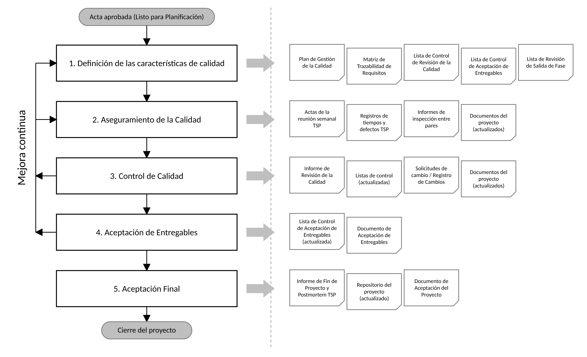

# Plan de Gestión de Calidad

Universidad Santiago de Cali

Facultada de Ingeniería – Programa ingeniería de sistemas

Plan de Gestión de Calidad

**MAMMO-AI**

> Fecha: 18/10/2026
>
> Versión: 1.0
>
> Versión de Plantilla: 3.0.1
>

*Esta plantilla está basada en PM² V3.0*

*Para consultar la última versión de esta plantilla por favor visite el Wiki PM²*

## Información de control del documento

<table>
<colgroup>
<col style="width: 31%" />
<col style="width: 68%" />
</colgroup>
<thead>
<tr class="header">
<th></th>
<th><strong>Valor</strong></th>
</tr>
</thead>
<tbody>
<tr class="odd">
<td><strong>Título del Documento:</strong></td>
<td>Plan de Gestión de Calidad</td>
</tr>
<tr class="even">
<td><strong>Nombre del Proyecto:</strong></td>
<td>MAMMO-AI</td>
</tr>
<tr class="odd">
<td><strong>Autor del Documento:</strong></td>
<td>
Alvaro Jose Jaramillo Gonzalez

Juan Jose Herrera Rengifo

Juan Camilo Ospina Daza

Kelvin Andres Palma

Daniel Esteban Olarte Vasquez
</td>
</tr>
<tr class="even">
<td><strong>Propietario del Proyecto:</strong></td>
<td>Jair Enrique Sanclemente Castro</td>
</tr>
<tr class="odd">
<td><strong>Director del Proyecto:</strong></td>
<td>Alvaro Jose Jaramillo Gonzalez</td>
</tr>
<tr class="even">
<td><strong>Versión del Documento:</strong></td>
<td>1.0</td>
</tr>
<tr class="odd">
<td><strong>Confidencialidad:</strong></td>
<td>Básica</td>
</tr>
<tr class="even">
<td><strong>Fecha:</strong></td>
<td>18/10/2026</td>
</tr>
</tbody>
</table>

## Aprobación y revisión del documento

NOTA: Se requieren todas las aprobaciones. Se deben mantener registros de cada aprobación.

Todos los revisores de la lista se consideran necesarios a menos que se indique explícitamente como Opcionales.

| **Nombre**                      | **Rol**                                  | **Acción** | **Fecha**  |
|---------------------------------|------------------------------------------|------------|------------|
| Jair Enrique Sanclemente Castro | Propietario del proyecto/ Docente asesor | *Aprueba*  | Pendiente  |
| Juan Camilo Ospina Daza         | Gestor de calidad TSP (Tester)           | Revisa     | 18/10/2026 |
| Alvaro Jose Jaramillo Gonzalez  | Director de proyecto/Lider del equipo    | Revisa     | 18/10/2026 |
| Daniel Esteban Olarte Vasquez   | Gestor de planificación TSP(planeador)   | Revisa     | 18/10/2026 |
| Juan Jose Herrera Rengifo       | Gestor de Desarrollo TSP(Constructor)    | Revisa     | 18/10/2026 |
| Kelvin Andres Palma Viveros     | Gestor de soporte TSP(Diseñador)         | Revis      | 18/10/2026 |

## Historial del documento

El Autor del Documento está autorizado a hacer los siguientes tipos de cambios al documento sin requerir que el documento sea aprobado nuevamente:

- *Edición, formato y ortografía.*

- *Aclaraciones.*

Para solicitar un cambio en este documento, póngase en contacto con el Autor del Documento o el Propietario del Proyecto.

Las modificaciones de este documento se resumen en la siguiente tabla en orden cronológico inverso (primero la última versión).

| **Revisión** | **Fecha**  | **Creada por**                                    | **Breve descripción de los cambios**                                             |
|--------------|------------|---------------------------------------------------|----------------------------------------------------------------------------------|
| 1.0          | 18/10/2026 | Juan Jose Herrera Rengifo/Juan Camilo Ospina Daza | Desarrollo del Plan de Gestión de Calidad y Verificación de coherencia y sentido |
|              |            |                                                   |                                                                                  |
|              |            |                                                   |                                                                                  |

## Gestión de la configuración: Localización del documento

La última versión de este documento está guardada en https://drive.google.com/drive/folders/1Be0gRK-sEwat-bqS235JzEdxNxlHtECY?usp=drive_link

## Introducción

Este documento define como se gestiona la calidad del proyecto MAMMO-AI, un aplicativo web de apoyo en el análisis y diagnostico preliminar de mamografías donde se clasifican las imágenes como normales o como sospechosas para esto se aplica una red neuronal convolucional, explica su resultado mediante el uso de mapas de calor Grad-CAM e incluye un apoyo de IA gamificado. Al tratarse de un apoyo en el ámbito de la salud, que trabaja y funciona con parámetros clínicos como la sensibilidad o exactitud del modelo y con el uso de datos sujetos a la Ley 1581 de 2012, las actividades de calidad son de vital importancia para el éxito del proyecto. La gestión del mismo se documenta con las plantillas de PM², mientras que las practicas de calidad siguen la metodología TSP o Team Software Process: revisiones personales, inspecciones entre pares, registro de tiempo y defectos y postmortem al cierre de cada ciclo.

Los objetivos de este documento son:

- Describir la estrategia de calidad, el enfoque y el proceso que se utilizarán para el proyecto.

- Identificar los roles y responsabilidades relacionados con la gestión de la calidad del proyecto.

- Identificar los principales artefactos y entregables de gestión del proyecto.

- Definir las actividades de control y aseguramiento de la calidad y planificarlas a lo largo del proyecto.

- Respaldar el acuerdo sobre los requisitos y las métricas de calidad del proyecto, y el método para evaluarlos.

- Especificar la metodología, estándares, herramientas y técnicas que se utilizan para apoyar la gestión de calidad.

Tenga en cuenta que en la Guía PM², el *Plan de Gestión de Calidad* se describe principalmente como parte del *Manual del Proyecto*. Sin embargo, el Director de Proyecto (DP) puede decidir, dado el tamaño o la complejidad del proyecto, usar un documento independiente para recoger las características de calidad para el proyecto y, en este caso, se propone utilizar esta plantilla.

## Objetivos de la Gestión de la Calidad

La gestión de la calidad del proyecto tiene como objetivo asegurar que el proyecto actual alcance los resultados esperados de la forma más eficiente, y que los entregables sean aceptados por las partes interesadas más relevantes. Implica supervisar todas las actividades necesarias para mantener el nivel de excelencia deseado. Esto incluye la creación e implementación de la planificación y aseguramiento de la calidad, así como el control y la mejora de la calidad.

Este proyecto seguirá el proceso de gestión de calidad de PM², que comprende las actividades relacionadas con la identificación, planificación, ejecución y seguimiento y control de las actividades relacionadas con la calidad del proyecto. Este proceso se complementa junto al TSP Team Software Process, en la que la calidad se genera a través del desarrollo y no solo se verifica al final: cada integrante del equipo revisa su trabajo antes de entregarlo, el equipo inspecciona entre pares antes de integrar cada parte del trabajo y todos los defectos o errores que se hallen se anotan y mejoran antes del siguiente ciclo.

Los principales objetivos de la calidad del proyecto son:

- Lograr que el modelo tenga una sensibilidad de clasificación de mamografias mayor o igual al 85% de las imágenes, reportar su especificidad de modo que minimice los casos sospechosos

- Asegurar que el aplicativo muestre la clasificación preliminar y el mapa de calor Grad-CAM en un tiempo menor a 10 segundos por cada imagen, además que el 100% de requisitos de prioridad alta se cumplan.

- Garantizar que la interfaz de IA y la documentación presenten los resultados como preliminares y de apoyo, nunca como un diagnostico definitivo o única respuesta con fin de reducir el sesgo de automatización.

- Asegurar el cumplimiento de la Ley 1581 de 2012 de protección de datos personales, de la Ley 527 de 1999, de la Ley 23 de 1982 y de la Decision Andina 351 de 1993, utilizando únicamente conjuntos de datos públicos y anonimizados.

- Obtener la Aceptación formal de cada entregable del proyecto de parte del Propietario del Proyecto en base a los criterios de aceptación definidos.

## Proceso de Gestión de Calidad

El proceso de gestión de calidad del proyecto comprende todas las actividades (relacionadas tanto con los procesos como con los entregables) que aumentarán la capacidad de cumplir con los resultados esperados del proyecto identificados en el Acta de Constitución del Proyecto.

El proceso de gestión de la calidad de este proyecto consta de cinco pasos fundamentales:

- Definir las Características de Calidad (del Proyecto).

- Realizar el Aseguramiento de la Calidad.

- Realizar el Control de Calidad.

- Llevar a cabo la Aceptación de los Entregables.

- Realizar la Aceptación Final (del proyecto).

### Paso 1: Definir las Características de Calidad
El propósito de este paso es identificar los objetivos, enfoque, requisitos, actividades y responsabilidades del proceso de gestión de la calidad del proyecto, así como la forma en que se implementará a lo largo del mismo. Éstos se documentan en este plan sobre la base de los objetivos, el enfoque, los entregables, los beneficios previstos y los recursos disponibles del proyecto (tal como se definen en el *Caso de Negocio*, el *Acta de Constitución del Proyecto*, el *Manual del Proyecto*, el *Plan de Trabajo del Proyecto*, y otros planes relevantes).

El Plan de Gestión de Calidad incluye la descripción de:

- Objetivos, enfoque y requisitos de calidad;

- Normas de calidad, directrices, herramientas y técnicas, p. ej. la Lista de Control de Revisión de Calidad y la Lista de Control de Aceptación de Entregables.

- Actividades de aseguramiento de la calidad y responsabilidades relacionadas, p. ej. Reuniones de Revisión del Proyecto, informes mensuales de actividades, verificación del cumplimiento, entre otras.

- Actividades de control de calidad para la mejora continua, p. ej. la revisión de los artefactos de gestión de proyectos y la revisión de los planes de calidad.

- Procedimiento de configuración relacionado con los artefactos y entregables del proyecto.

Cualquier actividad de calidad relacionada con los artefactos de gestión de proyectos se documenta en el *Plan de Gestión de Calidad*, mientras que las actividades de aseguramiento y control de calidad relacionadas con los entregables del proyecto se pueden encontrar en documentos separados como, por ejemplo, los casos de pruebas (paquete 1.6.1 de la EDT). Las actividades de Control de Calidad, en el contexto de la aceptación formal de los entregables por parte del cliente, se documentan en la matriz de trazabilidad de requerimentos.

Las técnicas que se usarán para la planificación de la calidad son las siguientes:

- Benchmarking: Comparación del modelo para la clasificación de mamografias mediante redes convolucionales y sistemas similares, para fijar metas de calidad realistas.

- Priorización de los requisitos de calidad (MoSCoW): Los requisitos de prioridad alta de la matriz de trazabilidad se tratan como must(debe tener) y los de prioridad media como should(debería tener). Los elementos excluidos en el plan de gestión de alcance se tratan como won’t (no tendrá).

- Muestreo estadístico: Partición de los datos de entrenamiento, validación y prueba, con el fin de que los resultados no estén sesgados.

Teniendo en cuenta los requisitos del solicitante, el director de Proyecto (DP) determina el equilibrio entre el coste/tiempo/riesgo y la calidad de los entregables, basándose en un análisis de coste-beneficio, y define las actividades de aseguramiento y control de calidad. Para estas actividades, también deben definirse las métricas de calidad, junto con las tolerancias de aceptación.

La *Lista de Control de Revisión de Calidad*, la *Lista de Control de Salida de Fase* y la *Lista Control de Aceptación de los Entregables* son las herramientas que se usarán para validar el cumplimiento de este plan. Las listas de control anteriores se deben definir y crear durante la fase de planificación

Adicionalmente a las listas de control anteriores, se usarán las siguientes herramientas:

Matriz de trazabilidad de requisitos, que relaciona cada requisito con su criterio de aceptación, entregable y estrategia.

Formato de TSP, registro de tiempo, registro de defectos, informe de inspección y además informe semanal de avance.

Tecnología gratuita como Colab, Github y Drive, control de versiones, revisión de código y seguimiento de incidencias.

### Paso 2: Realizar el Aseguramiento de la Calidad
El propósito de este paso es verificar el desempeño y cumplimiento de las actividades del proyecto (y de la gestión del proyecto) con los requisitos de calidad definidos. Las actividades de aseguramiento de la calidad se definen sobre la base del enfoque de gestión aclarado en el acta de constitución y en el Plan de Gestion de Alcance, y se programan en el cronograma del ciclo TSP (1.2.3 de la EDT).

El aseguramiento de la calidad se realizará evaluando:

- El diseño de los controles del proyecto, confirmando su implementación y evaluando su eficacia operativa. Estas actividades tendrán en cuenta los objetivos de calidad del proyecto junto con los riesgos del mismo.

- El cumplimiento de las normas y reglamentos de la organización, así como de las normas, reglamentos y legislación gubernamental y sectorial relevante.

El Director de Proyecto (DP) no suele realizar las actividades de aseguramiento de la calidad, pero se llevan a cabo internamente y/o externamente:

- Internamente: por el gestor de calidad del proyecto Juan Camila Ospina Daza, quien cumple el rol de Garantía de la Calidad del Proyecto (GCP) y cuenta con el apoyo de las revisiones por pares.

- Externamente: por el docente asesor Jair Enrique Sanclemente Castro, quien revisa los entregables.

Los resultados de las actividades de aseguramiento de la calidad se documentarán en los informes de calidad y estado en las revisiones por pares. El aseguramiento de la calidad puede traducirse en recomendaciones de mejora, que serán procesadas por el control de calidad en forma de solicitudes de cambio.

Los resultados del aseguramiento de la calidad se documentarán en los siguientes artefactos:

Reuniones semanales de seguimiento TSP

Los registros de defectos e informes de inspección TSP

El informe de revisión de la calidad.

EL registro de cambios, cuando una recomendación de mejora genere una solicitud de cambio.

### Paso 3: Realizar el Control de Calidad
El propósito de este paso es hacer un seguimiento y consolidar los resultados de las actividades de aseguramiento de la calidad para evaluar el cumplimiento y el rendimiento, recomendar los cambios necesarios y planificar nuevas actividades de aseguramiento de la calidad o perfeccionar las existentes. El Director de Proyecto (DP) es quien realiza el seguimiento y control de calidad durante todo el proyecto.

El Director de Proyecto (DP) utilizará la *Lista de Control de Revisión de la Calidad* para evaluar las actividades de control de la calidad y validar el cumplimiento de los planes en términos de alcance, tiempo, coste, calidad, organización del proyecto, comunicación, riesgos, contratos y satisfacción del cliente. Además, el Director de Proyecto (DP) resumirá y documentará las conclusiones de la *Lista de Control de Revisión de la Calidad*, su impacto, las recomendaciones y las medidas correctivas y de mejora. Los registros del proyecto, en particular el registro de riesgos, el registro de defectos TSP y el registro de cambios, también serán utilizados para documentar los riesgos relacionados, decisiones y cambios.

Al controlar y verificar la idoneidad de la gestión de la calidad del proyecto, el Director de Proyecto (DP) considerará todos los acontecimientos que puedan influir de manera negativa o positiva en el logro de los objetivos del proyecto y perfeccionará el *Plan de Gestión de la Calidad* en consecuencia. Además, el Director de Proyecto (DP) determinará la eficacia de los procesos del proyecto, buscará posibles mejoras en la eficiencia de los procesos, analizará los resultados de las mediciones y su eficacia, y elaborará *Informes de Revisión de la Calidad* consolidando de los resultados y las recomendaciones.

Se usarán los resultados de las actividades de aseguramiento de la calidad para mejorar la calidad de las actividades del proyecto y así, se podrán generar solicitudes de cambio de acciones correctivas o preventivas, o bien actualizaciones en la documentación del proyecto, p. ej. en *el Plan de Trabajo del Proyecto*.

Tras la identificación de todas las no conformidades o de las oportunidades de mejora, el Director de Proyecto (DP) elaborará/validará las recomendaciones y establecerá planes de acción, consultando a las partes interesadas relevantes.

Las acciones pueden dar lugar a solicitudes de cambio, a la identificación de nuevos riesgos e incidencias, a la reprogramación de actividades o a la adición de nuevas actividades al *Plan de Trabajo del Proyecto*. También pueden identificar las necesidades de formación y recursos, actividades adicionales de aseguramiento de la calidad, entre otras. Estas acciones identificarán qué documentación del proyecto debe actualizarse y el Identificador (ID) de la acción a partir de los documentos relacionados (registros del proyecto o el *Plan de Trabajo del Proyecto*). Todas estas acciones se incorporarán (por lo menos las que más esfuerzo/coste consumen) en *el Plan de Trabajo del Proyecto*, a fin de tener una visión consolidada de todas las actividades relacionadas con el proyecto.

Además, este paso también incluye la revisión y validación de cada paquete de trabajo del proyecto tal como se define en el EDT y su diccionario. Si los resultados cumplen los requisitos de calidad del proyecto, el Director de Proyecto (DP) obtendrá la aprobación de los entregables producidos en cada una de las fases, en base a los criterios definidos. Se utiliza la *Lista Revisión de Salida de Fase* para apoyar cada punto de revisión de salida de fase. Además, las decisiones formales de ir/no ir para cada fase serán acordadas y aceptadas por el Propietario del Proyecto (PP), basándose en los criterios de éxito.

Todos los cambios en el *Plan de Gestión de la Calidad* se acordarán por las partes interesadas pertinentes y aprobados por el Comité de Dirección del Proyecto (CDP).

### Paso 4: Realizar la Aceptación de los Entregables
El propósito de este paso es obtener la aprobación formal del Propietario del Proyecto (PP) para cada entregable del proyecto. Comprende la verificación de si los entregables cumplen los objetivos y el conjunto de criterios definidos en las métricas de este plan, de forma que el Propietario del Proyecto (PP) pueda aceptarlos formalmente, en el Documento de Aceptación de Entregables.

La *Lista de Control de Aceptación los Entregables* apoya el seguimiento del estado de todas las actividades que son condición previa para la transmisión de los entregables del proyecto al Propietario del Proyecto (PP) y la aceptación formal por parte de éste. Los entregables del proyecto se aceptan si las actividades de aceptación descritas en este plan se realizan con éxito y dentro de las tolerancias preestablecidas. Los entregables del proyecto pueden ser aceptados condicionalmente incluso con un conjunto de incidencias conocidas, siempre que éstas estén documentadas, no afecten un requisito de alta prioridad y que exista un plan para abordarlas.

### Paso 5: Realizar la Aceptación Final
El propósito de este paso es gestionar la aceptación final del proyecto, incluyendo los entregables aceptados, así como realizar el cierre administrativo del proyecto. La aceptación final se obtiene del Propietario del Proyecto (PP), a través de un Documento de Aceptación del Proyecto formal.

Antes de la aprobación formal del proyecto, el Director de Proyecto (DP) debe informar sobre el progreso del proyecto en la Reunión de Revisión de Fin de Proyecto, junto con la demostración de la aplicación (1.8.4 en la EDT). En esta etapa, el equipo realizara el postmortem TSP (1.8.6), en donde se compara lo planificado con lo ejectuado y documenta las lecciones aprendidas. Con estos resultados se realiza el informe de fin del proyecto, que resumirá el progreso del proyecto a lo largo de su ciclo de vida y los principales riesgos, limitaciones, oportunidades y lecciones aprendidas. Los obstáculos, las mejores practicas y las soluciones aplicadas se mantendrán en el repositorio del proyecto para que futuros equipos puedan continuar con el desarrollo de MAMMO-AI.

El cierre administrativo del proyecto incluye actualizar, revisar, organizar y archivar toda la documentación y registros del proyecto en la carpeta del proyecto en drive y repositorio github (paquete 1.8.3 EDT), tarea a cargo del gestor de soporte TSP. También comprende la liberación de los recursos del proyecto, la aceptación final del proyecto y la comunicación del final del proyecto a las partes interesadas relevantes. Se utilizará la *Lista de Revisión de Salida de Fase* para validar la finalización de las actividades del proyecto

### Roles y Responsabilidades en la Gestión de la Calidad

En la siguiente tabla RASCI se definen las responsabilidades de aquellos que participan en la gestión de la calidad.

| **RAM** (RASCI)                            | **CDP** | **PP** | **RN** | **PS** | **DP** | **ECP** |
|--------------------------------------------|---------|--------|--------|--------|--------|---------|
| Plan de Gestión de la Calidad              | **A**   | C      | C      | C      | **R**  | C       |
| Criterios de Aceptación de los Entregables | **A**   | S      | **S**  | C      | **R**  | C       |
| Realizar el Aseguramiento de la Calidad    | I       | C      | **C**  | I      | **A**  | **S**   |
| Realizar el Control de Calidad             | I       | C      | C      | **A**  | **R**  | C       |
| Realizar la Aceptación de los Entregables  | I       | **A**  | **A**  | I      | **R**  | C       |
| Realizar la Aceptación Final               | **A**   | A      | A      | C      | **R**  | S       |

Los datos de contacto de cada una de las partes interesadas anteriores están documentados en la *Matriz de Partes Interesadas*.

El Comité de Dirección del Proyecto (CDP) acuerda el enfoque y los criterios de calidad del proyecto.

En última instancia, el Director de Proyecto (DP) es quien aprueba la correcta y completa realización de las actividades de aseguramiento de la calidad. El responsable es la persona que desempeña el papel de auditor o revisor del proyecto, que puede ser interno al equipo, a la organización, pero externo al equipo, o externo a la organización.

El Director de Proyecto (DP), apoyado por el Responsable de Negocio (RN), es responsable de programar las actividades de aceptación y de asegurar que se llevan a cabo según el plan.

El Director de Proyecto (DP) también es responsable de realizar el control de calidad a lo largo del proyecto bajo la supervisión del Proveedor de Soluciones (PS).

El propietario del Proyecto (PP) es responsable de aprobar la aceptación de los entregables y del proyecto, de asegurar la disponibilidad de recursos (incluidas las personas) y de las directrices para las pruebas de aceptación.

## Técnicas y Herramientas

Para la gestión de la calidad del proyecto, se utilizarán las siguientes técnicas:

- Revisiones personales TSP.

- Revisión e inspección en pares TSP.

- Recorridos guiados.

- Registro y análisis de defectos TSP.

- Evaluación del modelo.

- Comparaciones.

- Pruebas funcionales.

- Pruebas de aceptación.

- Reuniones de revisión del proyecto.

Se utilizarán las siguientes herramientas para la gestión de la calidad del proyecto:

- Plan de Gestión de la Calidad de PM².

- Matriz de trazabilidad de requisitos.

- Lista de Control de Revisión de la Calidad PM².

- Lista de Control de Aceptación de los Entregables PM².

- Lista de Control de Revisión de Salida de Fase PM².

- Informe de Revisión de Calidad PM².

- Informe de Fin de Proyecto PM².

- Documento de Aceptación de los Entregables.

- Documento de Aceptación del Proyecto.

- Registros de defectos.

- Registros de inspección.

- Informe semanal de avance.

- Google Colab.

- Google drive.

- GitHub

## Actividades de Aseguramiento de la Calidad

El Director de Proyecto (DP) es el responsable último de las actividades de aseguramiento de la calidad dentro del proyecto. El Director de Proyecto (DP) es también responsable de programar e iniciar todas las auditorías o revisiones formales del proyecto.

Las actividades de aseguramiento de la calidad se realizarán por el Equipo Central del Proyecto (ECP) y por el gestor de calidad TSP Juan Camilo Ospina Daza, quien cumple el rol de garantía de calidad del proyecto. El docente asesor, Jair Enrique Sanclemente Castro, actúa como revisor externo al equipo.

Las actividades de aseguramiento de la calidad incluyen lo siguiente:

- Verificación del cumplimiento normativo: comprobar que solo se usen conjuntos de datos públicos y anonimizados, con su procedencia y licencia documentadas, en cumplimiento de la Ley 1581 de 2012, la Ley 527 de 1999, la Ley 23 de 1982 y la Decisión Andina 351 de 1993. Además, verificar que la aplicación y la documentación presenten los resultados como preliminares y no como diagnóstico definitivo.

- Revisión y aprobación de los artefactos: todo documento de gestión del proyecto (acta, planes, EDT, matriz de trazabilidad) es revisado por al menos un integrante distinto de su autor antes de enviarse para la aprobación del Propietario del Proyecto.

- *Revisiones personales e inspecciones entre pares (TSP): el autor revisa su propio trabajo con una lista de verificación, y el equipo inspecciona el diseño y el código antes de integrarlos al repositorio*

- Registro de tiempos y defectos (TSP): cada integrante registra sus horas y los defectos encontrados en los formatos de TSP, en Google Drive.

- Revisión de los registros de tiempos y defectos: el Gestor de Planificación revisa cada semana que los registros estén completos y sean coherentes con el avance reportado.

- Informe semanal del proyecto.

- Reuniones de Revisión Semanal de Seguimiento del Proyecto TSP.

- Revisiones de las Salidas de Fase.

- Reunión del Comité de Dirección del Proyecto.

- Pruebas de aceptación de los entregables.

- Revisión de Aceptación del Proyecto.

Las actividades de aseguramiento de la calidad se detallan y programan en el Plan de Trabajo del Proyecto y en el cronograma del ciclo TSP (paquetes 1.2.1 y 1.2.3 de la EDT).

## Métricas

En esta sección se incluyen los criterios de calidad que se deben reunir y comunicar durante el proyecto, para los artefactos del proyecto (es decir, las salidas de la gestión del proyecto). Obsérvese que los criterios relacionados con las pruebas de los entregables del proyecto y su aceptación formal por el cliente se detallan en documentos específicos del dominio del proyecto.

|                                                                |                                                  |                    |
|----------------------------------------------------------------|--------------------------------------------------|--------------------|
| **Nombre del Criterio**                                        | **Frecuencia**                                   | **Tolerancia**     |
| Revisión de artefactos (por fase del proyecto)                 | Una vez                                          | No hay.            |
| Registros de tiempos y defectos TSP                            | Semanalmente                                     | Una semana         |
| Informes de Situación distribuidos                             | Semanalmente                                     | Una semana         |
| Reuniones de seguimiento TSP                                   | Semanalmente                                     | Una semana         |
| Inspeccion entre pares antes de integrar código al repositorio | En cada integración                              | No hay             |
| Defectos graves abiertos al cerrar una fase                    | Por salida de fase                               | No hay, debe ser 0 |
| Reuniones del comité de Direccion de Proyecto realizadas       | Por hito                                         | No hay.            |
| Revisiones de hito realizada                                   | Por hito                                         | No hay.            |
| Revisiones de salida de fase                                   | Por salida de fase                               | No hay.            |
| Postmortem TSP realizado                                       | Al cierre de cada ciclo y al cierre del proyecto | No hay.            |

Los siguientes criterios se utilizaran para la aceptación formal de cada entregable por parte del propietario del proyecto.

| **Entregable**                            | **Criterio de aceptación**                                                                                                                                                            | **Método de verificación**                                                                       | **Tolerancia** | **Requisito** |
|-------------------------------------------|---------------------------------------------------------------------------------------------------------------------------------------------------------------------------------------|--------------------------------------------------------------------------------------------------|----------------|---------------|
| Modelo de clasificación                   | Sensibilidad igual o mayor a 85% sobre la cantidad de imágenes, reporte de especificidad. Entrenado solo con datos públicos y anónimos                                                | Evaluacion con la partición de prueba y validación.                                              | No hay         | 1.1,6.1       |
| Aplicativo web                            | Permite cargar mamografias y muestra la categoría ya sea normal o sospechosa en menos de 10 segundos por imagen. Presenta un aviso visible que informe que es un resultado preliminar | Pruebas funcionales y de desempeño con varias imágenes.                                          | No hay         | 2.1, 4.1, 7.1 |
| Visualizador explicable                   | Muestra mapa de calor Grad-CAM asociado a una imagen y su clasificación                                                                                                               | Pruebas de integración y verificación visual con diferentes imágenes                             | No hay         | 3.1           |
| Documentacion técnica y manual de usuario | Incluye arquitectura, requerimentos, informe de pruebas y guía de uso. El manual indica que los resultados son preliminares y deben ser revisados por un profesional.                 | Revision de la correcta documentación del proyecto y la correcta redaccion del manual de usuario | No hay         | 7.1           |
| Repositorio del proyecto                  | Contiene el código, el modelo, documentación y registro de datos.                                                                                                                     | Revision del repositorio e historial de versiones                                                | No hay         | 6.1           |
| Modulo de simulación con tutor IA         | Al menos 5 escenarios de simulaciones, con retroalimentación del tutor, incluidos casos donde la IA se equivoca                                                                       | Pruebas de los recorridos principales y escenarios donde falla                                   | No hay         | 5.1           |

Tabla 2. Criterios de aceptación entregables.

## Control de Calidad

### Revisiones de Calidad

Se realizarán revisiones de la calidad del proyecto cada hito, además del seguimiento semanal TSP, para verificar que se han creado y realizado, según lo planificado, todos los planes y procesos de proyecto definidos en el Acta de Constitucion, Plan de gestión de alcance y plan de gestión de calidad.

Se usará una *Lista de Control de Revisión de la Calidad* para evaluar el cumplimiento del proyecto en relación a las actividades previstas (y resultados relacionados) en ámbitos como el alcance, tiempo, coste, calidad, organización del proyecto, comunicaciones, riesgos y satisfacción del cliente.

Observe que algunas de las acciones de corrección y/o mejora aprobadas (por el Propietario del Proyecto (PP)) pueden también generar *Solicitudes de Cambio* y actualizaciones en los documentos y planes del proyecto.

Las conclusiones, recomendaciones y medidas correctivas/de mejora se consolidarán en *el Informe de Revisión de la Calidad*, se registrarán como incidencias en el repositorio de GitHub y se informará al propietario del proyecto y a todos los integrantes del grupo mediante la carpeta del proyecto en Drive y en la reunión semanal de seguimiento TSP.

Cada vez que se ejecute el paso de Control de Calidad, se deberá evaluar la eficacia de las recomendaciones y de las medidas correctivas/de mejora del ciclo anterior.

### Revisiones de los Entregables

Las revisiones de los entregables por parte del Propietario del Proyecto se realizarán en el hito en que se complete cada entregable, con base en los criterios de aceptación de la Tabla 2 (sección 6) y en la Lista de Control de Aceptación de Entregables, según la siguiente programación:

| **Hito**               | **Entregables que se revisan**                                                                                             |
|------------------------|----------------------------------------------------------------------------------------------------------------------------|
| Fin de la construcción | Modelo de clasificación, aplicativo web, visualizador explicable y modelo de simulación.                                   |
| Fin de pruebas         | Informe de pruebas                                                                                                         |
| Entrega final          | Documentación técnica y manual de usuario y repositorio del proyecto, junto con la revisión final de todos los entregables |

Como el proyecto no cuenta con un Plan de Aceptación de Entregables formal, las actividades de aceptación son las siguientes:

El Gestor de Calidad verifica que el entregable cumple sus criterios de aceptación y completa la Lista de Control de Aceptación de Entregables.

El Director del Proyecto presenta el entregable al Propietario del Proyecto mediante una demostración, junto con la evidencia de la verificación.

El Propietario del Proyecto acepta el entregable firmando el Documento de Aceptación de Entregables, lo acepta de forma condicional con incidencias documentadas y un plan para resolverlas, o lo rechaza con observaciones.

Si el entregable es rechazado, el equipo lo corrige y lo presenta en una nueva revisión.

Las conclusiones, recomendaciones y medidas correctivas/ de mejora se consolidarán en el *Informe de Revisión de la Calidad* y se informará al Propietario del proyecto y a todos los integrantes del equipo mediante la carpeta del proyecto en Drive.

### Otras Actividades de Control de la Calidad.

Además de las revisiones anteriores, se realizarán las siguientes actividades de control de la calidad:

Control de versiones del modelo: Una nueva versión solo reemplaza a la anterior si mantiene una sensibilidad igual o superior al 85 %.

Control de los requisitos: el estado de cada requisito en la Matriz de Trazabilidad se actualiza en cada hito con la evidencia de prueba correspondiente.

Análisis de defectos por fase: al cierre de cada fase, el Gestor de Calidad analiza los defectos registrados para identificar en qué fases se introducen más errores.

Control de la privacidad de los datos: antes del entrenamiento y antes de la entrega final, se verifica que ningún archivo del repositorio contenga datos que no sean públicos o anónimos.

Control del uso responsable: antes de cada entrega se inspecciona el tutor de IA y el manual, para comprobar que los resultados se presentan como preliminares y no como diagnóstico definitivo.

Control de coherencia documental: en cada hito se verifica que el Acta de Constitución, el Plan de Gestión del Alcance, la EDT, la Matriz de Trazabilidad y este plan sean coherentes entre sí en entregables, metas, roles y fechas.

## Registros de Calidad

Los registros de calidad se archivan en el repositorio del proyecto, en la carpeta "Seguimiento y Control". Las diferentes versiones de los artefactos del proyecto (creadas en cada actualización de los artefactos) proporcionarán evidencias de la realización de estas actividades.

## Gestión de la Configuración

El procedimiento de gestión de la configuración del proyecto incluye la identificación de los Elementos de Configuración del proyecto (EC), sus atributos y códigos de estado, el establecimiento de líneas base, la definición de los roles y responsabilidades para los cambios autorizados en los Elementos de Configuración (EC) y el mantenimiento y control de un repositorio del proyecto.

La gestión de la configuración del proyecto abarca:

- Definición de los Elementos de Configuración (EC) del proyecto.

- Convenciones sobre nomenclatura de archivos y correos electrónicos.

- Versionado y seguimiento de documentos del proyecto.

- Control del lanzamiento de artefactos y entregables y de los cambios en ellos.

- Revisiones periódicas a los registros de Elementos de Configuración (EC) para comprobar si el procedimiento de configuración se está realizando y si los registros coinciden con el estado real.

- Almacenamiento y archivo de los artefactos de gestión de proyectos, incluida la estructura de carpetas y las convenciones de nomenclatura.

- Seguridad de los Elementos de Configuración (EC), es decir, gestión de acceso a los EC, copias / copias de seguridad de los EC, procedimientos de recuperación y período de retención.

La revisión periódica de los registros de Elementos de Configuración (EC)verificará si todos los EC están correctamente identificados, si los cambios relacionados se registran, aprueban, se siguen y se aplican correctamente. Para ello se utilizará un registro de configuración. Los campos del registro de configuración son:

- Identificador del proyecto.

- identificador del elemento.

- Descripción.

- Estado

- Fecha del último cambio de estado.

- Versión.

- Tipo.

- Atributos.

- Propietario

- Referencia a la localización.

- Detalles de la relación entre elementos.

- Historial de cambios en el EC (Se puede referenciar esta información en el Registro de Cambios).

La localización del registro de configuración se indica en el Apéndice 1.

| **ID** | **Elemento de configuración**             | **Tipo**             | **Propietario**         | **Ubicación** |
|--------|-------------------------------------------|----------------------|-------------------------|---------------|
| 01     | Acta de constitución del proyecto         | Documento de gestión | Director del proyecto   | Drive         |
| 02     | Plan de Gestión de Alcance                | Documento de gestión | Director del proyecto   | Drive         |
| 03     | EDT y diccionario EDT                     | Documento de gestión | Gestor de planificación | Drive         |
| 04     | Plan de gestión de calidad                | Documento de gestión | Gestor de calidad       | Drive         |
| 05     | Matriz de trazabilidad de requisitos      | Registro             | Analista                | Drive         |
| 06     | Documentos de Requerimientos              | Documento técnico    | Analista                | Drive         |
| 07     | Documentación técnica y manual de usuario | Documento técnico    | Diseñador y tester      | Drive         |

**Convención de nomenclatura de los archivos de gestión de proyectos PM².**

Este proyecto sigue la metodología PM² y usa la siguiente convención de nomenclatura:

**Archivos**: (XX).(NombreDocumento).(NombreProyecto).(dd-mm-aaaa).v(x.x)

*15.Plan_de_Gestion_de_Calidad.MAMMO-AI.18-10-2026.v1.0.docx*

Explicaciones:

- XX (dos caracteres numéricos) es el número del documento según todas las plantillas PM². Se pueden nombrar otros documentos no incluidos en las plantillas PM² siguiendo la secuencia numérica de los documentos. Este número es único dentro de los artefactos del proyecto.

- x\. x se refiere a la versión del documento. Si comienza con "0.x" significa que el documento todavía no se ha aprobado. Se pueden reflejar cambios menores en el número decimal (número de revisiones) y los cambios mayores (revisiones formales) en el número.

Al crear un documento del proyecto, el Director de Proyecto (DP) incluirá:

- El título del documento.

- El tipo de documento (p.ej. plan, lista de control, registro, guía, plantilla, estudio, informe.

- El número de versión.

- La fecha de emisión.

- La información de control del documento, los aprobadores y revisores, y el historial y localización del documento.

- La clasificación de confidencialidad del documento.

**Etiqueta de asunto del correo electrónico del proyecto:** (NombreProyecto), (Tema), (tipo de comunicación, p.ej. para aprobación, para información, para revisión, para acción), (TextoLibre – en caso necesario).

\[MAMMO-AI\]\[Plan de Calidad\]\[Para revisión\]

**Versionado y lanzamiento de artefactos y entregables**

En este proyecto, se usan las siguientes herramientas para gestionar el versionado y publicación de entregables:

- Google Drive

- GitHub

- Google Colab

La localización de las últimas versiones de los artefactos y entregables del proyecto se indican el registro de versiones.

**Almacenamiento y archivo de los artefactos y entregables del proyecto**

La organización del Proveedor de Soluciones (PS) o del Propietario del Proyecto (PP) puede tener una política interna con respecto a la gestión de registros y archivos y los proyectos deben seguir estos procedimientos. Las organizaciones o unidades pueden tener un Responsable de Gestión Documental (RGD) que es responsable de implementar un sistema de gestión de documentos y archivos.

Para este proyecto, el Director de Proyecto (DP) estructurará los artefactos de gestión del proyecto por fase PM², siguiendo la siguiente convención de carpetas:

- 01 Inicio.

- 02 Planificación.

- 03 Ejecución.

- 04 Seguimiento y Control.

- 05 Cierre.

## Planes PM² Relacionados

Este Plan de Gestión de Calidad se relaciona con los siguientes documentos del proyecto, cuya ubicación se indica en el Apéndice 1:

**Acta de Constitución del Proyecto**

Establece el caso de negocio, el alcance, los entregables, los criterios de éxito, los riesgos iniciales y la gobernanza del proyecto. Es la fuente de los objetivos y las metas de calidad de este plan.Plan de Gestión de las Comunicaciones

**Plan de Gestión de Alcance**

Define como se verifica y controla el alcance, incluido el proceso de solicitud y aprobación de cambios que también se aplica a este plan

**Estructura de desglose de trabajo (EDT) y su diccionario**

Descompone el trabajo del proyecto en paquetes. Los criterios de salida de fase y las revisiones de calidad de este plan se organizan según sus componentes.

**Informe MAMMO-AI**

Contiene el planteamiento del problema, los objetivos, el referente teorico y la base legal que sustenta los requisitos de calidad del proyecto.

## Apéndice 1: Referencias y Documentos Relacionados

<table>
<colgroup>
<col style="width: 8%" />
<col style="width: 42%" />
<col style="width: 49%" />
</colgroup>
<thead>
<tr class="header">
<th><strong>ID</strong></th>
<th><strong>Referencia o Documento Relacionado</strong></th>
<th><strong>Fuente o Enlace/Localización</strong></th>
</tr>
</thead>
<tbody>
<tr class="odd">
<td>1</td>
<td>Acta de Constitución del proyecto MAMMO-AI, V.1.2</td>
<td><em>Google Drive</em></td>
</tr>
<tr class="even">
<td>2</td>
<td>Plan de gestion de alcance MAMMO-AI</td>
<td><em>Google Drive</em></td>
</tr>
<tr class="odd">
<td>3</td>
<td>EDT y Diccionario EDT MAMMO-AI</td>
<td><em>Google Drive</em></td>
</tr>
<tr class="even">
<td>4</td>
<td><em>Matriz de trazabilidad de requisitos MAMMO-AI</em></td>
<td><em>Google Drive</em></td>
</tr>
<tr class="odd">
<td>5</td>
<td>Informe MAMMO-AI</td>
<td><em>Google Drive</em></td>
</tr>
<tr class="even">
<td>6</td>
<td>Plan para la direccion del proyecto MAMMO-AI</td>
<td><em>Google Drive</em></td>
</tr>
<tr class="odd">
<td>7</td>
<td>Cronograma del proyecto MAMMO-AI</td>
<td><em>Google Drive</em></td>
</tr>
<tr class="even">
<td>10</td>
<td>Carpeta del Proyecto</td>
<td><a href="https://drive.google.com/drive/folders/1Be0gRK-sEwat-bqS235JzEdxNxlHtECY">Carpeta del proyecto en Google Drive</a></td>
</tr>
</tbody>
</table>
